# OneK8s

**One Kubernetes platform, one application contract for every cloud – built on Azure (AKS) first.** What the platform
must do is in the [requirements](requirements/0.2-requirements.md); how it does it is the
[design](design/1.0-summary.md).

> Status: **draft** for review ([release notes](design/8.1-release-notes.md)). Country codes `fi` / `se` and
> all IP ranges are examples.

## How we work: requirements-driven collaboration

Part 0 is the human side: [requirements](requirements/0.2-requirements.md) and
[acceptance criteria](requirements/0.3-acceptance-criteria.md). Parts 1 to 8 are the AI's design, checked against
them. `CODEOWNERS` and the required check **Approvals** enforce who approves what: the author counts as their own
side's approval, and an approval is kept across later pushes that do not touch that owner's files.

## Where to start

| You are | Read |
|---|---|
| Someone who sets or changes a requirement | [0.2 Requirements](requirements/0.2-requirements.md) and [0.3 Acceptance criteria](requirements/0.3-acceptance-criteria.md) |
| A reviewer or sponsor | [1.0 Summary](design/1.0-summary.md), then [1.2](design/1.2-how-the-design-meets-the-requirements.md) for how the design meets each requirement |
| The security team | [Part 2 Inside a cluster](design/2.1-network-layout.md), [4 Encryption](design/4.1-encryption-in-transit-and-tls.md) and [5 Egress control](design/5.1-egress-control-and-the-company-firewall.md), then [2.4](design/2.4-allowed-and-blocked-flows.md)'s isolation matrix |
| An application team | [1.4 The application contract](design/1.4-application-contract.md) |
| An operator | [Part 3 The fleet](design/3.1-cluster-types-stateless-and-stateful.md) and [6 Operations](design/6.1-ai-driven-day-2-operations.md) |
