# 1.0 Summary

**Requirements:** [R1](../requirements/0.2-requirements.md#r1), [R2](../requirements/0.2-requirements.md#r2), [R3](../requirements/0.2-requirements.md#r3), [R4](../requirements/0.2-requirements.md#r4), [R6](../requirements/0.2-requirements.md#r6), [R7](../requirements/0.2-requirements.md#r7), [R10](../requirements/0.2-requirements.md#r10), [R11](../requirements/0.2-requirements.md#r11), [R12](../requirements/0.2-requirements.md#r12), [R13](../requirements/0.2-requirements.md#r13), [R14](../requirements/0.2-requirements.md#r14), [R16](../requirements/0.2-requirements.md#r16), [R17](../requirements/0.2-requirements.md#r17), [R18](../requirements/0.2-requirements.md#r18), [R19](../requirements/0.2-requirements.md#r19), [R22](../requirements/0.2-requirements.md#r22), [R23](../requirements/0.2-requirements.md#r23), [R25](../requirements/0.2-requirements.md#r25), [R26](../requirements/0.2-requirements.md#r26), [R27](../requirements/0.2-requirements.md#r27), [R28](../requirements/0.2-requirements.md#r28), [R29](../requirements/0.2-requirements.md#r29), [R30](../requirements/0.2-requirements.md#r30), [R31](../requirements/0.2-requirements.md#r31), [R32](../requirements/0.2-requirements.md#r32).

The whole design in a few pages, for the reader who will not read the rest: what the platform is, the choices that
shape it, and what it costs. Every line links to the section that holds the detail; this page adds nothing the sections do not say.
It opens the [design PDF](https://onek8s.github.io/onek8s-design.pdf).

## What it is

**One Kubernetes platform, one application contract for every cloud – built on Azure (AKS) first.** Applications,
their manifests and the platform's in-cluster configuration use only open standards – Kubernetes, OCI, Flux, the
Gateway API, External Secrets, OIDC workload identity, OpenTelemetry – and data lives in PaaS services that every major
cloud offers over the same protocol. The contract is portable today ([section 1.3](1.3-open-standards-and-portability.md),
[R16](../requirements/0.2-requirements.md#r16)); the platform under it is an AKS platform that leans on what Azure manages, and a second cloud is another
implementation of it.

[Download the picture for Draw.io](../images/1.1-overview.drawio){: download="1.1-overview.drawio"}

The landing zone is hub-and-spoke with **one hub and one Azure Firewall Premium per exposure**
([section 1.1](1.1-overview.md)). Inside a cluster, countries are **isolation
zones**: their own nodes, subnets, route tables, Key Vault and policies, with the hub Firewall between them
([section 2.1](2.1-network-layout.md), [section 2.4](2.4-allowed-and-blocked-flows.md)). Inside a zone, every
application has its own namespace with default-deny policies, its own workload identity and its own share of the zone's
vault ([section 2.5](2.5-workload-identity-and-secrets.md), [section 2.6](2.6-application-multi-tenancy.md)).

[Download the picture for Draw.io](../images/3.1-cluster-topology.drawio){: download="3.1-cluster-topology.drawio"}

The fleet is **fourteen clusters, twenty with the optional stateful clusters**: per exposure and environment (dev,
acc, prd) two or three **stateless cells** that can be drained, upgraded or rebuilt at any time, and a **stateful
cluster** only when a workload needs it ([section 3.1](3.1-cluster-types-stateless-and-stateful.md),
[section 3.2](3.2-environments.md)). An internal application runs in one home cell and is migrated between cells. Everything in a cluster comes from
Git, delivered by Flux to the cells and by a pipeline to the stateful cluster
([section 3.3](3.3-keeping-clusters-in-sync.md)); releases and cluster upgrades move through the cells one at a time,
behind the cell router ([section 3.4](3.4-zero-downtime-application-upgrades.md),
[section 3.5](3.5-zero-downtime-cluster-upgrades.md)).

[Download the picture for Draw.io](../images/6.1-ai-operations.drawio){: download="6.1-ai-operations.drawio"}

Day-2 operations are run by **agents that change the platform only by pull request**, behind a merge gate that
humans own ([section 6.1](6.1-ai-driven-day-2-operations.md)).
Telemetry goes to one Grafana Cloud stack per environment through Private Link ([section 6.2](6.2-observability-with-grafana-cloud.md));
only persistent data is backed up, immutably, into the paired region, and clusters are rebuilt from IaC and Git
([section 6.3](6.3-backup-and-region-recovery.md)).

## The choices that shape it

- **Cells and zones**: one cluster per cell, the countries as isolation zones inside it; internal and external in
  separate subscriptions and clusters, with no route between the two hubs
  ([section 3.1](3.1-cluster-types-stateless-and-stateful.md#internal-and-external-separate-subscriptions-and-clusters)).
- **One cell network**: Azure CNI Pod Subnet with Cilium, every pod carrying its zone's address, so every flow between
  two zones of a cell and every flow out of the cell meets the hub Firewall, which decides egress per application from
  rule files ([section 2.1](2.1-network-layout.md), [section 5.1](5.1-egress-control-and-the-company-firewall.md));
  classic node pools with the cluster autoscaler ([section 2.3](2.3-node-pools.md)).
- **Private by default**: no public network access for any platform service, and private API servers over Private
  Link ([section 2.2](2.2-control-plane.md)).
- **Cells and update speeds**: three cells in prd, two in dev and acc; two update speeds, with node images pinned per
  cell ([section 3.5](3.5-zero-downtime-cluster-upgrades.md)).
- **The edge**: Gateway API only, the implementation a per-cluster setting; HTTP/2 and TLS 1.3 only in the whole
  gateway path, Traefik in every cell ([section 4.1](4.1-encryption-in-transit-and-tls.md)).
- **Secrets and access**: secrets only through External Secrets Operator, separated per namespace by Key Vault ABAC;
  namespace roles from Entra ID groups with matching vault rights; tenants list nothing
  ([section 2.5](2.5-workload-identity-and-secrets.md)).
- **Keys**: customer-managed HSM keys per control plane, per cluster's node disks and per zone's volumes, with KMS data
  encryption ([section 4.2](4.2-encryption-at-rest-and-customer-managed-keys.md)).
- **The stateful cluster**: built only with the first approved exception, on an LTS minor
  ([section 3.1](3.1-cluster-types-stateless-and-stateful.md)).
- **Agents**: they start with a human on every tier above low and earn trust per agent and environment
  ([section 6.1](6.1-ai-driven-day-2-operations.md)).

## What it costs

The structure is fixed; the numbers are measured in acceptance
([section 3.2](3.2-environments.md#cost-and-capacity-model)).

- **Fixed per cell**: the system pool, the gateways and their load balancers, private endpoints, the hub peering, the
  Standard tier – paid per cell and exposure, which is why the third cell in prd costs only its fixed part.
- **Fixed per environment**: the hub share (a Firewall Premium per exposure, about 1,300 USD a month list each), Key
  Vaults, the registry (Premium only in prd), Traffic Manager, backups, the Grafana Cloud stack, Log Analytics.
- **Variable**: the zone nodes on load (on-demand and spot, amd64 and arm64, chosen per application), PaaS, telemetry
  volume, Firewall data processing.

Capacity is N+1 per environment: with `k` cells every cell can carry `1/(k-1)` of the environment on top of its own
share, on on-demand capacity alone.

## How to read the rest

The side navigation lists every page, and the [front page](../README.md#where-to-start) says who reads what; how
humans and AI share the work is [how we work](../README.md#how-we-work-requirements-driven-collaboration).
The design is one PDF, every page of it with this summary first ([onek8s-design.pdf](https://onek8s.github.io/onek8s-design.pdf)).
