# 1.1 Overview

**Requirements:** [R1](../requirements/0.2-requirements.md#r1), [R2](../requirements/0.2-requirements.md#r2), [R4](../requirements/0.2-requirements.md#r4), [R7](../requirements/0.2-requirements.md#r7), [R19](../requirements/0.2-requirements.md#r19).

[Download the picture for Draw.io](../images/1.1-overview.drawio){: download="1.1-overview.drawio"}

Hub-and-spoke landing zone with **one hub per exposure** and
**internal and external workloads in separate subscriptions and clusters**.
What the picture does not show: the internal hub's Firewall inspects all egress and east-west traffic, and the hub
also holds Bastion. With no gateway in the external hub and no peering between the hubs, the clusters the Internet
reaches have no path to the corporate network at all. The management VNet hosts jump hosts and CI/CD agents; peering
is not transitive, so it joins nothing, and it is the only place the Kubernetes API can be reached from.
Every cluster of the fleet - stateless or stateful, internal or external - has this same inner layout; how the
clusters are placed in the frontend and backend networks is shown in [picture 3.1](3.1-cluster-types-stateless-and-stateful.md).
Every application runs in one home cell and is reached directly at its zone's gateway there - an external zone's on a
public load balancer, by public DNS, an internal zone's on an internal one, by private DNS - the records kept up to
date by ExternalDNS. In both cases the traffic ends at the zone's gateway in a stateless
cluster - the stateful cluster is never reached from outside the platform.
