# 2.2 Control plane

**Requirements:** [R7](../requirements/0.2-requirements.md#r7).

The API server is **private**, over **Private Link**. Its public
FQDN resolves to the private address (`private_dns_zone_mode = none`), so no AKS-managed private DNS zone has to be
linked to every network. Admins are authorised by Azure RBAC for Kubernetes. The system
pool keeps a fixed node count and runs only platform components.

- **No local accounts** (`--disable-local-accounts`): the certificate-based `clusterAdmin` credential would be a
  back door around Entra ID, PIM and the audit log. Every human, pipeline and agent signs in with Entra ID;
  break-glass is a PIM-activated Entra group, not a local credential. Azure Policy denies clusters with local
  accounts enabled.
- **Private Link, not VNet integration**: **API Server VNet Integration** (the API server as an internal load
  balancer in a delegated `snet-apiserver`) is refused by Azure on an encrypted virtual network with v4 and newer VM
  sizes, and the cells' networks are encrypted ([section 4.1](4.1-encryption-in-transit-and-tls.md)); every cell
  keeps a slot for its subnet. The cells use KMS data encryption, which reaches the private vault as a trusted
  service ([section 4.2](4.2-encryption-at-rest-and-customer-managed-keys.md)).
- **No SSH to nodes** (`--ssh-access disabled` on every node pool): nodes are replaced, never logged into. Node-level
  diagnosis uses `kubectl debug node/…` or a kernel-level tracing tool, through break-glass only
  ([section 6.2](6.2-observability-with-grafana-cloud.md#security-detections-and-forensics)).
