# 2.3 Node pools

**Requirements:** [R4](../requirements/0.2-requirements.md), [R10](../requirements/0.2-requirements.md), [R11](../requirements/0.2-requirements.md), [R17](../requirements/0.2-requirements.md).

Every isolation zone has its own nodes in that zone's subnets, labelled `platform/zone=<zone>` and tainted
`platform/zone=<zone>:NoSchedule`. Both cluster types run classic AKS node pools (VM scale sets); they differ in how
the pools scale, because they run different kinds of workloads:

| | Stateless clusters | Stateful cluster |
|---|---|---|
| Zone nodes | Per zone one pool per capacity type and architecture: `<zone>` (on-demand, amd64), `<zone>spot`, `<zone>arm`, `<zone>armspot` (`intse`, `intsespot`, …: the zone without the dash) | One pool per zone *and* AZ (`intfiz1`, `intfiz2`, `intfiz3`, …) |
| Subnet | `--vnet-subnet-id snet-<zone>-nodes`, `--pod-subnet-id snet-<zone>-pods` | The same |
| Availability zone | The cell's AZ | `--zones 1` / `2` / `3`, one pool per AZ |
| VM sizes | One fixed size per pool from the VNet-encryption-capable families, **amd64 and arm64** | One fixed size per pool, chosen when the workload's exception is onboarded; amd64 |
| Capacity type | On-demand and **spot**, chosen per application ([below](#cpu-architecture-and-spot-chosen-by-the-application)) | On-demand only |
| Scaling | The **cluster autoscaler**, every zone pool from **zero**: a zone without application pods has no nodes, because the zone's gateway and ESO run on the system pool ([below](#zone-nodes-only-for-applications)); the on-demand pools' maximum is sized for N+1 | **No autoscaling.** Fixed node count per pool, set in IaC; capacity changes are planned changes |
| Node replacement | Kubernetes and node image upgrades per pool while the cell is out of traffic, surge and PDBs respected ([section 3.5](3.5-zero-downtime-cluster-upgrades.md#stateless-clusters)) | Surge upgrade per pool, one AZ at a time ([section 3.5](3.5-zero-downtime-cluster-upgrades.md#stateful-cluster)) |
| Defined by | Cluster IaC: a new zone in a cell is an IaC change, never a hand-made pool | Cluster IaC |
| Disk encryption | Cluster's disk encryption set (`key-<cluster>-disk`) on the ephemeral OS disks; `--enable-encryption-at-host` on every pool | Cluster's disk encryption set on the OS disks, `--enable-encryption-at-host`; persistent volumes with the zone's own key ([section 4.2](4.2-encryption-at-rest-and-customer-managed-keys.md)) |
| System pool | Classic node pool `system`, fixed node count, pinned to the cell's AZ | Classic node pool `system`, fixed node count, spread over AZ 1–3 |

**Why two scaling models.** Stateless workloads scale on load all day and can be moved at any time, so their pools
follow the pending pods and give unused nodes back. The stateful cluster runs a few approved StatefulSets and
operators that are sized when they are onboarded and do not scale on load; every node change moves a replica and
re-attaches its disks. Fixed-size node pools keep its capacity predictable, and its nodes change only in planned
upgrades – never because an autoscaler decided to scale down. Node auto provisioning is not offered until it supports
the pod subnet.

### Zone nodes only for applications

In the stateless clusters a zone's nodes exist only while the zone has application pods. The zone's platform
components – its gateway (`<zone>-gateway`, [section 4.1](4.1-encryption-in-transit-and-tls.md)) and its External
Secrets Operator (`<zone>-secrets`, [section 2.5](2.5-workload-identity-and-secrets.md)) – run on the system pool next to
the platform's own controllers, so they never hold a zone node. A zone that no application uses yet, or no longer,
costs no VMs: the cluster autoscaler adds the first node when an application pod of the zone is pending and removes
the last one once it is empty. The zone's separation does not depend on where these two components run: the gateway's
load balancer is still the zone's own, in the zone's subnet, its routes are still limited to the zone's namespaces,
the ESO still reaches only the zone's vault, and Cilium policies still separate both from every other zone. What the
system pool loses is node-level separation between the zones' gateways, which share the platform's nodes; it is
sized for them (at least two Envoy replicas per zone and cell, the minimum of App Routing's HPA). The gateways also
share one control plane per cell, App Routing's istiod ([section 4.1](4.1-encryption-in-transit-and-tls.md)): the data
plane is per zone, the control plane is not.

Zone pools in the stateless clusters:

- All nodes run **Azure Linux 3.0** (`--os-sku AzureLinux` on every pool): the smaller image with fewer packages to
  patch.
- **LocalDNS is stated, not inherited.** From 1.37 AKS turns its node-level DNS proxy on by itself on every pool
  "where the networking supports it" (a cell running Cilium network policies is left out today, but that list is
  AKS's to change per minor). Every pool therefore carries an explicit `LocalDNS` mode - `Disabled`
  ([D03](7.2-decisions.md#decision-matrix)) - so a minor upgrade never changes how pods resolve names; whether the
  cells take it is open ([Q01](7.3-open-questions.md#recently-added-features-not-yet-adopted)).
- The autoscaler removes a node only after it has been empty or under-used for the scale-down delay, and drains it
  through the PDBs; all applications have ≥ 2 replicas and a PDB, so a scale-down never takes an application down.
- Node pools are cluster IaC, created only by the deployment identity; the VM sizes are limited to families with VNet
  encryption and encryption at host.

## CPU architecture and spot, chosen by the application

To lower cost, the stateless clusters offer **amd64 and arm64** nodes and **on-demand and spot** nodes in every
zone. The platform supports all four combinations; the team that builds an application decides what the application
supports and declares it with two labels in the pod template. Without labels an application gets the safe default,
amd64 on on-demand nodes, so nothing changes for applications that do not opt in.

| Pod label | Values | Effect (injected by Azure Policy mutation) |
|---|---|---|
| `platform/arch` | `amd64` (default) | `nodeSelector` `kubernetes.io/arch: amd64` |
| | `arm64` | `nodeSelector` `kubernetes.io/arch: arm64` |
| | `multi` | no architecture constraint: the scheduler may use any free node of either architecture |
| `platform/capacity` | `on-demand` (default) | nothing – the pod cannot tolerate the spot taint, so it runs only on on-demand nodes |
| | `spot` | tolerations of `platform/capacity=spot:NoSchedule` and of AKS's own `kubernetes.azure.com/scalesetpriority=spot:NoSchedule`, and a *preferred* node affinity for `kubernetes.azure.com/scalesetpriority: spot`: the pod runs on spot nodes when there are any, and on on-demand nodes when spot capacity is not available |

How the platform handles them:

- **Four pools per zone**: `<zone>` and `<zone>arm` on-demand, with no extra taint; `<zone>spot` and `<zone>armspot`
  spot, tainted `platform/capacity=spot:NoSchedule` next to the taint AKS puts on every spot pool. The cluster
  autoscaler's **priority expander** (its ConfigMap from the platform repository) grows the
  spot pools first for pending pods that tolerate them; when Azure has no spot capacity in the cell's AZ it backs off
  that pool and grows the on-demand one - a slower fallback, the same contract for applications. All four share the
  zone's subnets, label and zone taint; the spot taint is what keeps every application that did not choose spot away
  from spot nodes, also from spot nodes that already exist and have room.
- **VM sizes per architecture**: amd64 families (e.g. Dsv5/Dsv6, Esv5/Esv6, Daldsv6) and arm64 families (e.g.
  Dpsv6/Epsv6, Cobalt 100) – only those that support VNet encryption, because it is the only encryption between
  nodes ([section 4.1](4.1-encryption-in-transit-and-tls.md)), and encryption at host, which every node has
  ([section 4.2](4.2-encryption-at-rest-and-customer-managed-keys.md)).
- **Capacity and N+1**: the on-demand pools' maximum alone is sized for N+1 (one cell carrying the whole
  environment), because spot capacity can disappear exactly when a cell is pre-scaled. The spot pools' maximum caps
  how much of a zone can run on spot.
- **Spot evictions** come with about 30 seconds' notice and do **not** respect PDBs; Azure can evict many spot nodes
  at once. The autoscaler replaces evicted capacity – with spot if it is available, otherwise on-demand. An
  application may choose `spot` only if it tolerates losing replicas suddenly: graceful shutdown within 30 seconds, no long-running
  requests that cannot be retried, and work that is safe to repeat (queue consumers, batch jobs, stateless APIs with
  enough replicas). Latency-critical entry points and singletons-by-design stay on-demand.
- **Images**: `arm64` needs an arm64 image, `multi` a multi-architecture image (OCI image index with `linux/amd64`
  and `linux/arm64`). Admission cannot inspect images, so the build pipeline checks the platforms of the image index
  in ACR against the labels in the rendered manifests before an image is promoted, and the application's tests run on
  every architecture it declares. All platform DaemonSets (Cilium, CSI drivers, monitoring agent) are
  multi-architecture.
- **Validation**: applications set only the labels; Azure Policy rejects unknown label values, a `kubernetes.io/arch`
  selector that disagrees with the label (or any with `multi`) and any required affinity on it, any selector or
  affinity on `kubernetes.azure.com/scalesetpriority`, and pods that tolerate
  `platform/capacity` without the `spot` label ([section 2.7](2.7-policy-enforcement.md)).
- **System pool and stateful cluster**: the system pool stays amd64 on-demand. The stateful cluster runs only
  on-demand nodes – a spot eviction would move a replica and re-attach its disks without a PDB – and only amd64 pools;
  in the stateful cluster any label value other than the defaults is rejected. An arm64 pool set (one per zone and
  AZ) can be added when an onboarded workload needs it.

Choosing is a trade-off the application team owns: `multi` + `spot` is the cheapest, `amd64` + `on-demand` the most
predictable. The choice can be changed in any release, because it is only a label in the pod template.

## Pod right-sizing: vertical scaling in place

The autoscaler adds nodes and the N+1 headroom is sized from the pods' **requests**, so requests far from real use
cost money (too high) or reliability (too low). Since Kubernetes 1.35 a running container's CPU and memory can be
changed **in place**, and since 1.36 the pod-level budget too ([Kubernetes: resize pod resources in place](https://kubernetes.io/docs/tasks/configure-pod-container/resize-container-resources/));
the AKS [Vertical Pod Autoscaler add-on](https://learn.microsoft.com/en-us/azure/aks/vertical-pod-autoscaler) actuates
it. The platform uses it in two loops:

| Loop | Who | How fast | Writes |
|---|---|---|---|
| **Online**: resize running pods to their usage | The VPA add-on in mode `InPlaceOrRecreate` – deterministic, in the cluster | Minutes | The pods' `resize` subresource only, within the bounds of the application's `VerticalPodAutoscaler` |
| **Policy**: which applications may be resized, the bounds, and the requests new pods start from | **Right-sizing agent** ([section 6.1](6.1-ai-driven-day-2-operations.md#agents)) | Daily, and on OOMKill / throttling / stuck-resize alerts | Pull requests to the fleet repository, tiered by the merge gate |

The agent never resizes a pod itself: an agent with write access to pods would break *Git is the only write path*,
and a language model does not belong in a loop that must react in minutes - the same split as HPA / KEDA and the
cluster autoscaler, which act online inside bounds that are in Git.

- **Every stateless Deployment is right-sized by default** ([D13](7.2-decisions.md#decision-matrix)): the onboarding
  agent creates a `VerticalPodAutoscaler` next to the application's manifests with `updateMode: InPlaceOrRecreate`
  and safe starting bounds from the declared requests (memory `minAllowed` = the declared request, CPU `minAllowed`
  a quarter of it, `maxAllowed` twice the declared values); the right-sizing agent widens them after 14 days of
  usage. The requests new pods start from are a patch next to it. CI checks that every Deployment has its VPA.
- **Opt-out**: the pod label `platform/rightsizing: off` keeps the VPA in `updateMode: "Off"` – recommendations
  only, which the agent still uses to move the baseline in Git. The agent falls back to `Off` by itself for an
  application whose resizes misbehave, and says so in an issue.
- **Bounds**: `controlledValues: RequestsOnly` and a `maxAllowed` for every controlled resource, checked by the merge
  gate against `limits.yaml`; a pull request that moves each value at most ×2 is tier low. **Only requests move,
  limits stay in Git**, so a runtime that sizes its heap from the limit at start is not affected; `resizePolicy`
  `NotRequired` keeps a resize from restarting the container.
- **HPA / KEDA**: an HPA on CPU utilisation computes against the CPU request, so the VPA then controls only memory
  (and the reverse); an application whose HPA scales on both stays `Off`.
- **Stateful cluster**: VPA objects only in `Off` – every size change is a planned change through the pipeline.
- **What keeps it safe**: the kubelet admits a resize only if it fits the node (`PodResizePending`, deferred or
  infeasible); the autoscaler adds no node for a deferred resize, the VPA then evicts the pod (PDB respected) and
  the pending pod brings the node. `maxAllowed` must therefore fit the zone pools' VM size and the namespace quota,
  and admission policies do not see the `resize` subresource ([V09](7.2-decisions.md#azure-capability-and-verification-matrix)).
  A resize changes the pod, not the Deployment, so Flux sees no drift; the agent keeps Git close to the VPA's
  target so a rebuilt cell does not start from stale numbers. Memory QoS (1.37) makes a too-low request reserve
  memory, which the first 1.37 cell soaks for ([V26](7.2-decisions.md#azure-capability-and-verification-matrix)).

## Zone pinning

Application namespaces are named `<zone>-<app>` and carry the matching `platform/zone` label. The Azure Policy
add-on injects the zone's `nodeSelector` and toleration into every pod (one mutation definition per zone, matched by
the namespace prefix `<zone>-*`) and **rejects** pods that try to select or tolerate another zone. The checks use
the namespace *name*, not a lookup of the namespace's labels, because custom Azure Policy definitions cannot use
Gatekeeper data replication; the same `zone-placement` rule makes sure the label of a namespace matches its name prefix. Only platform
DaemonSets (Cilium, CSI drivers, monitoring) run on all nodes.

Note: the kubelet identity is cluster-wide in AKS, so it is **never** granted access to Key Vaults – workloads
use workload identity only (picture 2.5).
