# 3.1 Cluster types: stateless and stateful

**Requirements:** [R1](../requirements/0.2-requirements.md#r1), [R5](../requirements/0.2-requirements.md#r5), [R17](../requirements/0.2-requirements.md#r17), [R18](../requirements/0.2-requirements.md#r18), [R19](../requirements/0.2-requirements.md#r19), [R20](../requirements/0.2-requirements.md#r20), [R21](../requirements/0.2-requirements.md#r21), [R23](../requirements/0.2-requirements.md#r23), [R24](../requirements/0.2-requirements.md#r24).

Every environment has two kinds of clusters. The split follows one rule: **a cluster that holds no data can be
taken out of traffic, upgraded or even rebuilt at any time; a cluster that holds data cannot, so it is made
zone-redundant and changed as rarely as possible.**

## Where does a workload run

Data does not belong in Kubernetes by default. Every workload is placed by going down this list and stopping at the
first option that fits:

1. **Stateless cluster** – all application code. Its state lives in the options below.
2. **Azure PaaS service in the backend network** (PostgreSQL, MySQL, Managed Redis, Cosmos DB for MongoDB, Event
   Hubs with Kafka, Blob Storage, …) reached through private endpoints from the stateless clusters. Zone redundancy, backups,
   patching and upgrades are Microsoft's job; the immutable copies in the paired region are the platform's
   ([section 6.3](6.3-backup-and-region-recovery.md)). Services with no equivalent in the other clouds (Azure SQL,
   Service Bus, Cosmos DB's NoSQL API) are allowed only as a documented cloud-pinning exception at onboarding
   ([section 1.3](1.3-open-standards-and-portability.md#data-in-paas-services-that-every-cloud-offers)); where this
   document names them, it describes the Azure implementation of such an exception.
3. **Stateful cluster – last option**, only when
   - no Azure PaaS service provides the capability (e.g. a product that is only shipped as a container or operator), or
   - a special use case requires it (e.g. a licence, a latency requirement to data that only the cluster can meet,
     a protocol the PaaS service does not offer).

A workload in the stateful cluster needs a documented exception (why 1 and 2 do not fit, owner, exit plan) approved by
the platform team, and the stateful cluster itself is only built when the first exception is approved
([optional](3.2-environments.md)); the exception is the label `platform/stateful-exception=<ticket>` on its namespace, required by a
policy. The exceptions are reviewed when new PaaS services become available. The fewer workloads the
stateful cluster runs, the smaller its blast radius and upgrade risk.

## Comparison

| | Stateless (`aks-<env>-sl-az<N>`) | Stateful (`aks-<env>-sf`) |
|---|---|---|
| Runs | Frontends, APIs, workers – anything that can be killed and recreated; state in Azure PaaS | Only approved exceptions: workloads that own data on disks (StatefulSets, operators) for which no PaaS service fits |
| Count per environment | Per exposure (`int`, `ext`) one per availability zone: `sl-az1`, `sl-az2` in dev and acc; `sl-az1`, `sl-az2`, `sl-az3` in prd ([section 3.2](3.2-environments.md)) | Zero or one per exposure – built only when the first approved workload of that exposure needs it |
| Availability zones | All nodes of a cluster in its AZ (every pool `--zones <N>`); the cluster is the unit of failure | Every isolation zone has one node pool per AZ (`intfiz1`, `intfiz2`, `intfiz3`, …); system pool spread over AZ 1–3 |
| Nodes | Classic node pools per zone, capacity type and architecture with the cluster autoscaler, from zero ([section 2.3](2.3-node-pools.md)) | Classic AKS node pools with a fixed VM size and node count |
| Network | Frontend spoke `vnet-<env>-<exposure>-sl-az<N>` in the exposure's subscription, peered to the exposure's hub | Backend spoke `vnet-<env>-<exposure>-sf` in the exposure's subscription, peered to the exposure's hub, together with the PaaS private endpoints |
| Internet | Egress only via Azure Firewall FQDN allow-list (outbound type `userDefinedRouting`); inbound only via the traffic layer | **None.** [Network isolated cluster](https://learn.microsoft.com/en-us/azure/aks/concepts-network-isolated) (outbound type `none`, bootstrap artifacts from the private ACR cache), no public IPs, UDR `0.0.0.0/0` → Firewall which denies all Internet for backend prefixes |
| CNI | Azure CNI Pod Subnet with dynamic IP allocation, powered by Cilium - every pod with its zone's address ([section 2.1](2.1-network-layout.md)) | The same |
| Incoming HTTP(S) | [Gateway API](https://gateway-api.sigs.k8s.io/), the implementation chosen per cluster (Traefik), one `Gateway` per isolation zone, HTTPS only; the Kubernetes Ingress API is not used | **No Gateway API implementation and no Ingress.** Applications are published with internal `LoadBalancer` Services (L4) |
| TLS | Terminated by the zone's gateway with Let's Encrypt certificates for internal DNS names; applications serve plain HTTP inside the cluster | **Terminated by the application itself** – a hard onboarding requirement |
| Node-to-node encryption | [Azure Virtual Network encryption](https://learn.microsoft.com/en-us/azure/virtual-network/virtual-network-encryption-overview) – no service mesh, no mTLS | Application TLS (VNet encryption may be enabled as defence in depth but is not relied on) |
| Kubernetes version | Standard support, two speeds: `sl-az1` on the second latest GA minor (N-1), `sl-az2` (and `sl-az3`) one minor behind (N-2), never older than 1.36 ([update policy](3.5-zero-downtime-cluster-upgrades.md#update-policy)) | [Long Term Support](https://learn.microsoft.com/en-us/azure/aks/long-term-support) (`--tier premium --k8s-support-plan AKSLongTermSupport`): created on the second latest GA minor (N-1), **1.37 at the earliest** (the first minor whose claims report when they were last used), then kept on that minor until 6 months before its LTS ends |
| Tier | Standard | Premium (required for LTS; billed at the Premium rate only once the minor has left community support - AKS, April 2026) |
| Scaling | ≥ 2 replicas per app, HPA / KEDA on load, VPA resizes pods in place, the cluster autoscaler adds and removes nodes; **each cluster sized to carry 100 % of the load alone** (the zone pools' maximum) | ≥ 3 replicas per StatefulSet, one per AZ; **no autoscaling** – fixed node count per pool, sized when an exception is onboarded and changed as a planned IaC change |
| Storage | None – admission policy rejects PersistentVolumeClaims; ephemeral OS disks | Azure Disk `Premium_ZRS` / `StandardSSD_ZRS`, Azure Files ZRS (over NFS with encryption in transit, mounted with the namespace's workload identity instead of a storage account key - both GA in the Azure Files CSI driver since August 2026; the alternatives are weighed per exception), through per-zone StorageClasses encrypted with the zone's own key ([section 4.2](4.2-encryption-at-rest-and-customer-managed-keys.md)); prefer PaaS for databases. Every claim carries Kubernetes' `Unused` condition (1.37): the [storage agent](6.1-ai-driven-day-2-operations.md#agents) proposes what to do with volumes no pod has used for longer than the zone's retention, and nothing deletes them without the owning team |
| Upgrade model | Drain from traffic, upgrade or rebuild, return ([picture 3.5](3.5-zero-downtime-cluster-upgrades.md#stateless-clusters)) | In place, one AZ at a time, PDB-protected ([picture 3.5](3.5-zero-downtime-cluster-upgrades.md#stateful-cluster)) |

**Isolation zones are kept in both cluster types.** Each stateless and stateful cluster has the nodes, subnets, Key
Vaults and policies of the zones of its exposure – `int-fi` and `int-se` in an internal cluster, `ext-fi` and `ext-se`
in an external one – exactly as in pictures 2.1–2.6; the data in the stateful cluster is what needs the country
separation most. Its applications are reachable only from the same zone of the stateless clusters.

## Internal and external: separate subscriptions and clusters

Internal and external workloads never share a cluster or a subscription (the security team's decision). Countries
are separated one level lower, inside a cluster, by node pool and network:

| Separation | Internal ↔ external (exposure) | Country ↔ country (`fi`, `se`, …) |
|---|---|---|
| Boundary | **Subscription and cluster**: `sub-aks-<env>-int` and `sub-aks-<env>-ext`, each with its own cells and optional stateful cluster | **Isolation zone** inside the clusters of one exposure |
| Control plane, system pool, admission, Flux, the gateway control plane | Separate | Shared by the exposure's zones |
| Nodes and network | Separate spoke VNets peered to **separate hubs with an Azure Firewall each**, no peering and no route between them | Own node pools, own address space, subnets, NSGs and route tables |
| Key Vaults | Separate platform vaults (`kv-<env>-int-platform`, `kv-<env>-ext-platform`: certificates, the clusters' keys) and zone vaults | Own zone vault (`kv-<env>-<zone>`) |
| Azure RBAC, Azure Policy, budget, quota | Per subscription | Per zone where it matters (namespaces, ABAC, policy mutations) |
| ACR | One per exposure subscription, fed by the same promotion pipeline | Shared |
| Entry points | External: Traffic Manager and public load balancers, only in the external subscription. Internal: hub Private DNS and internal load balancers, only in the internal one | One profile / Private DNS zone per zone |

So an external cluster – the one the Internet reaches – has no internal zone, no internal identity, no role on an
internal vault and no route to an internal subnet at all: its hub has neither a peering to the internal hub nor a
gateway to the corporate network; a compromise of its control plane,
nodes, subscription or Firewall does not reach the internal workloads. Traffic between the two exposures is like
traffic between two zones ([R4](../requirements/0.2-requirements.md#r4)): denied. An internal application that must call an external one goes to its public
entry point like any Internet client (an FQDN rule on the internal Firewall); an external application has no path to
an internal one, and giving it one is a design change, not a Firewall rule. What the two keep in common is the source
– the same IaC modules with the exposure as a parameter, the same fleet repository with a directory per cluster – and
the management VNet, Entra ID, GitHub and the environment's Grafana Cloud stack.

## Incoming traffic: from outside and from inside

Clients never connect to a pod or node directly, and the stateful cluster is never reached from outside the
platform. The two kinds of zones use the cells differently, because their availability requirements differ:

- **External zones (`ext-*`): every application runs in every cell, active-active.** A **traffic layer** (Azure
  Traffic Manager, the cell router) outside the cells answers each client's DNS query with one cell, chosen by the
  client's network, and leaves a failed or drained cell out of its answers.
- **Internal zones (`int-*`): every application runs in one cell, its home cell.** The application team chooses the
  cell; its DNS name points straight to the zone's gateway in that cell, maintained by ExternalDNS. A **migration
  workflow** moves an application to another cell without downtime – on request, around cluster upgrades, and after
  a cell failure. A cell failure therefore costs the internal applications of that cell a short outage until they
  are migrated (recovery time target *TBD*, minutes) – accepted because internal applications have lower
  availability requirements than external ones. There is no WAF and no load balancer in front of internal zones.

| Source | Entry point | Path to the cells |
|---|---|---|
| Internet (external zones `ext-*`) | **Azure Traffic Manager**: public DNS name of the application → CNAME to the zone's Traffic Manager profile, which answers with one cell | The public load balancer of the zone's gateway in **every** cell: one public IP per external zone and cell, HTTPS (443) only |
| Corporate network (internal zones `int-*`) | **The zone's gateway in the application's home cell**: `<app>.int-fi.prd.example.com` resolves in the hub Private DNS to the gateway's internal load balancer IP of zone `int-fi` in that cell | On-premises → ExpressRoute/VPN → the internal hub's Firewall → the gateway's internal load balancer of the zone in the home cell |
| Other Azure workloads (other spokes) | Same as the corporate network | Same as above; a Firewall rule per source |
| Applications in the same zone and cell | The application's DNS name, like any client; never its `Service` or pods, which only its own namespace and the zone's gateway reach ([R22](../requirements/0.2-requirements.md#r22)) | The hub's Firewall (a rule in the caller's rule file) → the zone's gateway in the cell; never through the traffic layer or to another cell |
| Applications in the same internal zone, other cell | The application's DNS name, like any internal client | The internal hub's Firewall → the zone's gateway in the other cell (one Firewall rule per zone: zone prefix → zone prefix) |
| Applications in another zone | Never directly ([R4](../requirements/0.2-requirements.md#r4)). If a business flow needs it, the caller is treated like any other client: the application's DNS name, resolved to the target zone's gateway, with an application rule in the caller's rule file ([section 2.1](2.1-network-layout.md)) | The hub's Firewall (which proxies the flow from its own address) → the target zone's gateway in the home cell |

No component in front of a cell keeps state about the client: sessions and caches belong in Azure PaaS (e.g. Azure
Cache for Redis) or in the token, so a client can be moved to another cell at any time without losing anything.
What the cell choice controls is **which application version** a client sees while a release moves through the cells
one by one ([releases cell by cell](3.4-zero-downtime-application-upgrades.md#releases-cell-by-cell)).

### External zones: active-active with DNS affinity

**The traffic layer is DNS**: the client connects straight to the cell Traffic Manager names, and **its TLS session
ends at the zone's gateway** there - nothing in between decrypts it. Every client is mapped to one cell **by its
network**, so it keeps using the same cell across requests, TLS sessions and reconnects – also clients that do not
support cookies (API clients, mobile apps, other systems):

- **The affinity exists for consistent versions, not for state.** It makes sure that a client sees **one
  application version at a time** during a release.
- **A failed or drained cell is left out of the answers**, and its clients move to another cell as soon as their
  cached DNS answer expires (the record's TTL, 30 s); they come back when it returns.
- **All cells always prove that they work.** A cluster that only receives traffic in a failure is a cold standby
  with cold caches and untested capacity. With active-active, a cell failure only affects the clients of that cell
  (half or a third).
- **Long-lived connections** (WebSockets, Server-Sent Events, gRPC streaming) stay on one cell for the life of the
  connection – DNS is only asked again when the client reconnects. Applications that use them must reconnect with
  back-off, because draining a cell closes them after the drain timeout.

How Traffic Manager maps a client to a cell ([Traffic Manager routing methods](https://learn.microsoft.com/en-us/azure/traffic-manager/traffic-manager-routing-methods)):
per zone and environment one **parent** profile with the *Subnet* routing method maps the address space of the
clients' resolvers, in blocks assigned by measured traffic, to one **child** profile per cell with the *Priority*
method, which lists the cell's own gateway first and the other cells after it in a fixed order, so the clients of a
failed cell all move to the same cell. The health probe is HTTPS `GET /healthz` of an application of the zone through
each cell's gateway every 30 s, a cell is left out after 2 failures, and the TTL is 30 s, so a drain or a failover
reaches most clients within a minute; a cell is taken out by disabling its endpoints and returned a quarter of its
blocks at a time. The platform answers with A records only.

Limits of DNS affinity, accepted in this design: clients behind a large shared resolver land on the same cell, so
the load is less even than per-request routing (the cells are sized N+1, the blocks are rebalanced outside releases,
and an alert fires when a cell carries more than its N+1 share for an hour); a resolver that ignores the TTL keeps
using a drained cell longer, which the drain timeout allows for; a mobile client that changes networks may change
cells and meet the other version, which the [compatibility rule](3.4-zero-downtime-application-upgrades.md) covers.
**There is no WAF in the traffic layer** and none in the gateway: the design launches with DDoS protection, the
443-only NSG, the gateway's TLS termination, Cilium ingress rules and the applications' own input validation as the
controls.

**Real client IP**: the zone's gateway `Service` uses `externalTrafficPolicy: Local` (set through the Gateway's
`parametersRef` ConfigMap), so the gateway's Envoy sees the client's own
address; there is no proxy whose `X-Forwarded-For` it would have to trust.

Every external application also has a **per-cell host name** (e.g. `<app>-<cluster>.ext-fi.prd.example.com`, an A
record of that cell's gateway kept by ExternalDNS). The release and upgrade pipelines run their smoke and synthetic
tests on it, through the cell's real TLS path, before the cell gets user traffic
([releases](3.4-zero-downtime-application-upgrades.md#releases-cell-by-cell), [section 3.5](3.5-zero-downtime-cluster-upgrades.md#stateless-clusters));
the same names are the Traffic Manager endpoints.

The public addresses of the platform are the external zones' gateways - one Azure Standard public load balancer IP
per external zone and cell, created by the gateway's `Service` in `<zone>-gateway`. Besides them only the platform
gateway of a cell that takes Flux's GitHub webhook (one listener for the receiver, the platform's
one HTTP/1.1 path); every cell's Flux also polls Git every minute. An internal cell has no public load
balancer at all - one cannot answer behind the hub firewall. All public IPs are protected by one Azure DDoS Network Protection plan for the whole
tenant, attached to every cell VNet. The NSGs allow TCP 443 from
the Internet on the system subnet (where every zone's gateway pods run) and on an external zone's node subnet, and
nothing else from outside the VNet. This traffic does not pass the hub Firewall; the NSG, the zone's gateway and the
application's Cilium ingress (only from the zone's gateway) are its controls.

### Internal zones: one home cell per application, moved by migration

**Placement.** Every internal application has exactly one **home cell** per environment; the default is the slow-speed
cell `sl-az2`, which runs the more proven Kubernetes version ([update policy](3.5-zero-downtime-cluster-upgrades.md#update-policy)).
The team chooses it in Git (`placement.yaml`, e.g. `cell: sl-az2`), which every cell reads from `main` through a
Flux Kustomization of its own (path `placement/`, interval 1 min) – environment state, not part of the release train
([section 3.3](3.3-keeping-clusters-in-sync.md)). It creates the application's
Flux Kustomization only in its home cell – and during a migration also in the target cell; the application's
manifests themselves still come from the cell's branch.

**DNS by ExternalDNS.** Each internal zone has a Private DNS zone (`int-fi.prd.example.com`) in the exposure's
environment resource group, linked to every cell VNet and to the hub, so the hub firewall's DNS proxy - and the
corporate network behind it - resolves it. Every cell runs **ExternalDNS** in the platform namespace `external-dns`,
one instance per exposure of names:

- `external-dns-int`: provider `azure-private-dns`, a workload identity with *Private DNS Zone Contributor* on the
  internal zones' Private DNS zones only, `management.azure.com` on the Firewall allow-list; source
  `gateway-httproute` limited to Gateways labelled `platform/exposure=int`, so the A record of each hostname of an
  `HTTPRoute` points to the zone's gateway load balancer in that cell;
- `external-dns-ext` (external cells): provider `azure` on the public zone, Gateways labelled `platform/exposure=ext`,
  the per-cell host names and the global names that Traffic Manager fronts;
- **the home cell**: every internal route carries the annotation `platform/home-cell: <cluster>`, and each cell's
  `external-dns-int` publishes only the routes that name it (`--annotation-filter=platform/home-cell=<cluster>`), so
  exactly one cell publishes each name. The value comes from the team's placement through Flux substitution, the
  same in every cell; Azure Policy rejects the annotation set by hand in application manifests;
- one shared owner ID per environment with `upsert-only`, so the target cell of a migration can take over a record
  from a source cell that is gone; record TTL 60 s, sync interval 1 min.

**Migration workflow** – a pipeline in the runbooks repository; the same steps serve every reason to move:

1. **Deploy to the target**: the placement adds the target cell without `platform/dns-publish`; Flux deploys the
   application there (the autoscaler adds nodes if needed). Wait until its Kustomization is `Ready`.
2. **Test**: smoke tests against the target cell's gateway IP with the application's real host name
   (`curl --resolve`), over the real TLS path.
3. **Switch DNS**: the placement moves `platform/dns-publish` to the target cell. Its ExternalDNS overwrites the A
   record within a minute.
4. **Drain the source**: wait for the TTL and until the source cell's gateway sees no more requests for the
   application (or a maximum, e.g. 15 min, for clients that cache DNS too long); long-lived connections are closed
   and reconnect to the target.
5. **Remove from the source**: the placement drops the source cell; Flux prunes the application there.

Until step 5, the migration is rolled back by moving `platform/dns-publish` back. Planned migrations are
zero-downtime. Teams start one by a pull request that changes their `placement.yaml`.

**Cell failure.** An alert on the cell's health (gateway health routes probed by Grafana Cloud synthetic monitoring, AKS and VM
health) dispatches the **failover**: the migration workflow for all internal applications of the failed cell, with
step 4 skipped and step 5 deferred until the cell is back (a safe action,
[section 6.1](6.1-ai-driven-day-2-operations.md#safe-actions-without-a-pull-request)). Their recovery time is alert +
Flux reconcile + node provisioning and pod start in the target + ExternalDNS sync + TTL. The failed-over
applications stay in their new cell; the team or the platform moves them back by a planned migration.

**Consequences:**

- **TLS ends at the zone's gateway.** Internal clients connect to it directly with the zone's certificate
  ([section 4.1](4.1-encryption-in-transit-and-tls.md)); there is no WAF in front of internal zones.
- **Real client IP**: the gateway sees it directly, because its `Service` uses `externalTrafficPolicy: Local` and the internal hub's
  Firewall allows the flow with network rules (no SNAT to private destinations).
- **One version at a time.** An internal application runs in one cell, so its clients see one version, apart from
  the few minutes of a rolling update, which the [compatibility rule](3.4-zero-downtime-application-upgrades.md)
  covers anyway.
- **Capacity**: every cell must still be able to take all internal applications of the other cell(s) – for upgrades
  and failures – so the N+1 sizing does not change. The zone pools' maximum is the same in every cell.
- **Firewall**: corporate network and the pipeline agents → the zone's prefixes (its node and load balancer subnets
  in every cell, one IP group per zone) on TCP 443, so a migration never needs a Firewall change.

## VNets and address plan

**One spoke VNet per cluster, one address space per cell, one slot per isolation zone** - the slot layout of
[section 2.1](2.1-network-layout.md), stated per cell in the environment's shared configuration: an address space for
nodes and load balancers (`/24` slots by the zone's index) and a pod address space (a `/16` of the RFC 6598 range
`100.64.0.0/10` with a `/20` per slot index; every node pool needs a pod subnet, the system pool's is
`snet-system-pods`). An example cell with zone `int-se` at index 2:

| Cell | Address space | `snet-system` | A zone's slot | `snet-<zone>-nodes` | `snet-<zone>-ilb` | Pod subnets |
|---|---|---|---|---|---|---|
| `dev-int-stateless-az1` | `10.100.0.0/16` (`snet-system` `10.100.0.0/24`, `int-se` `10.100.2.0/24`, its load balancers `10.100.2.128/27`) | `/24` | `/24` | `/25` - about 120 nodes | `/27` | Pod address space `100.64.0.0/16`, a `/20` per slot index: `snet-system-pods` `100.64.0.0/20`, `snet-int-fi-pods` `100.64.16.0/20`, `snet-int-se-pods` `100.64.32.0/20` |

Because a zone has the same index in every cell, the zone is two prefixes per cell, its node slot and its pod slot,
and the Firewall's IP group for the zone lists them (`int-se` in the example: `10.100.2.0/24`, `100.64.32.0/20`): a
rule written for a zone does not change when a cell is added or rebuilt, and a rebuilt cell takes its own address
spaces again (drained first, so the old VNet is gone before the new one exists). The Firewall's SNAT private ranges
include `100.64.0.0/10` with the RFC 1918 ranges, so no pod address ever leaves the landing zone.

**The private endpoints are not in the cells.** The zone Key Vaults, the platform Key Vault, the registry (prd), the
Terraform state and the AI model endpoint have their private endpoints in one subnet (`snet-shared-pe`) of the
environment's shared network (`vnet-aks-<env>`), registered in the hub's `privatelink.*` zones; a cell reaches them
through the hub Firewall, whose rule for the vaults takes the cells' system subnets - where the External Secrets
Operators run - as its source. Zone separation of vault access is RBAC and ABAC plus that source group, not a
subnet per zone. The same shared network holds the stateful cluster when one is built.

Why not one common VNet for all cells?

| | One VNet per cell (chosen) | One VNet per environment | One frontend VNet for all stateless clusters + backend VNet |
|---|---|---|---|
| Frontend/backend separation ([R19](../requirements/0.2-requirements.md#r19)) | Separate VNets, only reachable through the exposure's hub Firewall | Lost – the Internet-less backend shares a VNet with the frontend, separated only by NSG/UDR | Kept |
| Change one cluster at a time ([R26](../requirements/0.2-requirements.md#r26)) | Yes – a VNet change (address space, DNS servers, VNet encryption, peering) affects one cluster, and a stateless cluster can be rebuilt with a fresh VNet | No – every VNet change hits all clusters at once | No for the stateless clusters – a VNet change hits all of them at once |
| VNet settings per cluster type | VNet encryption on the cells only, other DNS/egress settings for the backend | One setting for all | Yes |
| One prefix per zone | One per zone *and cell*, with the same slot index everywhere; the Firewall's IP group per zone joins them | Yes | Yes |
| Extra cost | One hub peering per cell; a new zone is one IP group entry per cell | – | – |

**Sizing.** `/24` slots give every zone about 120 nodes, enough for a small environment; a production cell takes
larger slots (a `/16` cut into sixteen gives each slot a `/20`), which is a per-cell value, so cells of different
sizes coexist and a cell is resized by a rebuild. The corporate IPAM therefore reserves **one prefix per cell**, not
one per zone across cells. If the corporate plan wants one
summarisable prefix per country or zone instead, the same indices give such a plan (a `/12` per environment, a `/16`
per country, a `/17` per zone) without changing the cells.

**IPv6**: the platform is IPv4 only and plans no IPv6.

## Adding a country online

A new country is two new zones, one per exposure. A zone is a slot of every cell's address space, so nothing is
re-addressed, no peering changes and no route is added; it is added in the order dev → acc → prd, and the existing
zones only get new Firewall rules:

1. **Declare the zone** in the environment's shared configuration (its exposure and its index, a free slot in every
   cell of the exposure, which the IaC checks), its Key Vault name and, for an internal zone, its Private DNS zone;
   the environment module creates the vault with its private endpoint and the DNS zone.
2. **Subnets and NSGs** (`snet-<zone>-nodes`, `snet-<zone>-ilb`) appear in every cell of the exposure from the
   slot, and `snet-<zone>-pods` from the pod address space's slot), and the cluster identity gets *Network
   Contributor* on them and on the zone's route table (`rt-<cell>-<zone>`: the default route, the cell's address
   spaces to the Firewall - its own load balancer subnet included -, the zone's own node subnet and pod slot kept in the VNet); the other tables, the system subnets' included, already route its slot,
   because they route the whole address space, so none of them changes. The Firewall's Kubernetes-flow rules name
   the zone's IP group.
3. **Firewall:** the zone's IP group (its node and pod slots in every cell), its allow-list and its application rule
   collections; the existing rules do not change.
4. **Certificates and identities:** the zone's gateway certificate in the platform Key Vault (the renewal job), the
   zone's External Secrets reader identities and role assignments; in the stateful cluster also the zone's
   persistent volume keys, disk encryption sets, storage accounts and StorageClasses
   ([section 4.2](4.2-encryption-at-rest-and-customer-managed-keys.md)).
5. **Nodes:** in the stateless cells, the zone's four pools (from zero, [section 2.3](2.3-node-pools.md)); in the
   stateful cluster, node pools `<zone>z1`–`z3` (fixed node count). Neither restarts existing nodes.
6. **Policies and Git:** the zone's Azure Policy mutation and validation definitions (one per zone), and the zone's
   `Gateway`, External Secrets Operator, Cilium baseline and namespaces through Flux (the platform repository's
   `infrastructure/zones`, applied once per zone as `zone-<zone>`) and the stateful pipeline.
7. **Entry points:** ExternalDNS's role on the internal zone's Private DNS zone; the external zone's Traffic
   Manager profiles and the public DNS CNAMEs of its applications. Existing zones' entry points do not change.

A country can be switched off in a cell without giving up its slot: its zone stays defined (vault, DNS zone,
certificate) and runs no nodes there.

## Flows between frontend and backend

| Source | Destination | Port | Rule |
|---|---|---|---|
| Stateless zone *X* pods (their own addresses) | Stateful zone *X* application internal LBs | Application TLS port (e.g. TCP 443) | Same isolation zone only (`int-fi` → `int-fi`), via Firewall; TLS terminated by the application |
| Stateless zone *X* pods | Zone *X* PaaS private endpoints | TCP 443, 1433, 5432, 5671 | Same isolation zone only, via Firewall; TLS enforced by the PaaS service |
| All nodes of the exposure | The exposure's ACR private endpoint | TCP 443 | Images, Helm charts |
| Internal clusters | External clusters, and the reverse | – | **Blocked**: no peering and no route between the two hubs. An internal caller reaches an external application through its public entry point like any Internet client; the reverse has no path |
| Stateful cluster | Frontend networks | – | **Blocked** – the backend never initiates connections to the frontend |
| Stateful cluster | Internet | – | **Blocked** – no route, no outbound IP, Firewall deny-all |
| Management VNet pipeline agents | Stateful API server (Private Link) | TCP 443 | Deployments to the stateful cluster ([section 3.3](3.3-keeping-clusters-in-sync.md)) |
| All nodes of the environment (Grafana Alloy) | Grafana Cloud private endpoint in the hub | TCP 443 | Telemetry through Azure Private Link, so the stateful cluster still has no Internet ([section 6.2](6.2-observability-with-grafana-cloud.md#network-grafana-cloud-through-private-link)) |
| Stateful nodes / pods | Microsoft Entra ID (`AzureActiveDirectory` service tag) | TCP 443 | Exception, needed for workload identity token exchange because Entra ID has no Private Link for sign-in |
| Stateful nodes (Azure Policy add-on) | `data.policy.core.windows.net`, `store.policy.core.windows.net`, `dc.services.visualstudio.com` | TCP 443 | Exception, Firewall application rules for these FQDNs only; the add-on has no Private Link ([section 2.7](2.7-policy-enforcement.md)) |

Telemetry goes to Grafana Cloud through Private Link; the AKS monitoring add-on is not enabled
([section 6.2](6.2-observability-with-grafana-cloud.md)). Other AKS add-ons that need public Azure
endpoints are not enabled in the stateful cluster; the Azure Policy add-on is the one accepted exception ([section 2.7](2.7-policy-enforcement.md)).
These two destinations (Entra ID, Azure Policy) are the whole list of public endpoints the stateful cluster may
reach; the Firewall application rules are the inventory, and the isolation tests prove from inside the cluster
that nothing else answers.

## Shared tier failure domains

Cells isolate compute and releases. The shared tier - Traffic Manager, the hub Firewalls, Private DNS, Entra ID,
the Azure Policy endpoints, Key Vault, the registry, the PaaS data services, the stateful cluster, Grafana Cloud
and GitHub - is not split into cells, so each of its parts is a failure domain of its own: zone-redundant where
Azure offers it, and with a known effect when it is lost anyway. What each failure does to running traffic, and how
it recovers, is the fault table of [section 0.3](../requirements/0.3-acceptance-criteria.md#shared-tier-failure-domains),
which the resilience tests inject one by one.
