# 3.2 Environments (fourteen to twenty clusters)

Every environment has **two subscriptions, one per exposure** ([decision D52](7.2-decisions.md#decision-matrix),
[section 3.1](3.1-cluster-types-stateless-and-stateful.md#internal-and-external-separate-subscriptions-and-clusters)),
and each has its own cells and optional stateful cluster with the zones of that exposure:

| Environment | Exposure | Subscription | Stateless | Stateful | Clusters |
|---|---|---|---|---|---|
| dev | internal | `sub-aks-dev-int` | `aks-dev-int-sl-az1`, `aks-dev-int-sl-az2` | (`aks-dev-int-sf`) | 2 (3) |
| dev | external | `sub-aks-dev-ext` | `aks-dev-ext-sl-az1`, `aks-dev-ext-sl-az2` | (`aks-dev-ext-sf`) | 2 (3) |
| acc | internal | `sub-aks-acc-int` | `aks-acc-int-sl-az1`, `aks-acc-int-sl-az2` | (`aks-acc-int-sf`) | 2 (3) |
| acc | external | `sub-aks-acc-ext` | `aks-acc-ext-sl-az1`, `aks-acc-ext-sl-az2` | (`aks-acc-ext-sf`) | 2 (3) |
| prd | internal | `sub-aks-prd-int` | `aks-prd-int-sl-az1`, `aks-prd-int-sl-az2`, `aks-prd-int-sl-az3` | (`aks-prd-int-sf`) | 3 (4) |
| prd | external | `sub-aks-prd-ext` | `aks-prd-ext-sl-az1`, `aks-prd-ext-sl-az2`, `aks-prd-ext-sl-az3` | (`aks-prd-ext-sf`) | 3 (4) |

**Fourteen clusters**, twenty with every stateful cluster. Where this document says `aks-<env>-sl-az<N>` or
`aks-<env>-sf` without an exposure, it means the cell or stateful cluster of either exposure: everything per cell is
the same in both. dev and acc must have the *same topology* as prd per exposure (at least two stateless clusters, and
a three-AZ stateful cluster if prd has one), otherwise the upgrade procedures cannot be rehearsed there; they can use
lower zone pool limits and smaller stateful node pools.

**Why three cells in prd** ([decision D08](7.2-decisions.md#decision-matrix)): with two cells an AZ loss *while* the
other cell is drained for an upgrade leaves nothing; with three, each carries a third and takes half (N+1 = 50 %
headroom), and the third cell costs only its fixed part. Dev and acc rehearse the same procedures with two cells.
One service differs by environment on purpose ([decision D62](7.2-decisions.md#decision-matrix)): prd's container
registry is Premium with a private endpoint; dev's and acc's are Basic on their public endpoint, Entra ID only.

## Cost and capacity model

The cost of an environment has three parts. The numbers are measured in acceptance at idle and at prd peak
([section 0.3](../requirements/0.3-acceptance-criteria.md#operations)) and recorded per environment and
isolation zone in Grafana Cloud; this page only fixes the structure, so the estimate and the budget are the platform
owner's sign-off ([H05](7.2-decisions.md#human-sign-offs-still-needed)).

| Part | What is in it | Scales with | Where it is capped |
|---|---|---|---|
| **Fixed per cell** | System pool (two nodes), the gateway control plane where App Routing runs and the zones' gateway pods, the zone gateways' load balancers and public IPs, private endpoints (zone vaults, platform vault, ACR), hub peering, AKS Standard tier | Number of cells and zones | IaC |
| **Fixed per environment** | Hub share (the exposure's hub and Firewall, [D53](7.2-decisions.md#decision-matrix); Private DNS, Bastion, the DDoS plan), Key Vaults, the container registry (Basic in dev and acc, Premium with its replica in prd, [D62](7.2-decisions.md#decision-matrix)), Traffic Manager profiles, backup vaults and storage, Grafana Cloud stack, Log Analytics, the stateful cluster's node pools and control plane if built | Number of environments, zones and stateful workloads | IaC |
| **Variable** | Zone nodes (on-demand and spot), PaaS data services, Grafana Cloud ingest and retention, Firewall data processing | Load, right-sizing, spot share, telemetry volume | `limits.yaml`: zone pool limits, `maxSpotShare`, retention; budgets and quota alerts to the capacity agent |

Capacity rules that the cost model must leave room for, all of them checked in acceptance:

- **N+1 per environment**: with `k` cells, every cell's on-demand pool limits, vCPU quota and node subnets allow
  it to carry `1/(k-1)` of the environment on top of its own share (100 % extra with two cells, 50 % with three).
  Spot capacity is not counted.
- **Quota headroom** for the surge of a cell upgrade (a surge node per pool before an old one goes) and of the
  stateful cluster's `maxSurge: 1` per pool; the capacity agent watches quota use against the sum of the pool limits
  and files the raise before it is needed.
- **Reservations and savings plans** cover only the steady baseline (system pools, stateful pools, the on-demand
  share that always runs), proposed by the cost agent as purchases for the platform owner.
- **Who pays**: OpenCost splits each cell's cost by namespace, and so by the namespaces' `platform/team` and
  `platform/cost-center` labels ([section 2.6](2.6-application-multi-tenancy.md#ownership-and-cost)); a monthly
  budget per environment subscription alerts its owners at 80 % and 100 % of actual cost and at a 100 % forecast.
  GPU nodes are the variable part's most expensive item: they exist only while a GPU pod runs
  ([section 2.3](2.3-node-pools.md#gpus-chosen-by-the-application)).

> **The stateful cluster is optional.** It is not built until the first workload has an approved stateful-cluster
> exception ([where does a workload run](3.1-cluster-types-stateless-and-stateful.md#where-does-a-workload-run)); until then every environment runs only the stateless
> clusters and Azure PaaS. The backend network itself exists from day one, because it holds the PaaS private endpoints
> and the ACR. Everything the stateful cluster needs later is already prepared, so adding it is an ordinary IaC change
> with no impact on the running platform: its `/18` per zone is reserved in the address plan, the stateful cluster
> module and pipeline are kept with the IaC, and the Firewall rules for "stateless zone *X* → stateful zone *X*"
> are only created with it. The same exception review also lets the platform team remove the stateful cluster again
> when its last workload moves to a PaaS service.

- **Clusters are cattle, built by IaC.** An environment module, applied once per environment *and exposure* in that
  exposure's subscription, creates what all clusters of the exposure share
  and what must survive a cluster rebuild: the Key Vaults per zone (with the application secrets), the platform Key
  Vault (with the environment's certificates and their role assignments), the application managed identities, the
  ACR and the Azure Policy assignments – and, in the backup subscription, the zones' immutable backup vaults and
  backup storage accounts in the paired region ([section 6.3](6.3-backup-and-region-recovery.md)). Two cluster modules (stateless, stateful) with `env` and `az` as parameters
  create the cluster's customer-managed keys in the platform Key Vault, its control plane identity and disk encryption set
  ([section 4.2](4.2-encryption-at-rest-and-customer-managed-keys.md)), the VNet, cluster, system pool and zone node pools, private endpoints to the shared zone and platform Key Vaults, the federated
  credentials and – in stateless clusters – the Flux bootstrap. The IaC also hands Flux a
  `cluster-settings` ConfigMap in `flux-system` for post-build substitution - `cluster_name`, `cluster_exposure`,
  the vault URLs and client IDs per namespace, the DNS zones and their resource group, `gateway_implementation` and
  `gateway_class_name_<gateway>`, the registry's login server - and the stateful pipeline sets the same variables
  itself.
- **Versions are the one intended difference.** Environments and cells run the same configuration but not always the
  same Kubernetes version or node image: patches move through dev → acc → prd with a delay, and `sl-az1` and `sl-az2`
  run different minors by design ([update policy](3.5-zero-downtime-cluster-upgrades.md#update-policy)).
- **Everything inside a cluster comes from Git** – via Flux in the stateless clusters and via the deployment pipeline
  in the stateful cluster; no manual `kubectl apply`. Human access in acc and prd is read-only Kubernetes RBAC plus
  break-glass via PIM.
- **Every environment has its own ACR per exposure** (in the exposure's backend spoke); the promotion pipeline imports
  the exact image digests from the previous environment's ACR (`az acr import`) into the ACR of each exposure that runs
  the image, so prd never pulls from the Internet and no cluster pulls across the exposures. CI signs every
  image it builds; promotion first verifies the signature, then copies it with the image (an OCI referrer, for
  example with `oras cp -r`). An unsigned image therefore never reaches the acc or prd registry
  ([section 2.7](2.7-policy-enforcement.md)).
