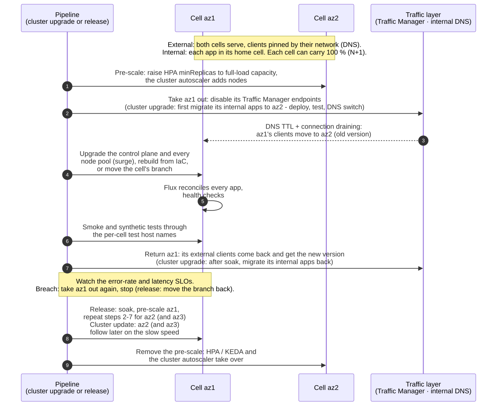

# 3.5 Zero-downtime cluster upgrades

**Requirements:** [R26](../requirements/0.2-requirements.md#r26), [R27](../requirements/0.2-requirements.md#r27).

Cluster upgrades are triggered by pipelines in a fixed order: **dev → acc → prd**, with the waiting times of the
[update policy](#update-policy) below, and within an environment as described per cluster type. Nothing is upgraded by
hand.

## Update policy

The two cluster types are updated at very different speeds, for the same reason they are built differently: a
stateless cell can be drained and replaced at any time, the stateful cluster holds data and is changed as rarely as
possible. The difference is the upgrade *cycle*, not the starting point: the stateful cluster starts on the same
second latest minor as `sl-az1`, and then moves slowly because the workloads it runs (databases, brokers, operators
with data on disks) are harder to move and test.

| | Stateless, fast speed: `sl-az1` | Stateless, slow speed: `sl-az2` (and `sl-az3`) | Stateful: `sf` |
|---|---|---|---|
| Kubernetes minor | **N-1**: the second latest GA minor in AKS | **One minor behind `sl-az1`** (N-2) – always a minor that `sl-az1` has already run in prd | **N-1 when the cluster is created** (the same minor as `sl-az1`), then kept on that minor as long as it has Long Term Support |
| Minor upgrades | When a new minor becomes GA, to the new N-1, with the same 1-week steps | To the minor `sl-az1` leaves, with the same 3-week steps | Within the **last 6 months of LTS support** of the current minor: dev first, then acc, then prd |
| How nodes are updated | Cell drained, control plane and every pool upgraded with surge ([below](#stateless-clusters)) | Same | **Patched in place** where possible; nodes replaced only when a change requires it ([below](#stateful-cluster)) |
| Node image of new nodes | Pinned per cell: a node created during scale-out takes its pool's node image, which changes only when the version pipeline upgrades the pool while the cell is drained | Same | The pool's node image version |
| AKS auto-upgrade channels | `none` – the version pipeline decides | `none` | Cluster `none`; node OS channel for in-place patches ([below](#stateful-cluster)) |

**Starting point: Kubernetes 1.36.** The platform is new, so every cluster – both stateless speeds and the stateful
cluster – is created on **1.36** (AKS GA June 2026, also an LTS minor), and 1.36 is the **floor**: no cluster runs an
older minor. The slow speed's "one minor behind `sl-az1`" therefore starts to apply only when `sl-az1` moves past
1.36; until then `sl-az2` runs 1.36 too, with its slower patch timetable. The floor gives every cell in-place
pod resize for containers (GA) and pod-level resources (beta), which [pod right-sizing](2.3-node-pools.md#pod-right-sizing-vertical-scaling-in-place)
relies on.
The stateful cluster is the one exception: it is created on **1.37 or later** (AKS GA October 2026, also an LTS
minor), because 1.37 is the first minor in which every `PersistentVolumeClaim` reports when it was last used - the
`Unused` condition the storage agent works from. Since the cluster is
built only with the first approved exception, this costs nothing today; should that exception come before 1.37 is
the second latest minor, the cluster takes 1.37 as the newer of the two LTS minors rather than waiting.
None of 1.36's and 1.37's deprecations touch the platform: it runs no kube-proxy (Cilium), cgroups v2 (Azure
Linux 3.0), CoreDNS, no static pods of its own and no `gitRepo` volumes; `Service.spec.externalIPs`, deprecated in
1.36, is denied by policy ([section 2.7](2.7-policy-enforcement.md)).
AKS's own backstop stays far behind the policy: from June 2027 it upgrades by itself any cluster still on an
unsupported minor 60 days after platform support ended, and its end-of-support notifications (Resource Graph,
Event Grid; GA May 2026) are one of the upgrade agent's triggers ([section 6.1](6.1-ai-driven-day-2-operations.md#agents)).

**Why two speeds in the stateless clusters.** At any moment one cell runs a version that is newer and less proven and
the other cell(s) a version that `sl-az1` has already run in production – so a regression in a Kubernetes patch, a
node image or a minor version reaches only the fast cell first, while the slow cell(s) keep serving
([releases cell by cell](3.4-zero-downtime-application-upgrades.md#releases-cell-by-cell) uses the same idea for applications). Removed or changed Kubernetes
APIs show up in `sl-az1` (dev first) a full minor cycle before they reach `sl-az2`. Applications and fleet manifests
must therefore work on both minors; CI validates the rendered manifests against both (and against the stateful LTS
version).

**How the stateless timetable is run.** A scheduled **version pipeline** reads the Kubernetes versions and node images
AKS offers in the region and the date each was released, computes the target version and node image of every
stateless cluster from the table above, and the upgrade agent ([section 6.1](6.1-ai-driven-day-2-operations.md#agents)) opens it as a pull request to the cluster IaC with a compatibility report. The cluster upgrade pipeline then
applies it cell by cell with the drain procedure below; dev and acc run without approval, prd needs an approval only
for minor upgrades. Rules:

- Every patch has its own timeline counted from its AKS release date; if a newer patch is already due, it replaces an
  older one that has not been promoted yet (patches are not applied one by one).
- `sl-az2` runs the oldest minor in AKS standard support. Its minor upgrade is scheduled so that prd is upgraded
  before that minor's end of support in the [AKS Kubernetes release calendar](https://learn.microsoft.com/en-us/azure/aks/supported-kubernetes-versions#aks-kubernetes-release-calendar);
  if the calendar leaves less than 3 weeks per step, the steps are shortened.
- **Why the slow speed is 3 weeks and not a month**: a month per
  step would put prd's slow cell on a node image that is three months old before it changes; three weeks keeps it
  at about nine weeks, and still a full release cycle behind `sl-az1`.
- **Emergency fast track**: a fix for an actively exploited vulnerability can skip the waiting times for both speeds
  with the platform owner's approval – still dev → acc → prd and still one cell at a time.
- `sl-az3` follows the slow speed so that two of three cells run the proven version.

**Stateful cluster: only when absolutely necessary.** Of the picture's reasons, security means a vulnerability in
the node OS, kubelet, container runtime or Kubernetes that cannot be mitigated otherwise, and a bug one that affects
the stateful workloads; the 6-month LTS window holds dev, acc and prd with soak times between them. The smallest
change is chosen: an in-place OS security patch (`SecurityPatch` channel, [below](#stateful-cluster)) before a node
image upgrade, a control-plane-only patch upgrade (`az aks upgrade --control-plane-only`; kubelets may lag behind the
API server within the Kubernetes version skew policy) before replacing nodes, and node replacement only when the
change cannot be made otherwise (e.g. a new Kubernetes minor).

## Stateless clusters

Users never hit a cell that is being changed. The procedure is the one of an application release
([releases cell by cell](3.4-zero-downtime-application-upgrades.md#releases-cell-by-cell)), and the two never run in
the same cell at the same time. The internal applications move with the **migration workflow**
([internal zones](3.1-cluster-types-stateless-and-stateful.md#internal-zones-one-home-cell-per-application-moved-by-migration)),
the tests use the per-cell host names ([incoming traffic](3.1-cluster-types-stateless-and-stateful.md#incoming-traffic-from-outside-and-from-inside)),
and Traffic Manager returns the external clients in steps of address blocks. The pools upgrade with surge, PDBs
respected; a large change (new VNet, CNI, OS SKU) **creates a fresh cluster** from IaC instead and lets Flux bootstrap
it (blue/green at cluster level). Node images and OS security updates follow the same timetable and procedure; the
AKS auto-upgrade and node OS channels are off, so nothing changes a cell outside it.
Prerequisite for all of this is **N+1 capacity**: the zone pools' maximum, vCPU quota and node subnet size must allow one
cluster to carry the whole environment.

## Stateful cluster

There is only one stateful cluster, so it is upgraded **in place** and protected by zone redundancy:

- **Version policy** ([update policy](#update-policy)): cluster auto-upgrade channel `none`; the pipeline applies
  Kubernetes patch versions dev → acc → prd, preferably control plane only.
- **OS patches in place**: the node OS channel **`SecurityPatch`** ([AKS node OS upgrades](https://learn.microsoft.com/en-us/azure/aks/auto-upgrade-node-os-image)) patches the existing
  nodes and reimages only for kernel-level patches, inside the maintenance window (dev a week before acc, two weeks
  before prd), respecting the surge settings and the PDBs - AKS-managed, no package mirror and no reboot daemon in
  the Internet-less cluster; if AKS refuses it on a network isolated cluster, `NodeImage` inside the same
  window. **Image Cleaner** runs weekly on every cluster and removes unused, vulnerable images from
  these long-lived nodes.
- **Node pools**: one fixed-size pool per isolation zone *and* AZ, so a pool upgrade touches only one AZ, with a
  drain timeout besides the picture's settings; at most one replica of each StatefulSet is down at any moment. The
  surge node is created in the same AZ, so zonal disks re-attach. The vCPU quota must leave room for the surge nodes,
  because the pools do not autoscale.
- **LTS minor upgrades** (rare, once per LTS cycle, within the last 6 months of LTS support): the same procedure,
  rehearsed in dev and acc first. Alternative
  for risky jumps: add new node pools on the new version, cordon and drain the old pools AZ by AZ, delete them.
- **The way back is [node pool rollback](https://learn.microsoft.com/en-us/azure/aks/roll-back-node-pool-version)**:
  a pool that misbehaves after a Kubernetes or node image step goes back one step, one pool - one AZ - at a time,
  with the same surge and PDB rules, which is why the pipeline moves the stateful pools one version at a time and
  rehearses the rollback in dev. The stateless cells need none of this: their way back is the previous cell behind
  the router.
- **Settings changes that reimage nodes** (SSH access, the IMDS restriction, the outbound type) are planned like a
  node image step, held to the window by AKS's Node Disruption Policy; a control-plane-only upgrade to the next LTS
  minor is allowed within the version skew, which separates the control plane step from the pools'.
