# 4.2 Encryption at rest with customer-managed keys

**Requirements:** [R21](../requirements/0.2-requirements.md#r21).

All data at rest in the clusters is encrypted with **customer-managed keys (CMK)**, not Microsoft-managed keys.
Every cluster's control plane has its own key, and so do the disks of its nodes. In the stateful cluster, every
isolation zone also has its own key for its persistent volumes. All keys live in the **platform Key Vault** of the
cluster's exposure, `kv-<env>-<exposure>-platform` – `kv-<env>-platform` for short, [section 1.2](1.2-how-the-design-meets-the-requirements.md) –
next to the certificates ([section 4.1](4.1-encryption-in-transit-and-tls.md#certificates-issued-centrally-distributed-through-the-platform-key-vault)).

## Keys

| Key (in `kv-<env>-platform`) | Encrypts | Used by | Mechanism |
|---|---|---|---|
| `key-<cluster>-kms` (`key-aks-prd-int-stateless-az1-kms`) | Kubernetes Secrets in etcd (control plane) | The cluster's user-assigned control plane identity | [KMS data encryption](https://learn.microsoft.com/en-us/azure/aks/kms-data-encryption) with a private key vault ([below](#control-plane-kms-etcd-encryption)) |
| `key-<cluster>-disk` | OS disks of every node in the cluster | Disk encryption set `des-<cluster>` | [Disk encryption set on the cluster](https://learn.microsoft.com/en-us/azure/aks/azure-disk-customer-managed-keys) (`--node-osdisk-diskencryptionset-id`) |
| `key-sf-pv-<zone>` (target, with the stateful cluster) | Persistent volumes (Azure Disk) and the Azure Files storage account of one isolation zone in the stateful cluster | Disk encryption set `des-<env>-sf-<zone>`; the zone's storage account | StorageClass `diskEncryptionSetID`; storage account CMK |

So per environment there are 2 keys per stateless cluster (`sl-az1`, `sl-az2`, optional `sl-az3`), 2 for the
stateful cluster, plus one per isolation zone in the stateful cluster (`int-fi`, `int-se`, `ext-fi`, `ext-se`, …).
Nothing is shared between environments, because each environment has its own platform vault.

**Why not one key per node pool.** The requirement was a key per node pool, but AKS does not support it. The OS-disk
disk encryption set is a **single cluster-wide setting** that can only be chosen when the cluster is created, and
node pools added later use it too. The closest the design
can get is:

- **OS disks: one key per cluster.** Node OS disks contain only the node image, container images and ephemeral pod
  data, never application data. In the stateless clusters they are ephemeral.
- **Application data: one key per isolation zone.** In the stateful cluster, every zone's node pools (`<zone>z1`–`z3`)
  write their data to persistent volumes, and those use the zone's own key. Disabling `key-sf-pv-int-fi` makes the
  `int-fi` data unreadable and leaves the other zones alone.

If AKS later supports a disk encryption set per node pool, the OS-disk key can be split per
zone the same way ([verification V15](7.2-decisions.md#azure-capability-and-verification-matrix)).

## Control plane: KMS etcd encryption

- Every cluster runs with KMS against the platform vault and its own `key-<cluster>-kms`, the vault reached as
  `Private` (no public network access).
- **[KMS data encryption](https://learn.microsoft.com/en-us/azure/aks/kms-data-encryption)** (preview). It names a
  **versionless** key and reaches a vault without public network access through the
  vault's trusted services exception (`bypass AzureServices`) – no private endpoint of AKS's own and no API Server
  VNet Integration, which Azure refuses on an encrypted VNet with v4+ VM sizes (H14, [section 2.2](2.2-control-plane.md)).
  Once on, it cannot be turned off; AKS rewrites every Secret as `aksService` when it is switched on, which the
  `secrets-via-eso` policy exempts.
- **The alternative, [classic KMS](https://learn.microsoft.com/en-us/azure/aks/use-kms-etcd-encryption)** (GA), reaches
  a private vault only through API Server VNet Integration (H14); a classic-KMS cluster switches to KMS data
  encryption in two updates.
- KMS requires a **user-assigned** control plane identity (`id-<region>-<env>-aks-<cell>`), created by the cluster
  module before the cluster. It gets **Key Vault Crypto User scoped to its own KMS key**, Reader on its disk
  encryption set and – with KMS data encryption, AKS's documented prerequisite because it reads the vault's network
  settings – **Key Vault Contributor on the platform vault**. See the trade-off below.
- Everything that ends up in etcd is encrypted with the cluster's key: the application secrets and certificates
  delivered as Kubernetes Secrets by External Secrets Operator ([section 2.5](2.5-workload-identity-and-secrets.md#delivered-only-by-external-secrets-operator)),
  the zone gateways' certificates, Flux and platform Secrets.

## Nodes: disk encryption set per cluster

- The cluster module creates `des-<cluster>` (system-assigned identity with **Key Vault Crypto Service
  Encryption User scoped to the cluster's disk key**, automatic key rotation enabled, versionless key URL) before the
  cluster and passes it as `--node-osdisk-diskencryptionset-id`. The cluster identity gets **Reader** on the disk
  encryption set.
- The disk encryption set reaches the private vault through the **trusted Microsoft services** exception. The platform
  vault therefore keeps `publicNetworkAccess: Disabled` and adds `bypass: AzureServices`. The trusted services bypass
  still applies when public access is disabled, so the vault gets no public network path.
- **Encryption at host** is enabled on every node (`--enable-encryption-at-host` on every node pool), so temp disks and disk caches on the VM host are
  encrypted as well. Azure Policy enforces it like the VM size allow-list. The allow-list may therefore contain only
  SKUs that support **both** VNet encryption and encryption at host ([section 2.3](2.3-node-pools.md)).
- The disk encryption set can only be set when a cluster is created, so **every cluster is created with CMK from the
  start** by the cluster module. The cluster module must never create a cluster without it, because adding it later
  would mean rebuilding the cluster.

## Stateful cluster: a key per isolation zone for persistent volumes

- One disk encryption set per zone, `des-<env>-sf-<zone>`, each with access to its own `key-sf-pv-<zone>` only.
- One set of StorageClasses per zone (`<zone>-premium-zrs`, `<zone>-standardssd-zrs`) with `diskEncryptionSetID`
  set to the zone's disk encryption set. The cluster identity has Reader on all of them. The built-in StorageClasses
  are not used: Azure Policy rejects PersistentVolumeClaims in `<zone>-*` namespaces unless they name one of that
  zone's StorageClasses, and only the platform can create StorageClasses.
- **Azure Files**: the CSI driver's dynamically created storage accounts would use Microsoft-managed keys. Each zone
  therefore has one storage account created by IaC (ZRS, private endpoint in `snet-<zone>-pe`, CMK with
  `key-sf-pv-<zone>`), and the zone's Azure Files StorageClass points at it (`storageAccount` parameter).
- **Backups** (Azure Backup for AKS) are disk snapshots that keep the disk's encryption set, so a zone's snapshots
  are under the same key as its data. The vault-tier copies that protect against a region loss are restored into
  volumes under the paired region's new zone keys ([section 6.3](6.3-backup-and-region-recovery.md#per-data-store)).
- A disk encryption set on a StorageClass applies only to **new** volumes. The per-zone classes therefore exist
  before the first workload is onboarded. Adding a country adds the zones' keys, disk encryption sets and
  StorageClasses ([adding a country](3.1-cluster-types-stateless-and-stateful.md#adding-a-country-online)).

## Rotation and lifecycle

| Key | Rotation | What happens |
|---|---|---|
| Disk keys (`*-disk`, `key-sf-pv-*`) | Key Vault rotation policy, new version every 12 months | Disk encryption sets with automatic key rotation pick up the new version within an hour. Managed disks are re-wrapped online; ephemeral OS disks get it when the node is recreated (node image upgrade, cell rebuild) |
| KMS keys (`*-kms`) | Same rotation policy | KMS data encryption names the versionless key and follows the rotation by itself, nothing to re-write. A classic-KMS cluster would take the new version as `--azure-keyvault-kms-key-id` on the next apply (on Kubernetes 1.37 AKS accepts only a versionless key ID, so a classic-KMS cluster moves to the versionless form before that minor) and re-write all Secrets (`kubectl get secrets -A -o json \| kubectl replace -f -`); KMS keeps the previous version cached, so the older one is disabled only after the next rotation |

- **HSM-protected keys.** The production platform vault is Key Vault **Premium** and every customer-managed key is an
  RSA-HSM key (FIPS 140-3 Level 3 validated HSMs), the Azure security baseline for customer-managed keys at a cost of
  cents per key; a Managed HSM pool is not needed for this assurance level ([decision D21](7.2-decisions.md#decision-matrix)).
  The SKU is a per-environment setting: dev and acc may run Standard vaults with software keys, prd runs Premium.
- **No expiry date on any key version.** An expired or deleted KMS key stops the API server, and the encrypted
  Secrets cannot be recovered; an expired disk key stops VMs from starting. Rotation policies only create new
  versions. Old versions are disabled by hand once nothing uses them. Since Kubernetes 1.37 (beta, KEP-3926) an
  administrator can at least *delete* objects the API server can no longer decrypt through the API, so a cluster whose
  KMS key version is gone can be brought back to a state where Git recreates every Secret through External Secrets
  Operator - instead of an etcd restore; part of the 1.37 checklist ([V26](7.2-decisions.md#azure-capability-and-verification-matrix)).
- **Deleting a key destroys its cluster's data.** The platform vault has purge protection, a `CanNotDelete`
  resource lock, Azure Policy denying key expiry dates in the platform vaults, and activity and diagnostic log alerts
  on any key disable, delete or permission change.
- **Rebuilt stateless clusters** reuse their key names. The cluster module creates a new key version for the new
  cluster, and the old versions are disabled once the old cluster is deleted.
- **Revocation (crypto-shredding)** is the reason to use CMK: disabling a key makes the data under it unreadable. It
  takes the platform team's PIM role on the vault and is part of the incident runbook. It is rehearsed in dev.

## Trade-off: cluster identities on the shared platform vault

Until now, no identity had a role on the platform vault scope except the renewal job and the platform team. KMS
data encryption with a private vault needs **Key Vault Contributor on the vault** for each cluster's control plane
identity (AKS reads the vault's network settings; classic KMS with a private vault needs it to create its private
link). That role is management plane only: under the RBAC permission model it cannot read
certificates or keys, or assign roles. It can, however, change the vault's network settings and delete the vault.
The design keeps the keys in the platform vault as decided, and limits the impact:

- Purge protection on the vault, a `CanNotDelete` lock and Azure Policy denying `publicNetworkAccess` other than
  `Disabled`; in production Azure Policy also requires purge protection on every vault
  ([D83](7.2-decisions.md#decision-matrix)).
- An activity log alert on every management-plane write to the platform vaults made by anything other than the
  environment IaC identity.
- Each cluster identity's data-plane role (Crypto User) is scoped to its own KMS key, so a cluster can never use
  another cluster's key.

If this is not acceptable, the keys move to a separate `kv-<env>-keys` vault per environment with the same layout
([decision D20](7.2-decisions.md#decision-matrix)).
