# 3. Network layout

An Azure VNet can have several non-overlapping **address spaces**, and AKS only requires that a cluster's subnets
are in the same VNet, not in the same address space. The design uses this: the control plane zone and **every
isolation zone get their own `/20` address space** in the spoke VNet, taken from that zone's prefix of the
environment ([address plan](10-cluster-types-stateless-and-stateful.md#vnets-and-address-plan)). The zone's subnets for nodes, internal load balancers and
private endpoints live inside that address space. A new zone is added online as a new address space, so the
existing ones never change. Whether the zone also has a pod subnet depends on the cluster type's CNI:

| | Stateful cluster | Stateless clusters |
|---|---|---|
| CNI | Azure CNI, VNet-integrated with dynamic pod IP allocation, powered by Cilium | Azure CNI Overlay, powered by Cilium |
| [ACNS](17-advanced-networking-and-fqdn-egress.md) | FQDN egress policies + observability + eBPF host routing | Same |
| Pod IPs | From `snet-<zone>-pods` – routable in the VNet, visible to NSGs and the firewall | From a private overlay CIDR outside the VNet (the same CIDR can be reused in every stateless cluster) |
| Pod traffic leaving the cluster | Keeps the pod IP | SNAT to the node IP (eBPF masquerading), so NSGs and the firewall see the zone's `snet-<zone>-nodes` |
| Which application may leave the cluster | Cilium FQDN policy per application ([section 17](17-advanced-networking-and-fqdn-egress.md)) | Same – the firewall sees only the zone, so the per-application control is in Cilium |
| `snet-<zone>-pods` | Yes | Not needed |
| `snet-<zone>-ilb` | Internal load balancers of the applications' `LoadBalancer` Services | Internal load balancer of the zone's gateway (internal zones; an external zone's gateway has a public load balancer, [section 10](10-cluster-types-stateless-and-stateful.md#external-zones-active-active-with-dns-affinity)) |

Zone isolation works the same with both CNIs because every zone has its own nodes in its own node subnet (a NAP
`NodePool` whose `AKSNodeClass` points at the zone's subnet, or AKS node pools in the stateful cluster): a packet from
a stateless zone always carries an address of that zone's subnets.
Every subnet has its own **NSG** (deny VNet-to-VNet by default) and each zone its own **route table** sending
`0.0.0.0/0` *and the other zones' address spaces* to the exposure's Azure Firewall ([decision D53](decisions.md#decision-matrix)),
so any cross-zone packet that the NSG would allow is still inspected and denied by the firewall.

Address spaces are an addressing tool, not an isolation boundary:

- All address spaces of a VNet reach each other through the system routes. A UDR overrides a system route only
  when its prefix is at least as specific, so a zone's route table needs one route **per other zone's address
  space** (a single `10.0.0.0/8 → Firewall` route would lose to the more specific `/20` system routes). Adding a
  zone adds one route to each existing zone's route table, generated by IaC.
- The `VirtualNetwork` service tag covers all address spaces of the VNet, the peered VNets and on-premises. NSG
  *allow* rules therefore use the zone prefixes (or Application Security Groups), never `VirtualNetwork`.

> **Why subnets and not separate VNets?** AKS requires all node pool subnets and the API server subnet of one
> cluster to be in the same VNet. Within one cluster, "network per country" is therefore implemented as
> *address space and subnets per zone + NSG + UDR via firewall*, which the security team accepts for countries.
> Internal and external are not separated this way: they are separate clusters in separate subscriptions behind
> separate hubs ([decisions D52, D53](decisions.md#decision-matrix)), so the picture shows an internal cell; an external cell's VNet
> (`vnet-prd-ext-sl-az1`) is the same with `ext-fi` and `ext-se` from the external halves of the address plan.
> Should a hard VNet boundary per country ever be required, the same step is taken once more – **one cluster per
> zone** – and the address plan stays the same.
