# 6. Allowed and blocked flows

Only the flows Kubernetes needs to function are allowed between a workload zone and the rest of the platform:

| # | Source | Destination | Port | Purpose |
|---|---|---|---|---|
| ① | Zone nodes | `snet-apiserver` | TCP 443, 4443 | kubelet / pods → API server |
| ② | `snet-apiserver` | Zone nodes | TCP 10250 | logs, exec, port-forward |
| ③ | Zone pods | CoreDNS (system pods) | UDP/TCP 53 | name resolution |
| ④ | metrics-server (system pods) | Zone nodes | TCP 10250 | resource metrics |
| ⑤ | The zone's External Secrets Operator (`<zone>-secrets` pods) | Own zone Key Vault PE | TCP 443 | application secrets; application pods never reach a Key Vault ([section 7](07-workload-identity-and-secrets.md#delivered-only-by-external-secrets-operator)) |
| ⑤b | The zone's External Secrets Operator (`<zone>-secrets` pods) | Platform Key Vault PE in `snet-platform-pe` | TCP 443 | certificates for the zone gateways and TLS-terminating apps; Cilium policy allows only these pods, RBAC only their zone's certificates |
| ⑥ | Zone nodes + pods | The exposure's Azure Firewall ([D53](decisions.md#decision-matrix)) | per FQDN | AKS required FQDNs, MCR, Entra ID (workload identity token exchange); pods only to the FQDNs of their application's egress policy |
| ⑥b | Zone nodes (Grafana Alloy of the node) | Grafana Cloud private endpoint in the hub, through the Firewall | TCP 443 | Metrics, logs and traces of the node's own pods; never over the Internet ([section 21](21-observability-with-grafana-cloud.md)) |
| ⑦ | Zone nodes | All nodes | TCP 4240, ICMP | Cilium health (optional) |
| – | AzureLoadBalancer | `snet-apiserver` | TCP 9988 | API server health probe |
| – | `snet-apiserver` | Platform Key Vault private endpoint created by AKS for KMS | TCP 443 | etcd encryption with the cluster's KMS key ([section 16](16-encryption-at-rest-and-customer-managed-keys.md)) |

**Everything else between zones is blocked** – pod-to-pod, pod-to-other-zone Key Vault and direct Internet –
enforced three times: NSG (L3/L4), Azure Firewall (L3–L7, logged), Cilium cluster-wide policy (pod identity).

Inside the allowed flows, a pod reaches a destination outside the cluster only if its application has declared that
destination by **FQDN** in its own Cilium egress policy ([section 17](17-advanced-networking-and-fqdn-egress.md)): the
Firewall decides what a *zone* may reach, the FQDN policy what an *application* may reach.

## Isolation matrix

What each principal can reach, per isolation zone. "Own" means the zone, namespace or application the principal
belongs to; everything not listed is blocked, and the negative tests of
[section 23](23-implementation-project-and-acceptance-testing.md#requirement-and-isolation-tests) try every blocked
cell of this table after every change.

| Principal | Kubernetes API | Network | Azure identities | Secrets | Certificates | Application data |
|---|---|---|---|---|---|---|
| Application pod | None: `automountServiceAccountToken: false`, no API access | Own namespace, the zone's gateway (ingress only), CoreDNS, the node's Alloy, declared FQDNs of the own zone; never IMDS, another zone, a vault or the stateful cluster of another zone | Own workload identity (`id-<zone>-<app>`), roles only on the zone's own resources | Only the Kubernetes `Secret`s ESO wrote into its namespace | The zone's wildcard (or its own) as a `Secret`, if onboarded with one | Own PaaS resources through the identity |
| Application team (humans) | Own namespaces only (Entra ID group), read-only in acc and prd | – | None; pipelines write secrets to the zone vault under the application's prefix only | Own prefix in the zone vault (pipeline) | None | Through the application only |
| Zone ESO controller (`<zone>-secrets`) | `Secret` writes and `serviceaccounts/token` in the zone's namespaces | Own zone vault PE, platform vault PE | None of its own; uses each namespace's `secrets-reader` token | Every application's reader identity of the zone, each limited by ABAC to its prefix | The zone's certificates, by per-object RBAC | None |
| Zone gateway (`<zone>-gateway`) | None (istiod configures it) | Own zone's application pods, istiod; receives from Internet or corporate network | None | None | The zone's wildcard, through ESO | None |
| Other zone, same cell | Blocked (RBAC by namespace) | Blocked by NSG, Firewall and Cilium | Different identities | Different vault | Different certificate | Different PaaS resources, private endpoints in the other zone's subnet |
| Stateful cluster, same zone | Separate cluster | Only from the same zone of the stateless clusters, on the application's TLS port | Same pattern, federated per cluster | Same zone vault | Same zone certificate | Zone's volumes under the zone's own key |
| Platform team | Read-only everywhere; writes only through Git | Management VNet → API servers | None standing; PIM | None standing; PIM on the vaults, alerted | None standing | None |
| AI agents | `AKS RBAC Reader` (no `Secret`s) | Management VNet → API servers, model endpoint, Git | Read-only Azure roles | Metadata only (security agent) | None | None |
| Deployment identities (IaC, Flux, stateful pipeline) | Write, scoped to platform and application namespaces; Flux cluster-wide in its cell | ACR private endpoint | Create and assign identities (IaC only) | Assign roles (IaC only), never read values | Create placeholders (IaC), issue (renewal job) | None |
| Break-glass (PIM) | Cluster admin for the activation, logged and alerted | Management VNet | Owner for the activation | Read with alert | Read with alert | Through the resources, with alert |

A compromised application pod therefore reaches its own namespace, its own zone's declared destinations and its
own PaaS resources, and nothing else; a compromised ESO controller reaches one zone's secrets; a compromised
cluster administrator reaches one cell. Country separation inside one cluster rests on these controls, not on a
separate control plane; whether that is enough for the regulation the organisation is under is a sign-off
([decision D01](decisions.md#decision-matrix)).
