# 7. Application multi-tenancy inside a zone

Each application gets its own namespace(s) inside a zone, with a baseline policy set applied automatically:

1. default deny for inbound and outbound traffic;
2. allow DNS to CoreDNS in `kube-system`;
3. allow inbound traffic only from the zone's gateway pods (stateless clusters; label
   `gateway.networking.k8s.io/gateway-name: <zone>` in `<zone>-gateway`) or, in the stateful cluster,
   only from the node subnets of the same zone in the stateless clusters (Cilium CIDR policy; the applications'
   `LoadBalancer` Services use `externalTrafficPolicy: Local` so the client IP is preserved);
4. allow traffic within the namespace;
5. no egress out of the cluster by default: **the application must declare every external destination by FQDN** in
   its own `CiliumNetworkPolicy` `egress` – Entra ID, PaaS private endpoints, stateful cluster services and approved Internet names (which must also be on the
   zone's Firewall allow-list); CIDR-based egress is rejected by Azure Policy
   ([section 16](16-advanced-networking-and-fqdn-egress.md)). Key Vault is never on that list: secrets and
   certificates arrive as Kubernetes `Secret`s from the zone's External Secrets Operator
   ([section 6](06-workload-identity-and-secrets.md#delivered-only-by-external-secrets-operator)).

Applications in the same zone therefore cannot talk to each other unless an explicit policy pair is agreed.
Kubernetes RBAC is namespace-scoped (Entra ID groups per application team), plus ResourceQuota/LimitRange per
namespace.

## Ownership and cost

Every namespace says who owns what runs in it and who pays for it (R25, [decision D47](decisions.md#decision-matrix)):

| Metadata | Example | Used by |
|---|---|---|
| Label `platform/team` | `payments` | Cost and usage per team (OpenCost, Grafana), alert routing |
| Label `platform/cost-center` | `cc-4711` | Charging the team's share of the cells |
| Annotation `platform/contact` | `payments-team@example.com` | Whoever finds something wrong with the namespace |

The onboarding request names them, and the IaC sets them on the namespace (aks-terraform
`managed_namespaces.<ns>.owner`); the platform's own namespaces are `platform`. Azure Policy
(`namespace-ownership`, [section 14](14-policy-enforcement.md)) requires them on every namespace but the ones AKS
creates. **OpenCost** ([section 19](19-observability-with-grafana-cloud.md#what-grafana-cloud-does)) prices every
node from Azure's retail prices and splits its cost over the namespaces by what their pods request and use, so a
team's share of the cell, its GPU nodes included, is a query by these labels
([decision D46](decisions.md#decision-matrix)). A monthly budget on each environment subscription alerts the owners
at 80 % and 100 % of the actual cost and at a forecast of 100 % ([section 9](09-environments.md#cost-and-capacity-model)).

---

[Back to contents](../README.md) · Previous: [6. Workload identity first, Key Vault secrets only when needed](06-workload-identity-and-secrets.md) · Next: [8. Cluster types: stateless and stateful](08-cluster-types-stateless-and-stateful.md)
