# 8. Cluster types: stateless and stateful

Every environment has two kinds of clusters. The split follows one rule: **a cluster that holds no data can be
taken out of traffic, upgraded or even rebuilt at any time; a cluster that holds data cannot, so it is made
zone-redundant and changed as rarely as possible.**

## Where does a workload run

Data does not belong in Kubernetes by default. Every workload is placed by going down this list and stopping at the
first option that fits:

1. **Stateless cluster** – all application code. Its state lives in the options below.
2. **Azure PaaS service in the backend network** (PostgreSQL, MySQL, Managed Redis, Cosmos DB for MongoDB, Event
   Hubs with Kafka, Blob Storage, …) reached through private endpoints from the stateless clusters. Zone redundancy, backups,
   patching and upgrades are Microsoft's job; the immutable copies in the paired region are the platform's
   ([section 20](20-backup-and-region-recovery.md)). Services with no equivalent in the other clouds (Azure SQL,
   Service Bus, Cosmos DB's NoSQL API) are allowed only as a documented cloud-pinning exception at onboarding
   ([section 21](21-open-standards-and-portability.md#data-in-paas-services-that-every-cloud-offers)); where this
   document names them, it describes the Azure implementation of such an exception.
3. **Stateful cluster – last option**, only when
   - no Azure PaaS service provides the capability (e.g. a product that is only shipped as a container or operator), or
   - a special use case requires it (e.g. a licence, a latency requirement to data that only the cluster can meet,
     a protocol the PaaS service does not offer).

A workload in the stateful cluster needs a documented exception (why 1 and 2 do not fit, owner, exit plan) approved by
the platform team, and the stateful cluster itself is only built when the first exception is approved
([optional](09-environments.md)); the exception is the label `platform/stateful-exception=<ticket>` on its namespace, required by a
policy. The exceptions are reviewed when new PaaS services become available. The fewer workloads the
stateful cluster runs, the smaller its blast radius and upgrade risk.

## Comparison

| | Stateless (`aks-<env>-sl-az<N>`) | Stateful (`aks-<env>-sf`) |
|---|---|---|
| Runs | Frontends, APIs, workers – anything that can be killed and recreated; state in Azure PaaS | Only approved exceptions: workloads that own data on disks (StatefulSets, operators) for which no PaaS service fits |
| Count per environment | Per exposure (`int`, `ext`) one per availability zone: `sl-az1`, `sl-az2` in dev and acc; `sl-az1`, `sl-az2`, `sl-az3` in prd ([section 9](09-environments.md), [decisions D08, D52](decisions.md#decision-matrix)) | Zero or one per exposure – built only when the first approved workload of that exposure needs it |
| Availability zones | All nodes of a cluster in its AZ (system pool `--zones <N>`, NAP `NodePool`s by zone requirement); the cluster is the unit of failure | Every isolation zone has one node pool per AZ (`intfiz1`, `intfiz2`, `intfiz3`, …); system pool spread over AZ 1–3 |
| Nodes | [Node auto provisioning](https://learn.microsoft.com/en-us/azure/aks/node-autoprovision): one Karpenter `NodePool` per isolation zone, VM size chosen per workload ([section 4](04-node-pools.md)) | Classic AKS node pools with a fixed VM size and node count |
| Network | Frontend spoke `vnet-<env>-<exposure>-sl-az<N>` in the exposure's subscription, peered to the exposure's hub ([D53](decisions.md#decision-matrix)) | Backend spoke `vnet-<env>-<exposure>-sf` in the exposure's subscription, peered to the exposure's hub, together with the PaaS private endpoints |
| Internet | Egress only via Azure Firewall FQDN allow-list (outbound type `userDefinedRouting`); inbound only via the traffic layer | **None.** [Network isolated cluster](https://learn.microsoft.com/en-us/azure/aks/concepts-network-isolated) (outbound type `none`, bootstrap artifacts from the private ACR cache), no public IPs, UDR `0.0.0.0/0` → Firewall which denies all Internet for backend prefixes |
| CNI | [Azure CNI Overlay](https://learn.microsoft.com/en-us/azure/aks/concepts-network-azure-cni-overlay) powered by Cilium | Azure CNI (VNet-integrated, dynamic pod IP allocation) powered by Cilium |
| Advanced networking | ACNS with eBPF host routing and FQDN egress policies ([section 16](16-advanced-networking-and-fqdn-egress.md)) | Same |
| Incoming HTTP(S) | [Gateway API](https://gateway-api.sigs.k8s.io/) with AKS App Routing (`approuting-istio`) as the implementation, one `Gateway` per isolation zone, HTTPS only; the Kubernetes Ingress API is not used | **No Gateway API implementation and no Ingress.** Applications are published with internal `LoadBalancer` Services (L4) |
| TLS | Terminated by the zone's gateway with Let's Encrypt certificates for internal DNS names; applications serve plain HTTP inside the cluster | **Terminated by the application itself** – a hard onboarding requirement |
| Node-to-node encryption | [Azure Virtual Network encryption](https://learn.microsoft.com/en-us/azure/virtual-network/virtual-network-encryption-overview) – no service mesh, no mTLS | Application TLS (VNet encryption may be enabled as defence in depth but is not relied on) |
| Kubernetes version | Standard support, two speeds: `sl-az1` on the second latest GA minor (N-1), `sl-az2` (and `sl-az3`) one minor behind (N-2), never older than 1.36 ([update policy](12-zero-downtime-cluster-upgrades.md#update-policy)) | [Long Term Support](https://learn.microsoft.com/en-us/azure/aks/long-term-support) (`--tier premium --k8s-support-plan AKSLongTermSupport`): created on the second latest GA minor (N-1), then kept on that minor until 6 months before its LTS ends |
| Tier | Standard | Premium (required for LTS) |
| Scaling | ≥ 2 replicas per app, HPA / KEDA on load, VPA resizes pods in place, NAP adds and removes nodes; **each cluster sized to carry 100 % of the load alone** (NAP `NodePool` limits) | ≥ 3 replicas per StatefulSet, one per AZ; **no autoscaling** – fixed node count per pool, sized when an exception is onboarded and changed as a planned IaC change |
| Storage | None – admission policy rejects PersistentVolumeClaims; ephemeral OS disks | Azure Disk `Premium_ZRS` / `StandardSSD_ZRS`, Azure Files ZRS, through per-zone StorageClasses encrypted with the zone's own key ([section 18](18-encryption-at-rest-and-customer-managed-keys.md)); prefer PaaS for databases |
| Upgrade model | Drain from traffic, upgrade or rebuild, return ([picture 11](12-zero-downtime-cluster-upgrades.md#stateless-clusters)) | In place, one AZ at a time, PDB-protected ([picture 12](12-zero-downtime-cluster-upgrades.md#stateful-cluster)) |

**Isolation zones are kept in both cluster types.** Each stateless and stateful cluster has the nodes, subnets, Key
Vaults and policies of the zones of its exposure – `int-fi` and `int-se` in an internal cluster, `ext-fi` and `ext-se`
in an external one – exactly as in pictures 2–7; the data in the stateful cluster is what needs the country
separation most. The stateful cluster has no Gateway API (and no Ingress) at all: each zone's applications are
reachable only on their own internal load balancer IPs, and only from the same zone of the stateless clusters.

## Internal and external: separate subscriptions and clusters

Internal and external workloads never share a cluster or a subscription ([decision D52](decisions.md#decision-matrix),
the security team's decision). Countries are separated one level lower, inside a cluster, by node pool and network:

| Separation | Internal ↔ external (exposure) | Country ↔ country (`fi`, `se`, …) |
|---|---|---|
| Boundary | **Subscription and cluster**: `sub-aks-<env>-int` and `sub-aks-<env>-ext`, each with its own cells and optional stateful cluster | **Isolation zone** inside the clusters of one exposure |
| Control plane, system pool, admission, Flux, App Routing's istiod | Separate | Shared by the exposure's zones |
| Nodes and network | Separate spoke VNets peered to **separate hubs with an Azure Firewall each**, no peering and no route between them ([D53](decisions.md#decision-matrix)) | Own NAP `NodePool`s / node pools, own address space, subnets, NSGs and route tables |
| Key Vaults | Separate platform vaults (`kv-<env>-int-platform`, `kv-<env>-ext-platform`: certificates, the clusters' keys) and zone vaults | Own zone vault (`kv-<env>-<zone>`) |
| Azure RBAC, Azure Policy, budget, quota | Per subscription | Per zone where it matters (namespaces, ABAC, policy mutations) |
| ACR | One per exposure subscription, fed by the same promotion pipeline | Shared |
| Entry points | External: Traffic Manager and public load balancers, only in the external subscription. Internal: hub Private DNS and internal load balancers, only in the internal one | One profile / Private DNS zone per zone |

So an external cluster – the one the Internet reaches – has no internal zone, no internal identity, no role on an
internal vault and no route to an internal subnet at all: its hub has neither a peering to the internal hub nor a
gateway to the corporate network ([decision D53](decisions.md#decision-matrix)); a compromise of its control plane,
nodes, subscription or Firewall does not reach the internal workloads. Traffic between the two exposures is like
traffic between two zones (R5): denied. An internal application that must call an external one goes to its public
entry point like any Internet client (an FQDN rule on the internal Firewall); an external application has no path to
an internal one, and giving it one is a design change, not a Firewall rule. What the two keep in common is the source
– the same IaC modules with the exposure as a parameter, the same fleet repository with a directory per cluster – and
the management VNet, Entra ID, GitHub and the environment's Grafana Cloud stack.

## Incoming traffic: from outside and from inside

Clients never connect to a pod or node directly, and the stateful cluster is never reached from outside the
platform. The two kinds of zones use the cells differently, because their availability requirements differ:

- **External zones (`ext-*`): every application runs in every cell, active-active.** A **traffic layer** (Azure
  Traffic Manager, the cell router) outside the cells answers each client's DNS query with one cell, chosen by the
  client's network, and leaves a failed or drained cell out of its answers.
- **Internal zones (`int-*`): every application runs in one cell, its home cell.** The application team chooses the
  cell; its DNS name points straight to the zone's gateway in that cell, maintained by ExternalDNS. A **migration
  workflow** moves an application to another cell without downtime – on request, around cluster upgrades, and after
  a cell failure. A cell failure therefore costs the internal applications of that cell a short outage until they
  are migrated (recovery time target *TBD*, minutes) – accepted because internal applications have lower
  availability requirements than external ones. There is no WAF and no load balancer in front of internal zones.

| Source | Entry point | Path to the cells |
|---|---|---|
| Internet (external zones `ext-*`) | **Azure Traffic Manager**: public DNS name of the application → CNAME to the zone's Traffic Manager profile, which answers with one cell | The public load balancer of the zone's gateway in **every** cell: one public IP per external zone and cell, HTTPS (443) only |
| Corporate network (internal zones `int-*`) | **The zone's gateway in the application's home cell**: `<app>.int-fi.prd.example.com` resolves in the hub Private DNS to the gateway's internal load balancer IP of zone `int-fi` in that cell | On-premises → ExpressRoute/VPN → the internal hub's Firewall → the gateway's internal load balancer of the zone in the home cell |
| Other Azure workloads (other spokes) | Same as the corporate network | Same as above; a Firewall rule per source |
| Applications in the same zone and cell | Kubernetes Service (`<app>.<zone>-<app>.svc`) | Stays inside the cell and its availability zone; never goes through the traffic layer or to another cell |
| Applications in the same internal zone, other cell | The application's DNS name, like any internal client | The internal hub's Firewall → the zone's gateway in the other cell (one Firewall rule per zone: zone prefix → zone prefix) |
| Applications in another zone | Not allowed (R5). If a business flow needs it, the caller is treated like any other client: it goes through the target zone's entry point and needs an explicit Firewall rule | – |

No component in front of a cell keeps state about the client: sessions and caches belong in Azure PaaS (e.g. Azure
Cache for Redis) or in the token, so a client can be moved to another cell at any time without losing anything.
What the cell choice controls is **which application version** a client sees while a release moves through the cells
one by one ([releases cell by cell](11-zero-downtime-application-upgrades.md#releases-cell-by-cell)).

### External zones: active-active with DNS affinity

**The traffic layer is DNS.** An external application's public name is a CNAME to the zone's **Azure Traffic
Manager** profile, which answers every DNS query with the public address of the zone's gateway in one cell.
The client then connects straight to that cell: **its TLS session ends at the zone's gateway** in the cell, with the
zone's certificate – end to end, nothing in between decrypts it. All cells carry external traffic all the time, and
every client is mapped to one cell **by its network**, so it keeps using the same cell across requests, TLS sessions
and reconnects – also clients that do not support cookies (API clients, mobile apps, other systems):

- **The affinity exists for consistent versions, not for state.** It makes sure that a client sees **one
  application version at a time** during a release.
- **A failed or drained cell is left out of the answers**, and its clients move to another cell as soon as their
  cached DNS answer expires (the record's TTL, 30 s); they come back when it returns.
- **All cells always prove that they work.** A cluster that only receives traffic in a failure is a cold standby
  with cold caches and untested capacity. With active-active, a cell failure only affects the clients of that cell
  (half or a third).
- **Long-lived connections** (WebSockets, Server-Sent Events, gRPC streaming) stay on one cell for the life of the
  connection – DNS is only asked again when the client reconnects. Applications that use them must reconnect with
  back-off, because draining a cell closes them after the drain timeout.

How Traffic Manager maps a client to a cell:

| | Traffic Manager (external zones) |
|---|---|
| Profiles | Per zone and environment one **parent** profile with the *Subnet* routing method, and per cell one **child** profile with the *Priority* routing method, nested as the parent's endpoints |
| Mapping | The parent maps the IPv4 and IPv6 address space, split into blocks (e.g. 16 per family), to the cells' child profiles – the family of the *resolver's* address, not of the service: the platform answers with A records only until [D54](decisions.md#decision-matrix) switches an external zone to dual stack. Blocks are assigned by measured traffic so that the cells get similar load |
| Client address used | The address of the client's DNS resolver, or the client subnet it passes on (EDNS Client Subnet) – not anything the client sends in HTTP |
| Fallback | Each child profile lists the cell's own gateway at priority 1 and the other cells at priorities 2 and 3, in the fixed order `az1` → `az2` → `az3`, so the clients of a failed cell all move to the same cell |
| Health probe | HTTPS `GET /healthz` of an application of the zone, through each cell's gateway with the application's host name (`custom_header host`), every 30 s; a cell is left out after 2 failures |
| Take a cell out | Disable the cell's endpoints: its blocks are answered with the next cell of their child profile |
| Return a cell | Enable the endpoints; in steps if wanted, by mapping the cell's blocks back a quarter at a time |
| TTL | 30 s, so a drain or a failover reaches most clients within a minute |

Limits of DNS affinity, accepted in this design:

- **Resolvers**: clients behind a large shared resolver (a public DNS service without client subnet) land on the
  same cell, so the load is less even than with per-request routing. The cells are sized N+1 anyway; the block
  assignment is rebalanced from the access logs when needed (outside releases, because it moves clients). The cell
  dashboards show the request share per cell and zone, and an alert fires when one cell carries more than its N+1
  share for an hour, so skew from large NAT pools is seen before it matters.
- **Cached answers**: a client or resolver that ignores the TTL keeps using a drained cell longer. The drain timeout
  of a cell (section 12) is chosen with that in mind, and a failed cell's clients retry until their cache expires.
- **Changing networks**: a mobile client that switches networks may change cells. During a release it can then see
  the other version, which the [compatibility rule](11-zero-downtime-application-upgrades.md) covers.
- **No WAF in the traffic layer.** Traffic Manager only answers DNS; HTTP reaches the zone's gateway unfiltered.
  There are no gateway rate limits or request size limits either, and no WAF in the gateway: App Routing's Gateway
  API implementation supports none of them. The design launches without a WAF, with DDoS protection, the 443-only
  NSG, the gateway's TLS termination, Cilium ingress rules and the applications' own input validation and rate
  limiting as the controls, and keeps the layout ready for one ([decision D04](decisions.md#decision-matrix), the
  security team's sign-off):
  - **The defined add-on is Application Gateway WAF v2 per external zone and cell**, zonal like the cell, in its own
    subnet `snet-<zone>-waf` of the zone's address space. It becomes the Traffic Manager endpoint of that cell,
    terminates TLS with the zone's certificate from the platform Key Vault (Application Gateway's own Key Vault
    integration, through a private endpoint), runs the OWASP core rule set in prevention mode and re-encrypts to the
    gateway's load balancer, which then listens only to the WAF subnet. The gateway reads the client address from
    `X-Forwarded-For` of that one trusted hop. Applications, routes and certificates do not change; switching a zone
    over is an IaC change per zone and cell, rolled out cell by cell.

**Real client IP**: the zone's gateway `Service` uses `externalTrafficPolicy: Local` (set through the Gateway's
`parametersRef` ConfigMap), so the gateway's Envoy sees the client's own
address; there is no proxy whose `X-Forwarded-For` it would have to trust.

Every external application also has a **per-cell host name** (e.g. `<app>-<cluster>.ext-fi.prd.example.com`, an A
record of that cell's gateway kept by ExternalDNS). The release and upgrade pipelines run their smoke and synthetic
tests on it, through the cell's real TLS path, before the cell gets user traffic
([releases](11-zero-downtime-application-upgrades.md#releases-cell-by-cell), [section 12](12-zero-downtime-cluster-upgrades.md#stateless-clusters));
the same names are the Traffic Manager endpoints.

The external zones' gateways are the only public addresses of the platform: one Azure Standard public load balancer
IP per external zone and cell, created by the gateway's `Service` in `<zone>-gateway`, protected by one Azure DDoS
Network Protection plan for the whole tenant, attached to every cell VNet ([decision D32](decisions.md#decision-matrix)). The NSG of `snet-ext-<country>-nodes` allows TCP 443 from the Internet and
nothing else from outside the VNet. This traffic does not pass the hub Firewall; the NSG, the zone's gateway and the
application's Cilium ingress (only from the zone's gateway) are its controls.

### Internal zones: one home cell per application, moved by migration

**Placement.** Every internal application has exactly one **home cell** per environment, chosen by its team in Git
(`apps/<app>/stateless/<env>/placement.yaml`, e.g. `cell: sl-az2`); the default is the slow-speed cell `sl-az2`,
which runs the more proven Kubernetes version ([update policy](12-zero-downtime-cluster-upgrades.md#update-policy)).
Placement is environment state, not part of the release train: CI renders it into a separate signed artifact
`placement:<git-sha>`, which every cell follows through its own Flux Kustomization (tag `<env>-placement`,
interval 1 min). It creates the application's Flux Kustomization only in its home cell – and during a migration also
in the target cell; the application's manifests themselves still come from the cell's fleet tag.

**DNS by ExternalDNS.** Each internal zone has a Private DNS zone in the hub (`int-fi.prd.example.com`, linked to the
hub VNet and resolved from on-premises through the DNS forwarders). Every cell runs **ExternalDNS** in the platform
namespace `infra-dns`, with:

- provider `azure-private-dns`, a workload identity with *Private DNS Zone Contributor* on the internal zones'
  Private DNS zones only, and `management.azure.com` on the Firewall allow-list;
- source `gateway-httproute`: the A record of each hostname of an `HTTPRoute` points to the address of the zone's
  `Gateway` in that cell – a **static IP** per zone and cell, set on the gateway's internal load balancer
  (`service.beta.kubernetes.io/azure-load-balancer-ipv4`, a Service annotation in the Gateway's `parametersRef`
  ConfigMap) and kept in `cluster-vars`;
- annotation filter `platform/dns-publish=true`: only the cell that serves the application publishes it. The
  placement artifact sets the annotation (through Flux variable substitution), so exactly one cell publishes each
  name, and Azure Policy rejects the annotation in application manifests;
- one shared `txt-owner-id` per environment and policy `upsert-only`, so the target cell of a migration can take
  over a record from the source cell – also when the source cell is gone – and no cell ever deletes a record
  another cell has just written. Records of removed applications are deleted by the decommissioning pipeline;
- record TTL 60 s, sync interval 1 min.

**Migration workflow** – a pipeline in the runbooks repository; the same steps serve every reason to move:

1. **Deploy to the target**: the placement adds the target cell without `platform/dns-publish`; Flux deploys the
   application there (NAP adds nodes if needed). Wait until its Kustomization is `Ready`.
2. **Test**: smoke tests against the target cell's gateway IP with the application's real host name
   (`curl --resolve`), over the real TLS path.
3. **Switch DNS**: the placement moves `platform/dns-publish` to the target cell. Its ExternalDNS overwrites the A
   record within a minute.
4. **Drain the source**: wait for the TTL and until the source cell's gateway sees no more requests for the
   application (or a maximum, e.g. 15 min, for clients that cache DNS too long); long-lived connections are closed
   and reconnect to the target.
5. **Remove from the source**: the placement drops the source cell; Flux prunes the application there.

Until step 5, the migration is rolled back by moving `platform/dns-publish` back. Planned migrations are
zero-downtime. Teams start one by a pull request that changes their `placement.yaml`.

**Cell failure.** An alert on the cell's health (gateway health routes probed by Grafana Cloud synthetic monitoring, AKS and VM
health) dispatches the **failover**: the migration workflow for all internal applications of the failed cell, with
step 4 skipped and step 5 deferred until the cell is back (a safe action,
[section 15](15-ai-driven-day-2-operations.md#safe-actions-without-a-pull-request)). Their recovery time is alert +
Flux reconcile + node provisioning and pod start in the target + ExternalDNS sync + TTL. The failed-over
applications stay in their new cell; the team or the platform moves them back by a planned migration.

**Consequences:**

- **TLS ends at the zone's gateway.** Internal clients connect to it directly with the zone's certificate
  ([section 13](13-encryption-in-transit-and-tls.md)); there is no WAF in front of internal zones.
- **Real client IP**: the gateway sees it directly, because its `Service` uses `externalTrafficPolicy: Local` and the internal hub's
  Firewall allows the flow with network rules (no SNAT to private destinations).
- **One version at a time.** An internal application runs in one cell, so its clients see one version, apart from
  the few minutes of a rolling update, which the [compatibility rule](11-zero-downtime-application-upgrades.md)
  covers anyway.
- **Capacity**: every cell must still be able to take all internal applications of the other cell(s) – for upgrades
  and failures – so the N+1 sizing does not change. The NAP `NodePool` limits are the same in every cell.
- **Firewall**: corporate network and the pipeline agents → `snet-int-<country>-ilb` of every cell on TCP 443, with
  zone prefixes, so a migration never needs a Firewall change.

## VNets and address plan

**Recommendation: one spoke VNet per cluster, with one address space per isolation zone.** The prefixes are
planned **per zone, not per cluster**, so that one prefix still describes a whole zone across all clusters of an
environment.

Why not one common VNet?

| | One VNet per cluster (recommended) | One VNet per environment | One frontend VNet for all stateless clusters + backend VNet |
|---|---|---|---|
| Frontend/backend separation (R9) | Separate VNets, only reachable through the exposure's hub Firewall | Lost – the Internet-less backend shares a VNet with the frontend, separated only by NSG/UDR | Kept |
| Change one cluster at a time (R12) | Yes – a VNet change (address space, DNS servers, VNet encryption, peering) affects one cluster, and a stateless cluster can be rebuilt with a fresh VNet | No – every VNet change hits all clusters at once | No for the stateless clusters – a VNet change hits all of them at once |
| VNet settings per cluster type | VNet encryption on the stateless VNets only, other DNS/egress settings for the backend | One setting for all | Yes |
| One prefix per zone | Yes – from the address plan below | Yes | Yes |
| Extra cost | 3–4 hub peerings per environment and exposure; the address space of a new zone is added in each cluster VNet of its exposure (an IaC loop) | – | – |

The usual reason to share a VNet – one summarisable prefix per zone – is achieved by the address plan instead, so
the separate VNets cost almost nothing. The only real cost is that each new zone is added to 3–4 VNets instead of 1.
A VNet is never shared between the exposures in any case: it lives in the exposure's subscription and peers to the
exposure's hub ([decision D53](decisions.md#decision-matrix)).

**Address plan (example).** Every environment gets a `/12`, every country a `/16` of it, and every isolation zone
a `/17` (internal first half, external second half). Inside a zone's `/17` the frontend (stateless clusters) uses the first `/18` and the stateful cluster the second `/18`, one `/20` each. That `/20` is added as an address space
to the cluster's VNet, and inside it the subnet layout of [picture 2](02-network-layout.md) is reused. The platform
`/16` holds the control plane zone of every cluster in the same way: the internal clusters' in its first `/17`, the
external clusters' in its second. The internal/external halves of every country's `/16` therefore also are the two
exposures' halves, which only ever appear in the VNets of their own subscription.

| Prefix | dev `10.16.0.0/12` | acc `10.32.0.0/12` | prd `10.48.0.0/12` |
|---|---|---|---|
| Platform (control plane zones) | `10.16.0.0/16` | `10.32.0.0/16` | `10.48.0.0/16` |
| Country `fi` | `10.17.0.0/16` | `10.33.0.0/16` | `10.49.0.0/16` |
| Country `se` | `10.18.0.0/16` | `10.34.0.0/16` | `10.50.0.0/16` |
| Next country | `10.19.0.0/16` | `10.35.0.0/16` | `10.51.0.0/16` |

Layout of one zone, prd `int-fi` `10.49.0.0/17` (`ext-fi` is the same from `10.49.128.0/17`):

| `/20` | Use | Address space of VNet |
|---|---|---|
| `10.49.0.0/20` | `int-fi` in `sl-az1` | `vnet-prd-int-sl-az1` |
| `10.49.16.0/20` | `int-fi` in `sl-az2` | `vnet-prd-int-sl-az2` |
| `10.49.32.0/20` | `int-fi` in `sl-az3` (optional) | `vnet-prd-int-sl-az3` |
| `10.49.48.0/20` | Reserve (e.g. a fourth cell or a side-by-side rebuild) | – |
| `10.49.64.0/20` | `int-fi` in the stateful cluster | `vnet-prd-int-sf` |
| `10.49.80.0/20` – `10.49.112.0/20` | Reserve: more pod IPs for the stateful cluster (added as another address space) | `vnet-prd-int-sf` |

A stateless cluster that is rebuilt with a fresh VNet reuses its own `/20`s: it is drained first, so the old cluster
and VNet are deleted before the new ones are created (the other clusters carry the load, N+1). In dev and acc, which
have no `sl-az3`, that slot can host a side-by-side rebuild instead.

So `vnet-prd-int-sl-az1` has the address spaces `10.48.0.0/20` (control plane), `10.49.0.0/20` (`int-fi`) and
`10.50.0.0/20` (`int-se`); `vnet-prd-ext-sl-az1`, in the external subscription, `10.48.128.0/20` (control plane),
`10.49.128.0/20` (`ext-fi`) and `10.50.128.0/20` (`ext-se`). The prefixes summarise in the way the rules are written:

| Rule scope | prd prefix |
|---|---|
| Everything in the environment | `10.48.0.0/12` |
| Country `fi` (both zones) | `10.49.0.0/16` |
| Zone `int-fi`, all clusters | `10.49.0.0/17` |
| Zone `int-fi`, frontend (cells) | `10.49.0.0/18` |
| Zone `int-fi`, stateful cluster (backend) | `10.49.64.0/18` |

The rule "stateless zone *X* → stateful zone *X*" is therefore one Firewall rule per zone (`10.49.0.0/18 →
10.49.64.0/18`), and it does not change when a stateless cluster is added or rebuilt. The stateful `/18` is reserved even
while an environment has no stateful cluster. The `/20` per zone and
cluster is generous for the stateless clusters (nodes only); it is sized for the stateful cluster's pod subnets.
If the corporate network cannot spare three `/12`s, the same structure works one level smaller (`/17` per
country). The AKS service CIDR and the overlay pod CIDR of the stateless clusters must stay outside all of these
prefixes and outside the on-premises ranges.

**IPv6: reserved, not used** ([decision D54](decisions.md#decision-matrix)). Every environment also gets an IPv6 `/48`
(`fd00:16::/48`, `fd00:32::/48`, `fd00:48::/48` as ULA examples; a corporate GUA block if the IPAM has one, [H02](decisions.md#human-sign-offs-still-needed)),
every cell VNet a `/56` of it and every node subnet that may become dual stack a `/64` – the one size Azure allows
for an IPv6 subnet. Nothing is assigned until an external cell is rebuilt dual stack; the IPv6 prefixes then appear
only in the external cells' node subnets, their gateways' public frontends and the NSG rules – never in the
Firewalls, the private endpoints or the internal and stateful clusters.

## Adding a country online

A new country is two new zones. It is added cluster by cluster in the order
dev → acc → prd, and the existing zones only get new routes and Firewall rules:

1. **Allocate** the country's next `/16` per environment from the address plan (kept in IaC, or in an Azure
   Virtual Network Manager IP address pool).
2. **Address spaces:** add the zones' `/20`s to each cluster VNet and sync the hub peering
   (`az network vnet peering sync`). Both are online operations; the new prefixes are then advertised to
   on-premises through the hub gateway automatically.
3. **Subnets, NSGs, route tables** for the new zones; add a route for each new address space to the existing zones'
   route tables (and the reverse). Give the cluster identity *Network Contributor* on the new subnets.
4. **Firewall and on-premises:** new rules for the new zone prefixes (IP groups); the existing rules do not change.
5. **Environment module:** zone Key Vaults, private endpoints, managed identities, certificate in the platform Key Vault;
   in the stateful cluster also the zones' persistent volume keys, disk encryption sets, storage accounts and
   StorageClasses ([section 18](18-encryption-at-rest-and-customer-managed-keys.md)).
6. **Nodes:** in the stateless clusters, NAP `NodePool`s and `AKSNodeClass`es `intxx` / `extxx` for the new subnets
   (Flux, with the new subnet IDs in `cluster-vars`); in the stateful cluster, node pools `intxxz1`–`z3` /
   `extxxz1`–`z3` (`--vnet-subnet-id`, `--pod-subnet-id`, fixed node count). Neither restarts existing nodes.
7. **Policies and Git:** the zone's Azure Policy mutation and validation, the zone's `Gateway` and namespaces through
   Flux and the stateful pipeline.
8. **Entry points:** the internal zone's Private DNS zone in the hub (with ExternalDNS's role on it) and a static
   gateway IP per cell in `cluster-vars`; the external zone's Traffic Manager profiles (the parent with its block
   mapping, a child per cell) and the public DNS CNAMEs of its applications. Existing zones' entry
   points do not change.

In the backend spoke each isolation zone's `snet-<zone>-pe` also holds the private endpoints of that zone's PaaS
services (SQL, Storage, Service Bus, …); a shared `snet-shared-pe` holds the ACR private endpoint used by all clusters
of the environment. With the overlay CNI the stateless spokes have no pod subnets; their node subnets are sized for
the full load of the environment (N+1). Only the stateful spoke has pod subnets.

## Flows between frontend and backend

| Source | Destination | Port | Rule |
|---|---|---|---|
| Stateless zone *X* nodes (pod traffic SNATed by the overlay) | Stateful zone *X* application internal LBs | Application TLS port (e.g. TCP 443) | Same isolation zone only (`int-fi` → `int-fi`), via Firewall; TLS terminated by the application |
| Stateless zone *X* nodes (pod traffic SNATed by the overlay) | Zone *X* PaaS private endpoints | TCP 443, 1433, 5432, 5671 | Same isolation zone only, via Firewall; TLS enforced by the PaaS service |
| All nodes of the exposure | The exposure's ACR private endpoint | TCP 443 | Images, Helm charts, Flux OCI artifacts |
| Internal clusters | External clusters, and the reverse | – | **Blocked**: no peering and no route between the two hubs ([D53](decisions.md#decision-matrix)). An internal caller reaches an external application through its public entry point like any Internet client; the reverse has no path ([D52](decisions.md#decision-matrix)) |
| Stateful cluster | Frontend networks | – | **Blocked** – the backend never initiates connections to the frontend |
| Stateful cluster | Internet | – | **Blocked** – no route, no outbound IP, Firewall deny-all |
| Management VNet pipeline agents | Stateful API server (Private Link) | TCP 443 | Deployments to the stateful cluster ([section 10](10-keeping-clusters-in-sync.md)) |
| All nodes of the environment (Grafana Alloy) | Grafana Cloud private endpoint in the hub | TCP 443 | Telemetry through Azure Private Link, so the stateful cluster still has no Internet ([section 19](19-observability-with-grafana-cloud.md#network-grafana-cloud-through-private-link)) |
| Stateful nodes / pods | Microsoft Entra ID (`AzureActiveDirectory` service tag) | TCP 443 | Exception, needed for workload identity token exchange because Entra ID has no Private Link for sign-in ([decision D09](decisions.md#decision-matrix)) |
| Stateful nodes (Azure Policy add-on) | `data.policy.core.windows.net`, `store.policy.core.windows.net`, `dc.services.visualstudio.com` | TCP 443 | Exception, Firewall application rules for these FQDNs only; the add-on has no Private Link ([section 14](14-policy-enforcement.md)) |

Telemetry goes to Grafana Cloud through Private Link; the AKS monitoring add-on is not enabled
([section 19](19-observability-with-grafana-cloud.md)). Other AKS add-ons that need public Azure
endpoints are not enabled in the stateful cluster; the Azure Policy add-on is the one accepted exception ([section 14](14-policy-enforcement.md)).
These two destinations (Entra ID, Azure Policy) are the whole list of public endpoints the stateful cluster may
reach; the Firewall application rules are the inventory, and the isolation tests prove from inside the cluster
that nothing else answers ([decision D09](decisions.md#decision-matrix)).

## Shared tier failure domains

Cells isolate compute and releases. The shared tier is not split into cells, so each of its parts is a failure
domain of its own: zone-redundant where Azure offers it, and with a known effect when it is lost anyway. The fault
table of [section 17](17-implementation-project-and-acceptance-testing.md#high-availability-and-resilience) injects
each of these.

| Shared component | Redundancy | If it fails | Effect on running traffic | Recovery |
|---|---|---|---|---|
| Azure Traffic Manager | Global DNS service, outside the region | DNS answers stop or go stale | Clients keep cached answers for the TTL; new clients cannot resolve external names | Microsoft; the per-cell host names still resolve through public DNS as a manual bypass |
| Hub Azure Firewall (one per exposure, [D53](decisions.md#decision-matrix)) | Zone-redundant; the other exposure's Firewall is untouched | Egress from every cell of that exposure stops – and, for the internal Firewall, the corporate path to the internal zones | External zones keep serving (their ingress does not pass the Firewall); workload identity token refresh and PaaS calls fail once cached tokens and connections expire | Microsoft; nothing in the cells changes |
| Hub Private DNS and resolvers | Zone-redundant service | Internal names and PaaS private endpoint names stop resolving for new connections | Cells keep established connections; Cilium's cached FQDN answers keep policies working until their TTL | Microsoft; IaC recreates the zones in a region recovery |
| Microsoft Entra ID | Global, multi-region | No new workload identity tokens, no human sign-in | Pods keep running on tokens already issued (up to their lifetime); ESO keeps the `Secret`s it synced; new pods of workload-identity applications start but cannot call Azure until Entra ID returns | Microsoft; this is why secrets are delivered as `Secret`s and not fetched at start |
| Azure Policy endpoints | Public endpoints, global | The add-on cannot fetch new assignments; admission keeps the constraints it has (fails closed on webhook errors as configured) | None for running pods; rollouts continue with the last synced policies, bootstrap of a new cell waits | Microsoft |
| Azure Key Vault (zone or platform) | Zone-redundant, geo-replicated within the region pair | ESO syncs fail and alert; KMS cannot decrypt new etcd reads if the KMS key is unreachable for long | Existing `Secret`s stay usable; pods keep running; a long KMS outage degrades the API server of every cluster | Microsoft; Key Vault is the single most important shared dependency, which is why nothing fetches from it at request time |
| ACR | Zone-redundant Premium, prd geo-replicated to the paired region | No image pulls, no Flux artifacts | Running pods unaffected (images cached on nodes); scale-out onto fresh nodes and rollouts stall | Microsoft; releases are halted by the operations agent |
| PaaS data services | Zone-redundant per service, one per zone and application | Only that application's data store | Only that application, in every cell at once (data is shared) | PaaS failover; point-in-time or geo-restore ([section 20](20-backup-and-region-recovery.md)) |
| Stateful cluster | Zone-redundant control plane, node pools per AZ | Only the applications with a stateful exception, and their consumers | Consumers in every cell at once | In-place recovery, PDB-guarded; restore from the vault tier |
| Grafana Cloud and its Private Link | Outside the region | No new telemetry, no SLO gates | None for traffic; releases and upgrades stop at their gates (no data means no promotion); Alloy buffers on the nodes | Grafana Labs; the watchdog alert fires from outside the region |
| GitHub | Outside Azure | No merges, no Flux source | None for traffic; Flux keeps the last applied state; safe runbook actions still run from the runbooks repository mirror in the management VNet | GitHub; a region recovery does not depend on the lost region, but it does depend on GitHub |

---

[Back to contents](../README.md) · Previous: [7. Application multi-tenancy inside a zone](07-application-multi-tenancy.md) · Next: [9. Environments (fourteen to twenty clusters)](09-environments.md)
