# 1.3 Open standards and portability

**OneK8s** is named after the one ring that rules them all: **one Kubernetes platform, one application contract
for every cloud – built on Azure (AKS) first.** Applications run in any public cloud without changes to them or to how
they are deployed (requirement R26). What is portable is the *contract*; the platform under it is an AKS platform
that uses what Azure manages, because portability is the last of the decision criteria
([D66](7.2-decisions.md#decision-matrix)). Azure (AKS) is the first cloud implemented; what a second cloud, the
regulation and an exit would take is in [section 7.5](7.5-other-clouds-and-exit.md).

The rule that makes it work: **applications, their manifests and the platform's in-cluster configuration speak
only open standards. Cloud-specific choices live in exactly two places** – the infrastructure-as-code of that cloud,
and a handful of values per cluster (`cluster-settings`) that the IaC hands to Flux.

## What is the same in every cloud

| Layer | Open standard / project | In this platform |
|---|---|---|
| Container images | [OCI image and distribution specs](https://opencontainers.org/) | Every app is an OCI image; every cloud registry serves the same image |
| Cluster API | Kubernetes, [CNCF certified](https://www.cncf.io/training/certification/software-conformance/) | Manifests use only GA Kubernetes APIs; no cloud CRDs in team repositories |
| Delivery | [Flux](https://fluxcd.io/) (CNCF graduated), Kustomize, Helm | The same Git repositories and Kustomizations reconcile every cluster ([section 3.3](3.3-keeping-clusters-in-sync.md)) |
| Ingress | [Gateway API](https://gateway-api.sigs.k8s.io/), the implementation chosen per cluster ([D55](7.2-decisions.md#decision-matrix)) | Teams write `HTTPRoute`s; the Gateway, its listeners and TLS are the platform's ([section 4.1](4.1-encryption-in-transit-and-tls.md)) |
| Secrets | [External Secrets Operator](https://external-secrets.io/) | Teams write `ExternalSecret`s against a `SecretStore` named `key-vault`; only the store's provider is cloud-specific ([section 2.5](2.5-workload-identity-and-secrets.md)) |
| Identity | OIDC workload identity federation | Pods get cloud tokens through a Kubernetes service account – never stored keys |
| DNS | [external-dns](https://kubernetes-sigs.github.io/external-dns/) | Publishes listener hostnames in the cloud's DNS – one provider flag |
| Network policy | Kubernetes `NetworkPolicy`, Cilium | Deny-by-default between namespaces; egress to named destinations is the cloud's firewall ([D61](7.2-decisions.md#decision-matrix)) |
| Workload security | Pod Security Standards, Gatekeeper constraint templates, `ValidatingAdmissionPolicy` (CEL) | The rules of [section 2.7](2.7-policy-enforcement.md) are Gatekeeper templates and CEL policies; on AKS the Azure Policy add-on delivers them |
| Telemetry | [OpenTelemetry](https://opentelemetry.io/), Prometheus | Apps emit OTLP; the collector's destination is configuration ([section 6.2](6.2-observability-with-grafana-cloud.md)) |
| Data | PaaS services over open protocols: PostgreSQL, MySQL, Redis, MongoDB, Kafka, the S3 API | An application talks to a data service through its protocol, never a cloud SDK, and uses the common subset of its features ([section 3.1](3.1-cluster-types-stateless-and-stateful.md#where-does-a-workload-run), [section 7.5](7.5-other-clouds-and-exit.md#data-in-paas-services-that-every-cloud-offers)) |

The reference application of [section 7.1](7.1-implementation-project-and-acceptance-testing.md#acceptance-tests-in-dev)
shows it end to end: its manifests contain no Azure name at all.

## What stays cloud-specific

| Piece | Where | On Azure |
|---|---|---|
| Tenant, accounts / subscriptions, policy, hub network | The landing zone, out of this design's scope: Microsoft's [Azure landing zones](https://learn.microsoft.com/en-us/azure/cloud-adoption-framework/ready/landing-zone/) with the hub-and-spoke of [section 1.1](1.1-overview.md) | Azure landing zone accelerator |
| Clusters and what an environment's clusters share: network, secret store, registry, DNS, global traffic manager | Cluster IaC | Terraform modules per environment and cluster type ([section 3.2](3.2-environments.md)) |
| The few facts the cluster needs about its cloud: cluster name and exposure, tenant ID, secret store URLs and client IDs per namespace, DNS zones and resource groups, the gateway class per gateway, the registry and image-signing identity | `cluster-settings` of each cluster, filled in by the IaC | A ConfigMap per cluster in the platform repository ([section 3.3](3.3-keeping-clusters-in-sync.md)) |
| Providers of a few platform components | Platform repository, per cloud overlay | External Secrets `azurekv`, external-dns `azure`, the Gateway API implementation (`approuting-istio` or `traefik-<gateway>`) |
| Day-2 tools that read the cloud | The agents' tools ([section 6.1](6.1-ai-driven-day-2-operations.md)) | Azure tools behind a cloud-neutral tool interface |
| How the admission policies reach the cluster | Cluster IaC (policy assignments) | Azure Policy add-on (Gatekeeper managed by AKS), assigned per environment subscription |
| The egress firewall and its per-application rule files | The hub | Azure Firewall Premium per exposure ([section 5.1](5.1-egress-control-and-the-company-firewall.md)) |
| Human access to the clusters | Landing zone and cluster IaC | Entra ID groups, PIM, Azure RBAC for Kubernetes |

What replaces each of these in another cloud, the services every cloud offers over the same protocol, the dependencies
outside the tenant and the exit strategy are in [section 7.5](7.5-other-clouds-and-exit.md).
