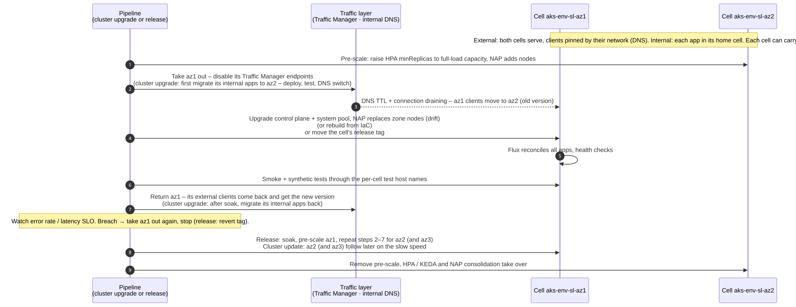

# 14. Zero-downtime cluster upgrades

Cluster upgrades are triggered by pipelines in a fixed order: **dev → acc → prd**, with the waiting times of the
[update policy](#update-policy) below, and within an environment as described per cluster type. Nothing is upgraded by
hand.

## Update policy

The two cluster types are updated at very different speeds, for the same reason they are built differently: a
stateless cell can be drained and replaced at any time, the stateful cluster holds data and is changed as rarely as
possible. The difference is the upgrade *cycle*, not the starting point: the stateful cluster starts on the same
second latest minor as `sl-az1`, and then moves slowly because the workloads it runs (databases, brokers, operators
with data on disks) are harder to move and test.

| | Stateless, fast speed: `sl-az1` | Stateless, slow speed: `sl-az2` (and `sl-az3`) | Stateful: `sf` |
|---|---|---|---|
| Kubernetes minor | **N-1**: the second latest GA minor in AKS | **One minor behind `sl-az1`** (N-2) – always a minor that `sl-az1` has already run in prd | **N-1 when the cluster is created** (the same minor as `sl-az1`), then kept on that minor as long as it has Long Term Support |
| Patches (Kubernetes patch versions, node images) | dev **1 week** after AKS releases them, acc 1 week after dev, prd 1 week after acc (prd ≈ 3 weeks after release) | dev **3 weeks** after release, acc 3 weeks after dev, prd 3 weeks after acc (prd ≈ 9 weeks after release) | **Only when absolutely necessary** (see below) |
| Minor upgrades | When a new minor becomes GA, to the new N-1, with the same 1-week steps | To the minor `sl-az1` leaves, with the same 3-week steps | Within the **last 6 months of LTS support** of the current minor: dev first, then acc, then prd |
| How nodes are updated | Cell drained, control plane + system pool upgraded, NAP replaces the zone nodes ([below](#stateless-clusters)) | Same | **Patched in place** where possible; nodes replaced only when a change requires it ([below](#stateful-cluster)) |
| Node image of new nodes | Pinned per cell: `imageVersion` in every zone `AKSNodeClass`, set from `cluster-vars` by the version pipeline, so a node created during scale-out runs the cell's current image, not the newest | Same | Classic pools: the pool's node image version |
| AKS auto-upgrade channels | `none` – the version pipeline decides | `none` | Cluster `none`; node OS channel for in-place patches ([below](#stateful-cluster)) |

**Starting point: Kubernetes 1.36.** The platform is new, so every cluster – both stateless speeds and the stateful
cluster – is created on **1.36** (AKS GA June 2026, also an LTS minor), and 1.36 is the **floor**: no cluster runs an
older minor. The slow speed's "one minor behind `sl-az1`" therefore starts to apply only when `sl-az1` moves past
1.36; until then `sl-az2` runs 1.36 too, with its slower patch timetable. The floor gives every cell in-place
pod resize for containers (GA) and pod-level resources (beta), which [pod right-sizing](05-node-pools.md#pod-right-sizing-vertical-scaling-in-place)
relies on, and meets the 1.33 requirement of eBPF host routing ([section 17](17-advanced-networking-and-fqdn-egress.md)).

**Why two speeds in the stateless clusters.** At any moment one cell runs a version that is newer and less proven and
the other cell(s) a version that `sl-az1` has already run in production – so a regression in a Kubernetes patch, a
node image or a minor version reaches only the fast cell first, while the slow cell(s) keep serving
([releases cell by cell](13-zero-downtime-application-upgrades.md#releases-cell-by-cell) uses the same idea for applications). Removed or changed Kubernetes
APIs show up in `sl-az1` (dev first) a full minor cycle before they reach `sl-az2`. Applications and fleet manifests
must therefore work on both minors; CI validates the rendered manifests against both (and against the stateful LTS
version).

**How the stateless timetable is run.** A scheduled **version pipeline** reads the Kubernetes versions and node images
AKS offers in the region and the date each was released, computes the target version and node image of every
stateless cluster from the table above, and the upgrade agent ([section 20](20-ai-driven-day-2-operations.md#agents)) opens it as a pull request to the IaC repository with a compatibility report. The cluster upgrade pipeline then
applies it cell by cell with the drain procedure below; dev and acc run without approval, prd needs an approval only
for minor upgrades. Rules:

- Every patch has its own timeline counted from its AKS release date; if a newer patch is already due, it replaces an
  older one that has not been promoted yet (patches are not applied one by one).
- A step is promoted only if the previous environment of the same speed is healthy on that version (no rollback, SLOs
  met during the wait).
- `sl-az2` runs the oldest minor in AKS standard support. Its minor upgrade is scheduled so that prd is upgraded
  before that minor's end of support in the [AKS Kubernetes release calendar](https://learn.microsoft.com/en-us/azure/aks/supported-kubernetes-versions#aks-kubernetes-release-calendar);
  if the calendar leaves less than 3 weeks per step, the steps are shortened.
- **Why the slow speed is 3 weeks and not a month** ([decision D11](decisions.md#decision-matrix)): NAP forces a
  node whose image is older than 90 days onto the newest image, outside any maintenance window. A month per step
  would put prd's slow cell on an image that is already three months old, so the forced update would take the
  pinning away. Three weeks per step keeps every cell's image younger than 90 days with a margin, and still a full
  release cycle behind `sl-az1`.
- **Emergency fast track**: a fix for an actively exploited vulnerability can skip the waiting times for both speeds
  with the platform owner's approval – still dev → acc → prd and still one cell at a time.
- `sl-az3` (prd only) follows the slow speed, so that two of three cells run the proven version.

**Stateful cluster: only when absolutely necessary.** The stateful cluster is changed only for one of these reasons:

1. **End of LTS support**: the upgrade to the next LTS minor starts no later than **6 months before** the current
   minor's LTS ends – this window is used for dev, acc and prd with soak times between them. Until then the cluster
   intentionally stays on its old minor.
2. **Security**: a vulnerability that affects the cluster (node OS, kubelet, container runtime, Kubernetes) and
   cannot be mitigated otherwise.
3. **A bug** that affects the stateful workloads and is fixed in a newer patch.
4. **Supportability**: AKS no longer supports the running patch version or node image.

When a change is needed, the smallest one is chosen: an **in-place OS security patch of the existing nodes**
(`SecurityPatch` channel, [below](#stateful-cluster)) before a node image
upgrade, a **control-plane-only** patch upgrade (`az aks upgrade --control-plane-only`; kubelets may lag behind the
API server within the Kubernetes version skew policy) before replacing nodes, and node replacement only when the change
cannot be made otherwise (e.g. a new Kubernetes minor).

## Stateless clusters

One cell at a time is **taken out of traffic, upgraded and returned** – users never hit a cell that is being
changed. It is the same procedure as an application release ([releases cell by cell](13-zero-downtime-application-upgrades.md#releases-cell-by-cell)), and the
two never run in the same cell at the same time:

1. pre-scale the remaining cluster(s) to full-load capacity;
2. take the cell out of traffic: move the internal applications whose home is this cell to another cell with the
   **migration workflow** ([internal zones](10-cluster-types-stateless-and-stateful.md#internal-zones-one-home-cell-per-application-moved-by-migration)),
   then disable the cell's Traffic Manager endpoints and wait for the DNS answers to expire and the connections to
   drain;
3. upgrade the control plane and the system pool; NAP then replaces the zone nodes with the new node image and
   version through drift (the cell's `NodePool` disruption budgets are opened for this while it is out of traffic) – or, for large changes (new VNet, CNI, OS SKU), **create a fresh cluster**
   from IaC and let Flux bootstrap it (blue/green at cluster level);
4. wait until all Flux Kustomizations are `Ready`, run smoke and synthetic tests through the cell's per-cell test
   host names ([incoming traffic](10-cluster-types-stateless-and-stateful.md#incoming-traffic-from-outside-and-from-inside));
5. return the cell's external clients on Traffic Manager in steps of address blocks while watching error-rate and latency
   SLOs; on breach take the cell out again and stop. After the soak, migrate the internal applications back to their
   chosen home cell;
6. repeat for the next cell.

Node image / OS security updates follow the same timetable ([update policy](#update-policy)) and the same
procedure: the new node image is set while the cell is drained, and NAP rolls it out to the zone nodes through drift
within its disruption budgets. AKS auto-upgrade and node OS auto-upgrade channels are not used in the stateless clusters,
so nothing changes a cell outside this procedure.
Prerequisite for all of this is **N+1 capacity**: NAP `NodePool` limits, vCPU quota and node subnet size must allow one
cluster to carry the whole environment.

## Stateful cluster

There is only one stateful cluster, so it is upgraded **in place** and protected by zone redundancy:

- **Version policy**: created on the second latest GA minor (N-1) with LTS, then changed only when absolutely necessary ([update policy](#update-policy)).
  Cluster auto-upgrade channel `none`; Kubernetes patch versions are applied only for one of the listed reasons, by the
  pipeline, dev → acc → prd, preferably control plane only.
- **OS patches in place**: security patches are applied to the **existing nodes** instead of replacing them – node OS
  channel **`SecurityPatch`** ([decision D10](decisions.md#decision-matrix)): AKS applies the security-only patches of
  the image maintainer to the running nodes in place where that is possible, and only for patches that cannot be
  applied live (kernel updates) reimages the nodes one at a time onto the patched image, both only inside the planned
  maintenance window (`aksManagedNodeOSUpgradeSchedule`), dev a week before acc and two weeks before prd, respecting
  the surge settings and the PDBs. The channel is AKS-managed and needs no package mirror and no reboot daemon in the
  Internet-less cluster. Whether AKS accepts it on a network isolated cluster is still to be verified (V13): the network
  isolated cluster documentation lists only `NodeImage` and `None`; if `SecurityPatch` is refused, the cluster takes
  `NodeImage` inside the same window ([decision D10](decisions.md#decision-matrix)). A node is reimaged with a whole new node image
  only when AKS support requires it. Because these nodes live long, **Image Cleaner** (`--enable-image-cleaner`, daily) removes
  unused, vulnerable images from them. The stateless cells do not need it: their NAP nodes are replaced regularly
  (`expireAfter`, drift, cell rebuilds).
- **Control plane**: zone-redundant (Premium tier); upgrading it does not restart workloads.
- **Node pools**: one fixed-size pool per isolation zone *and* AZ, so a pool upgrade touches only one AZ. Surge settings
  `maxSurge: 1`, `maxUnavailable: 0`, a drain timeout and node soak time; drains respect the PDBs, so at most one
  replica of each StatefulSet is down at any moment. The surge node is created in the same AZ, so zonal disks
  re-attach; ZRS disks additionally allow a pod to move to another AZ. The vCPU quota must leave room for the surge nodes,
  because the pools do not autoscale.
- **LTS minor upgrades** (rare, once per LTS cycle, within the last 6 months of LTS support): the same procedure,
  rehearsed in dev and acc first. Alternative
  for risky jumps: add new node pools on the new version, cordon and drain the old pools AZ by AZ, delete them.
