# 2.1 Network layout

Every cell has its own VNet with **one address space**, cut into sixteen equal **slots**: slot 0 is the system
subnet (`snet-system`: the system pool, every zone's gateway pods and the API server's private endpoint), slots 1 to
14 belong to the **isolation zones by their index**, which is the same in every cell of the exposure, and slot 15 is
reserved for the delegated API server subnet of VNet integration (H14). Inside a zone's slot the first half is the
zone's node subnet `snet-<zone>-nodes` and the fifth eighth its load balancer subnet `snet-<zone>-ilb`; the rest is
reserve ([address plan](3.1-cluster-types-stateless-and-stateful.md#vnets-and-address-plan)). A new zone takes a free
slot in every cell, so nothing existing is re-addressed. Private endpoints are not in the cells at all: they sit in
one shared subnet of the environment's network and are reached through the hub firewall. Whether the zone's pods
have VNet addresses depends on the cell's CNI mode:

| | Stateful cluster (designed) | Stateless cell, overlay (the default) | Stateless cell, node subnet |
|---|---|---|---|
| CNI | Azure CNI, VNet-integrated with dynamic pod IP allocation, powered by Cilium | Azure CNI Overlay, powered by Cilium | Azure CNI node subnet, powered by Cilium (`network_plugin_mode = "none"`; node auto provisioning has no pod-subnet mode) |
| [ACNS](5.1-advanced-networking-and-fqdn-egress.md) | FQDN egress policies + observability + eBPF host routing | Off by default ([D61](7.2-decisions.md#decision-matrix)); on per cell where a zone needs it ([section 5.2](5.2-egress-control-options-and-the-company-firewall.md#acns-and-ebpf-host-routing-in-detail)) | Same |
| Pod IPs | From `snet-<zone>-pods` – routable in the VNet | From the overlay range `100.201.0.0/16`, the same in every cell, outside the VNets | From the zone's node subnet, in a `/16` of `100.64.0.0/10` per cell ([D59](7.2-decisions.md#decision-matrix)) |
| Pod traffic leaving the cluster | Keeps the pod IP | SNAT to the node IP, so NSGs and the firewall see the zone's `snet-<zone>-nodes` | Keeps the pod IP up to the hub firewall (AKS's masquerading agent translates nothing); the firewall SNATs it with the other private ranges |
| Which application may leave the cluster | Cilium FQDN policy per application ([section 5.1](5.1-advanced-networking-and-fqdn-egress.md)) | The hub Firewall decides per zone from per-application rule files; per application only with ACNS ([section 5.2](5.2-egress-control-options-and-the-company-firewall.md)) | The hub Firewall decides per zone; its log names the pod |
| `snet-<zone>-pods` | Yes | No | No: pods share `snet-<zone>-nodes` (110 pods a node reserved) |
| `snet-<zone>-ilb` | Internal load balancers of the applications' `LoadBalancer` Services | Internal load balancer of the zone's gateway (internal zones; an external zone's gateway has a public load balancer, [section 3.1](3.1-cluster-types-stateless-and-stateful.md#external-zones-active-active-with-dns-affinity)) | Same |

Zone isolation works the same with both CNIs because every zone has its own nodes in its own node subnet (a NAP
`NodePool` whose `AKSNodeClass` points at the zone's subnet, or AKS node pools in the stateful cluster): a packet from
a stateless zone always carries an address of that zone's subnets.
Every subnet has its own **NSG** (`nsg-<cell>-<subnet>`, deny-all inbound as the last rule) and the cell one **route
table** (`rt-<cell>`) on its system and node subnets, sending `0.0.0.0/0` to the exposure's hub Firewall
([decision D53](7.2-decisions.md#decision-matrix)) with BGP propagation off, so everything that leaves the cell is
inspected. Traffic *between* the zones of one cell never reaches the firewall - the slots are one address space with
one set of system routes - so inside a cell the NSGs and Cilium are the two layers that separate zones, and the
firewall is the third layer for everything that leaves it.

What the NSGs allow on a node subnet, and from where:

- the kubelet port (TCP 10250) from the cell's system subnet (the AKS tunnel); Cilium health (TCP 4240), ICMP and
  DNS (53) between the cell's node subnets; the overlay pod range `100.201.0.0/16` between the node subnets (pods
  are Cilium's to tell apart, not the NSG's); load balancer probes from `AzureLoadBalancer`; ICMP from the hub
  firewall's address; traffic within the subnet;
- TCP 443 from the **Internet** on the system subnet (every zone's gateway pods run there) and on an external
  zone's node subnet; TCP 443 from **`VirtualNetwork`** on an internal zone's node and load balancer subnets and on
  the system subnet - an NSG rule takes one service tag, and the corporate ranges arrive through the hub as
  `VirtualNetwork`.

> **Why subnets and not separate VNets?** AKS requires all node pool subnets and the API server subnet of one
> cluster to be in the same VNet. Within one cluster, "network per country" is therefore implemented as
> *a subnet slot per zone + NSG + Cilium, with the hub firewall for everything that leaves the cell*, which the
> security team accepts for countries. Internal and external are not separated this way: they are separate
> clusters in separate subscriptions behind separate hubs ([decisions D52, D53](7.2-decisions.md#decision-matrix)),
> so the picture shows an internal cell; an external cell's VNet (`vnet-prd-ext-stateless-az1`) is the same with
> `ext-fi` and `ext-se` in its slots.
> Should a hard VNet boundary per country ever be required, the same step is taken once more – **one cluster per
> zone** – and the address plan stays the same.
