# 2.4 Allowed and blocked flows

Only the flows Kubernetes needs to function are allowed between a workload zone and the rest of the platform:

| # | Source | Destination | Port | Purpose |
|---|---|---|---|---|
| ① | Zone nodes, system pool | The API server's private endpoint in `snet-system` | TCP 443 | kubelet / pods → API server over Private Link ([D58](7.2-decisions.md#decision-matrix)); with VNet integration (H14) the delegated `snet-apiserver` instead |
| ② | `snet-system` (the AKS tunnel) | Zone nodes | TCP 10250 | logs, exec, port-forward; the NSG allows 10250 from the system subnet only |
| ③ | Zone pods | CoreDNS (system pods) | UDP/TCP 53 | name resolution |
| ④ | metrics-server (system pods) | Zone nodes | TCP 10250 | resource metrics |
| ⑤ | The zone's External Secrets Operator (`<zone>-secrets` pods) | Own zone Key Vault, through the hub Firewall to its private endpoint in the environment's `snet-shared-pe` | TCP 443 | application secrets; application pods never reach a Key Vault ([section 2.5](2.5-workload-identity-and-secrets.md#delivered-only-by-external-secrets-operator)); the Firewall's rule takes the cells' system subnets as source |
| ⑤b | The zone's External Secrets Operator (`<zone>-secrets` pods) | Platform Key Vault, the same way | TCP 443 | certificates for the zone gateways and TLS-terminating apps; Cilium policy allows only these pods, RBAC only their zone's certificates |
| ⑥ | Zone nodes + pods | The exposure's Azure Firewall ([D53](7.2-decisions.md#decision-matrix)) | per FQDN | AKS required FQDNs, MCR, Entra ID (workload identity token exchange); pods only to the FQDNs of their zone's per-application rule files |
| ⑥b | Zone nodes (Grafana Alloy of the node) | Grafana Cloud, through the Firewall | TCP 443 | Metrics, logs and traces of the node's own pods, to a private endpoint in the hub so that nothing crosses the Internet ([section 6.2](6.2-observability-with-grafana-cloud.md)) |
| ⑦ | Zone nodes | The zone's own nodes and the system pool | TCP 4240, ICMP | Cilium health (optional); between two zones the Firewall drops it since [D73](7.2-decisions.md#decision-matrix), so `cilium-health` lists the other zones' nodes as unreachable |
| – | API server | Platform Key Vault | TCP 443 | etcd encryption with the cluster's KMS key: KMS data encryption reaches the private vault as a trusted service ([section 4.2](4.2-encryption-at-rest-and-customer-managed-keys.md)) |

**Everything else between zones is blocked** – pod-to-pod, pod-to-other-zone Key Vault and direct Internet –
enforced by the Azure Firewall (L3–L7, logged: every node and pod subnet routes the cell's address spaces to it, its
own slot excepted, [D73](7.2-decisions.md#decision-matrix)), NSG (L3/L4) and Cilium cluster-wide policy (pod
identity) inside a cell, and by the Firewall for everything that leaves it. The flows ① to ④ above cross the Firewall
too, as the network rules of the exposure's Firewall Policy: from the system pool to a zone's nodes and pods (TCP, and
ICMP for Cilium's health), from a zone to the system pool only cluster DNS, the API server's private endpoint and
Cilium's health - the platform's own pods (the other zones' gateways and External Secrets Operators among them) are
behind the same three layers as another zone. An application
calls an application of another zone only as a client of that zone's published entry point, through the Firewall, with
an application rule in its own rule file ([section 2.1](2.1-network-layout.md)).

Inside the allowed flows, a pod reaches a destination outside the cluster only if a hub Firewall rule names it by
**FQDN**, written per application ([section 5.1](5.1-egress-control-and-the-company-firewall.md)).

## Isolation matrix

What each principal can reach, per isolation zone. "Own" means the zone, namespace or application the principal
belongs to; everything not listed is blocked, and the negative tests of
[section 7.1](7.1-implementation-project-and-acceptance-testing.md#requirement-and-isolation-tests) try every blocked
cell of this table after every change.

| Principal | Kubernetes API | Network | Azure identities | Secrets | Certificates | Application data |
|---|---|---|---|---|---|---|
| Application pod | None: `automountServiceAccountToken: false`, no API access | Own namespace, the zone's gateway (ingress only), CoreDNS, the node's Alloy, declared FQDNs of the own zone (another zone's published name among them); never IMDS, another zone's pods, nodes or load balancer directly, a vault or the stateful cluster of another zone | Own workload identity (`id-<zone>-<app>`), roles only on the zone's own resources | Only the Kubernetes `Secret`s ESO wrote into its namespace | The zone's wildcard (or its own) as a `Secret`, if onboarded with one | Own PaaS resources through the identity |
| Application team (humans) | Own namespaces only (Entra ID group), read-only in acc and prd | – | None; pipelines write secrets to the zone vault under the application's prefix only | Own prefix in the zone vault (pipeline) | None | Through the application only |
| Zone ESO controller (`<zone>-secrets`) | `Secret` writes and `serviceaccounts/token` in the zone's namespaces | The zone vault and the platform vault, through the hub Firewall | None of its own; uses each namespace's `secrets-reader` token | Every application's reader identity of the zone, each limited by ABAC to its prefix | The zone's certificates, by per-object RBAC | None |
| Zone gateway (`<zone>-gateway`) | None with App Routing (istiod configures it); read-only Gateway API access with Traefik ([D55](7.2-decisions.md#decision-matrix)) | Own zone's application pods, istiod; receives from Internet or corporate network | None | None | The zone's wildcard, through ESO | None |
| Other zone, same cell | Blocked (RBAC by namespace) | Blocked by the Firewall (logged), NSG and Cilium ([D73](7.2-decisions.md#decision-matrix)); its published entry point only with an application rule in the caller's rule file | Different identities | Different vault | Different certificate | Different PaaS resources, private endpoints in the other zone's subnet |
| Stateful cluster, same zone | Separate cluster | Only from the same zone of the stateless clusters, on the application's TLS port | Same pattern, federated per cluster | Same zone vault | Same zone certificate | Zone's volumes under the zone's own key |
| Platform team | Read-only everywhere; writes only through Git | Management VNet → API servers | None standing; PIM | None standing; PIM on the vaults, alerted | None standing | None |
| AI agents | `AKS RBAC Reader` (no `Secret`s) | Management VNet → API servers, model endpoint, Git | Read-only Azure roles | Metadata only (security agent) | None | None |
| Deployment identities (IaC, Flux, stateful pipeline) | Write, scoped to platform and application namespaces; Flux cluster-wide in its cell | ACR private endpoint | Create and assign identities (IaC only) | Assign roles (IaC only), never read values | Create placeholders (IaC), issue (renewal job) | None |
| Break-glass (PIM) | Cluster admin for the activation, logged and alerted | Management VNet | Owner for the activation | Read with alert | Read with alert | Through the resources, with alert |

A compromised application pod therefore reaches its own namespace, its own zone's declared destinations and its
own PaaS resources, and nothing else; a compromised ESO controller reaches one zone's secrets; a compromised
cluster administrator reaches one cell. Country separation inside one cluster rests on these controls, not on a
separate control plane; whether that is enough for the regulation the organisation is under is a sign-off
([decision D01](7.2-decisions.md#decision-matrix)).
