# 2.5 Workload identity first, Key Vault secrets only when needed

**Rule: an application authenticates with its workload identity wherever the target supports Microsoft Entra ID;
a secret is used only when there is no other way.** No passwords, connection strings with keys, SAS tokens or
storage account keys for Azure services.

## Workload identity per application

- Each application has, per isolation zone and environment, its own user-assigned managed identity
  (`id-<zone>-<app>`), created by IaC together with the namespace (designed: today a managed namespace gets only
  its vault reader identity, [below](#delivered-only-by-external-secrets-operator)). Its Kubernetes ServiceAccount carries the
  `azure.workload.identity/client-id` annotation; pods get a short-lived projected token that is exchanged for an
  Entra ID token – nothing long-lived is stored anywhere.
- **Federated credentials per cluster**: every cluster has its own OIDC issuer, so the identity has one federated
  credential per cluster of the environment (`sl-az1`, `sl-az2`, (`sl-az3`), `sf`) for subject
  `system:serviceaccount:<namespace>:<app>`. A rebuilt stateless cluster gets a new issuer; the IaC that creates the
  cluster also updates the federated credentials (a managed identity allows at most 20).
- The identity gets **data-plane roles directly on the Azure resources of its zone**, never on other zones:

| Target | How the application authenticates | Local auth disabled with |
|---|---|---|
| Azure SQL Database | Entra token (`Active Directory Default` in the driver), contained database user for the identity | Entra-only authentication |
| Azure Database for PostgreSQL | Entra token as password, role mapped to the identity | Entra-only authentication |
| Storage (Blob, Queue, Table, Files REST) | `Storage Blob Data …` roles | `allowSharedKeyAccess: false` |
| Service Bus, Event Hubs | `… Data Sender / Receiver` roles | `disableLocalAuth: true` |
| Cosmos DB | Cosmos DB data-plane RBAC | `disableLocalAuth: true` |
| Azure Cache for Redis | Entra authentication, access policy for the identity | access keys disabled |
| Key Vault | **No role** – applications never call Key Vault; their secrets are delivered by External Secrets Operator ([below](#delivered-only-by-external-secrets-operator)) | RBAC permission model |
| Other Azure APIs (App Configuration, Azure OpenAI, …) | Azure RBAC roles | `disableLocalAuth` where available |

  "Local auth disabled" is enforced with Azure Policy on the resources, so a key-based fallback cannot be switched
  on later. Application configuration contains only endpoints and client IDs, which are not secrets. The table lists
  the Azure services; the ones without an equivalent in every cloud (Azure SQL, Service Bus, Cosmos DB's NoSQL API)
  are available only as a documented cloud-pinning exception ([section 1.3](1.3-open-standards-and-portability.md#data-in-paas-services-that-every-cloud-offers)).
- **Platform components use workload identity too**: Flux (`OCIRepository` `provider: azure`), the stateful
  deployment pipeline (workload identity federation, no client secret), External Secrets Operator (below), external-dns. Unlike applications, platform components may use
  Key Vault directly with their own identity ([below](#platform-components-may-use-key-vault-directly)). Images are pulled
  with the kubelet identity, which has only `AcrPull` on the environment's ACR – no `imagePullSecrets`.

## Secrets only when needed

A secret is allowed only when the target cannot use Entra ID: third-party APIs and SaaS keys, partner systems and
legacy protocols. TLS certificates are **not** in the zone vaults; they live in the environment's platform Key Vault
([section 4.1](4.1-encryption-in-transit-and-tls.md#certificates-issued-centrally-distributed-through-the-platform-key-vault)).
Such a secret always lives in the zone's **Key Vault** – never in Git, Helm values or a Kubernetes `Secret` created by
hand.

Each zone has its **own Key Vault per environment** (`kv-<env>-<zone>`, RBAC permission model, public access
disabled), shared by all clusters of the environment, with one private endpoint in the environment's shared
`snet-shared-pe`, reached from the cells through the hub Firewall ([section 3.1](3.1-cluster-types-stateless-and-stateful.md#vnets-and-address-plan)).
The tenant of a vault is the **namespace**: every secret a namespace owns is named `<namespace>--<secret>`
(`int-fi-example--api-key`), and a namespace name may not contain `--`. Inside a zone's vault, applications share the vault but are separated with
[Azure ABAC conditions](https://learn.microsoft.com/en-us/azure/key-vault/general/rbac-abac):

- The namespace's **secret reader identity** `id-<region>-<env>-shared-kv-<namespace>` (see below – not the
  application's own identity) gets **Key Vault Secrets User** on the zone vault with condition
  `@Resource[Microsoft.KeyVault/vaults/secrets:name] StringStartsWith '<namespace>--'`.
- Application pipelines (`writers`) get **Key Vault Secrets Officer** under the namespace's write condition - the
  resource name for existing secrets (`get`, `update`, `delete`, `recover`, `purge`), the request name for new ones
  (`setSecret`, `restore`); rotation is owned by the application team (expiry dates set, Event
  Grid `SecretNearExpiry` alerts).
- The namespace's Entra ID groups ([section 2.6](2.6-application-multi-tenancy.md#who-may-work-in-a-namespace),
  [decision D49](7.2-decisions.md#decision-matrix)) get what their Kubernetes role gets on `Secret`s: the `admin` group **Key Vault Secrets Officer** under the
  same prefix conditions as the pipelines; the `edit` group the custom **Key Vault Secrets Editor** role (`OneK8s Key Vault Secrets Editor (<resource group>)`, defined and
  assignable at the environment's resource group: `setSecret`, `update`, `readMetadata` - no `getSecret`, delete, purge or restore) under the same conditions, so
  it creates and changes the namespace's secrets and sees their attributes but never a value
  ([decision D51](7.2-decisions.md#decision-matrix)); the `view` group nothing.
- The **platform viewers** ([section 2.6](2.6-application-multi-tenancy.md#platform-viewers),
  [decision D50](7.2-decisions.md#decision-matrix)) list every secret's name and attributes, never a value.

Constraints to keep in mind: Key Vault ABAC is **preview**, supports **secrets only** (not keys/certificates
operations) and only **vault name + secret name** attributes, and lowercase values. Therefore the secret naming
convention `<namespace>--<secret>` is mandatory and enforced by the platform (the IaC refuses a namespace name with `--`, the ESO policy any other key). The conditions gate `readMetadata`
as well as `getSecret`, which refuses every list call – deliberately, see *Soft multi-tenancy* below. Because most applications need no secrets at all, the
vault stays small and the preview dependency affects only the few exceptions. ABAC is also not the only boundary
between two applications of a zone: each has its own reader identity, its own `SecretStore`, and admission rejects
an `ExternalSecret` that names another application's prefix ([section 2.7](2.7-policy-enforcement.md)), so a change in
the preview cannot open a path on its own. The fallback, one vault per application with a secret exception, is a
per-application flag in the environment IaC module ([decision D15](7.2-decisions.md#decision-matrix)).

### Soft multi-tenancy

A zone's applications share one vault, and the separation between them is in the data plane, not in the resource:
this is **soft multi-tenancy**. What each tenant – a namespace, its identity and its groups – can do:

| | Own secrets (`<namespace>--*`) | Another namespace's secrets | Secret names of the vault |
|---|---|---|---|
| Namespace identity (External Secrets Operator) | Read value and metadata, by name | Refused | Refused (no listing) |
| `admin` group, pipelines | Create, read, change, delete, recover, purge, by name | Refused | Refused (no listing) |
| `edit` group | Create and change, read attributes - never a value, no delete, recover or purge | Refused | Refused (no listing) |
| `view` group | – | – | – |
| Platform viewers | – (no value) | – (no value) | Listed, with attributes |

The conditions cover `readMetadata` too, and Key Vault evaluates a condition on a list call against the whole
collection, which has no name, so **no tenant can list the vault**: each works with its own secrets by name, which
is all External Secrets Operator does, and nobody can create a secret outside the naming convention (the condition
on a new secret is on the name in the request). Tools that browse the vault – the Azure portal among them – are for
the platform viewers, whose role lists every name; so names must never carry secrets. The isolation tests sign in
as a member of each group and as the namespace's identity and check every row of the table
([section 7.1](7.1-implementation-project-and-acceptance-testing.md#requirement-and-isolation-tests)). The hard
alternative – one vault per namespace – stays a per-namespace option ([decision D15](7.2-decisions.md#decision-matrix)).

**The same pattern applies to other shared PaaS services**: one instance per zone (or environment), a data-plane
role per namespace scoped below the instance, the namespace's workload identity and groups as the only principals,
and the names of other tenants' objects visible at most to the platform viewers:

| Service | Shared instance | Per-namespace scope | How the namespace's principals are held to it |
|---|---|---|---|
| Azure Database for PostgreSQL flexible server | Server per zone | Database `<namespace>` (or schema) | Entra ID roles for the workload identity and groups (`pgaadauth_create_principal`), `GRANT` on its own database only, `REVOKE CONNECT ... FROM PUBLIC` on every database; other databases' names stay visible in `pg_database` |
| Azure Cosmos DB | Account per zone | Database `<namespace>` | Cosmos DB data-plane role assignments scoped to `/dbs/<namespace>` (built-in or custom roles), local (key) auth disabled |
| Azure Storage | Account per zone | Container `<namespace>` | Storage Blob Data roles assigned on the container, or ABAC conditions on the container name |
| Azure Service Bus / Event Hubs | Namespace per zone | Queue, topic or event hub `<namespace>-*` | Data Sender/Receiver roles assigned on the entity |
| Azure SQL Database | Logical server per zone | Database `<namespace>` | Contained Entra ID users per database |

Where a service cannot scope its data plane below the instance, or a tenant needs its own keys, network or
performance isolation, the namespace gets its own instance – hard multi-tenancy, a decision per onboarding.

## Delivered only by External Secrets Operator

**Rule: no application reads Key Vault itself.** Secrets and certificates reach application pods only as Kubernetes
`Secret`s written by [External Secrets Operator](https://external-secrets.io/) (ESO). The rule applies to application
namespaces; platform components are the exception ([below](#platform-components-may-use-key-vault-directly)). The **Secrets Store CSI driver is not
used**: the AKS Key Vault secrets provider add-on (`azure-keyvault-secrets-provider`) is disabled by the cluster IaC
on every cluster, so its CRDs are not installed, and the stateless storage rule refuses inline `csi` volumes
([section 2.7](2.7-policy-enforcement.md)); an Azure Policy that denies enabling the add-on and an admission rule for
`SecretProviderClass` objects are designed, not built.

- **One ESO controller per isolation zone**, in the platform namespace `<zone>-secrets` (a reserved application
  name, like `<zone>-gateway`), on the system pool – so that a zone without applications has no nodes
  ([section 2.3](2.3-node-pools.md#zone-nodes-only-for-applications)) – and deployed by
  Flux (stateless) or the pipeline (stateful). Each instance has its own `controllerClass` (`<zone>`) and reconciles
  only the stores of its zone; the CRDs and the conversion webhook are installed once per cluster. Its path to Key
  Vault is the zone's own flow ⑤ (⑤b to the platform vault, [section 2.4](2.4-allowed-and-blocked-flows.md)), so a
  controller can never reach another zone's vault and a compromised controller exposes one zone at most. It should
  write `Secret`s and request ServiceAccount tokens only through RoleBindings in its own zone's namespaces; today
  the chart's cluster-wide role is used as is, an open item ([section 7.1](7.1-implementation-project-and-acceptance-testing.md#cis-benchmark)).
  The CRDs, the conversion webhook and the certificate controller are installed once per cluster by the **platform
  release** in the namespace `external-secrets` (`controllerClass: platform`), which also serves the platform
  namespaces' own stores.
- **A secret reader identity per namespace** (`id-<region>-<env>-shared-kv-<namespace>`, created by IaC with every
  managed namespace). It is separate from the application's own identity and is federated (one credential
  `aks-<cluster>` per cluster, like above) to the ServiceAccount **`key-vault`** in the namespace. It is the only
  identity with a data-plane role on the zone vault, limited to the namespace's prefix by the ABAC condition above.
  Application pods may not run as `key-vault` (Azure Policy). The teams' `edit` and `admin`
  roles do include `serviceaccounts/token`, so their members could obtain its token – which gives them nothing they
  do not already hold, since those groups manage the namespace's secrets in the vault themselves; no workload can.
- **One `SecretStore` named `key-vault` per application namespace**, generated from the onboarding by a platform
  preset: provider `azurekv`, `vaultUrl` of the own zone vault (the gateway and platform namespaces point theirs at
  the platform vault, [section 4.1](4.1-encryption-in-transit-and-tls.md)), `authType: WorkloadIdentity` with
  `serviceAccountRef: key-vault`, `controller: <zone>`. Azure Policy rejects any other store configuration.
  Applications write only **`ExternalSecret`s** that reference their own namespace's store; `ClusterSecretStore`,
  `ClusterExternalSecret` and `PushSecret` are platform only. An application can therefore only ever pull with its
  own reader identity, and Key Vault ABAC still decides which secret names that is – application A's
  `ExternalSecret` for `b-…` fails with `403`.
- **No other way in.** Application identities have no Key Vault role at all; in application namespaces Cilium
  never allows `*.vault.azure.net` (only `<zone>-secrets` and the platform namespaces below reach a vault), and Azure Policy rejects an application egress policy that names a vault
  ([section 5.1](5.1-advanced-networking-and-fqdn-egress.md)). In application namespaces, admission accepts
  `Secret`s only from the zone's ESO controller (plus Helm release Secrets), so a secret in Git, Helm values or
  created with `kubectl` is rejected as before. Only the environment IaC module assigns Key Vault data-plane roles;
  an acceptance test and the security agent ([section 6.1](6.1-ai-driven-day-2-operations.md)) check that no
  application identity holds one.
- **Consumption and rotation.** Applications mount the resulting `Secret` as a **volume** (preferred: the kubelet
  updates the files after a rotation; no `subPath`) or as environment variables (picked up only on the next
  rollout). `refreshInterval` is 1 hour by default, shorter where a rotation must take effect faster; the
  `SecretSynced` condition and ESO's metrics alert the platform and the application team when a sync fails.

## Platform components may use Key Vault directly

Platform components in platform namespaces (`<zone>-secrets`, `external-secrets`, `flux-system`, `infra-observability`) are owned,
reviewed and upgraded by the platform team, so they are not forced through ESO. Such a component may read Key Vault
directly with **its own workload identity**, with a data-plane role scoped as narrowly as Key Vault allows (a single
certificate or secret where possible), declared in the IaC module and reviewed with the platform change, and with the
vault in its namespace's platform-owned egress policy. The Secrets Store CSI driver stays disabled for them too.

- **The zone's gateway uses ESO exactly like an application.** `<zone>-gateway` has the standard `key-vault`
  ServiceAccount, federated to its reader identity `id-<region>-<env>-shared-kv-<zone>-gateway`, which has **Key
  Vault Secrets User** on the platform vault under the prefix `<zone>-gateway--` - the zone's certificate is the
  secret `<zone>-gateway--wildcard`, the gateway namespace's share like any other
  ([section 4.1](4.1-encryption-in-transit-and-tls.md#certificates-issued-centrally-distributed-through-the-platform-key-vault)).
  The gateway pods have no Azure identity at all (with App Routing istiod hands them the Secret, Traefik reads it
  itself; App Routing's own Key Vault integration through the Secrets Store CSI driver is not used), their egress
  policy names no vault, and the ESO rules of [section 2.7](2.7-policy-enforcement.md) apply to `<zone>-gateway` as
  to any application namespace.
- **External Secrets Operator** itself, Flux and the monitoring components follow the rules above: own identity, own
  narrow roles, egress policy owned by the platform.
- **Grafana Alloy** cannot read Key Vault, so its Grafana Cloud credential is delivered by the platform ESO
  controller in `external-secrets` through `flux-system`'s share of the platform vault (the secret
  `flux-system--grafana-cloud`, read by `flux-system`'s reader identity under its prefix,
  [section 6.2](6.2-observability-with-grafana-cloud.md#collection-grafana-alloy-node-local)).

Trade-offs of delivering secrets as Kubernetes `Secret`s instead of CSI file mounts:

- The values are **stored in etcd**, encrypted with the cluster's customer-managed KMS key
  ([section 4.2](4.2-encryption-at-rest-and-customer-managed-keys.md)), and readable by anyone with `get secrets` in
  the namespace: only the application team in its own namespaces, the platform team through PIM; the AI agents'
  `Azure Kubernetes Service RBAC Reader` role does not include `Secret`s.
- **ESO becomes a critical platform component** (one controller per zone and cluster, upgraded by the platform). In
  return a Key Vault or Entra ID outage no longer stops pods from starting – the `Secret` is already in the
  cluster, whereas a CSI mount fails at pod start.
