# 2.6 Application multi-tenancy inside a zone

Each application gets its own namespace(s) inside a zone, with a baseline policy set applied automatically:

1. default deny for inbound and outbound traffic;
2. allow DNS to CoreDNS in `kube-system`;
3. allow inbound traffic only from the zone's gateway pods (stateless clusters; label
   `gateway.networking.k8s.io/gateway-name: <zone>` in `<zone>-gateway`) or, in the stateful cluster,
   only from the node subnets of the same zone in the stateless clusters (Cilium CIDR policy; the applications'
   `LoadBalancer` Services use `externalTrafficPolicy: Local` so the client IP is preserved);
4. allow traffic within the namespace;
5. no egress out of the cluster by default (the zone's `CiliumClusterwideNetworkPolicy` baseline; the namespace's own `NetworkPolicy` only closes its ingress): where the cell runs ACNS, **the application must declare every external destination by FQDN** in
   its own `CiliumNetworkPolicy` `egress` – Entra ID, PaaS private endpoints, stateful cluster services and approved Internet names (which must also be on the
   zone's Firewall allow-list); CIDR-based egress is rejected by Azure Policy
   ([section 5.1](5.1-advanced-networking-and-fqdn-egress.md)). Key Vault is never on that list: secrets and
   certificates arrive as Kubernetes `Secret`s from the zone's External Secrets Operator
   ([section 2.5](2.5-workload-identity-and-secrets.md#delivered-only-by-external-secrets-operator)).

Applications in the same zone therefore cannot talk to each other unless an explicit policy pair is agreed.
Kubernetes RBAC is namespace-scoped (Entra ID groups per application team), plus ResourceQuota/LimitRange per
namespace.

## Who may work in a namespace

The onboarding request names up to three Entra ID groups per namespace, one for each of Kubernetes' built-in
user-facing roles ([decision D49](7.2-decisions.md#decision-matrix)):

| Role | Group's members may | They may not | In the zone's Key Vault |
|---|---|---|---|
| `view` | Read most objects in the namespace | Read `Secret`s, roles or role bindings; write anything | Nothing |
| `edit` | `view`, and write most objects, `Secret`s included where policy lets anyone (in a zone's namespaces only External Secrets Operator does) | Change roles or role bindings | Custom Key Vault Secrets Editor on `<namespace>--*` only, by name: create and change secrets and read their attributes, never a value; no delete; no listing ([D51](7.2-decisions.md#decision-matrix)) |
| `admin` | `edit`, and roles and role bindings inside the namespace | Change the namespace, its quota or its default network policies | Key Vault Secrets Officer on `<namespace>--*` only, by name: also read values, delete, recover and purge; no listing |

None of them reaches another namespace or anything cluster-wide. The IaC (aks-terraform
`managed_namespaces.<ns>.groups`) gives each group a `RoleBinding` `platform-<role>` in the namespace, applied by
Flux through a configuration `<ns>-access` of its own (one Kustomization per role), and the Azure role `Azure Kubernetes Service Namespace User` on the
managed namespace, so that its members can fetch a kubeconfig for that namespace alone
(`az aks namespace get-credentials`). On the namespace's share of the zone vault the same groups get the matching
rights ([section 2.5](2.5-workload-identity-and-secrets.md#delivered-only-by-external-secrets-operator)): since
application secrets reach the cluster only through External Secrets Operator, managing them in the vault is how a
team with `edit` changes its `Secret`s. A role without a group gets no binding and no vault role. The isolation tests
([section 7.1](7.1-implementation-project-and-acceptance-testing.md#requirement-and-isolation-tests), R6) compare
the bindings with the IaC and check each role's rights – in the cluster and in the vault – by impersonating a member
of its group and by signing in as a test application that is one.

None of these groups can list the cluster's namespaces or the vault's secrets: other tenants' names stay hidden
from them – **soft multi-tenancy**, the separation of tenants sharing one cluster and one vault in their data
planes ([section 2.5](2.5-workload-identity-and-secrets.md#soft-multi-tenancy), which also applies the pattern to
other PaaS services).

### Platform viewers

Some tools need to see what the tenants may not: the Azure portal's Kubernetes views (*Workloads*, *Services and
ingresses*, …) start from the cluster's list of namespaces, and a vault browser from the list of secrets. The
**platform viewers** are the Entra ID groups that may list both – names and attributes only, nothing inside a
namespace and no secret value ([decision D50](7.2-decisions.md#decision-matrix)). A team member who is also a platform
viewer picks the namespace in the portal and sees there what the namespace's group allows. The IaC (aks-terraform
`shared/` `platform_viewer_group_object_ids`) grants them one custom role, **defined and assignable at the
environment's resource group** – nothing at the subscription, so it fits a hardened corporate landing zone that keeps
subscription-level role definitions to its platform team:

| Permission | For |
|---|---|
| `Microsoft.ContainerService/managedClusters/read`, `.../listClusterUserCredential/action` | The clusters in the portal, a kubeconfig (Entra ID) |
| Data action `Microsoft.ContainerService/managedClusters/namespaces/read` | Azure RBAC for Kubernetes: get, list and watch namespaces |
| `Microsoft.KeyVault/vaults/read`, data action `Microsoft.KeyVault/vaults/secrets/readMetadata/action` | The vaults in the portal, every secret's name and attributes |
| `Microsoft.Resources/subscriptions/resourceGroups/read` | The resource group in the portal |

The isolation tests check that the role is assignable at the resource group only, and sign in as a test member: it
lists the namespaces and every vault's secret names, and reads nothing in a namespace, no secret value, and writes
nothing.

## Ownership and cost

Every namespace says who owns what runs in it and who pays for it (R25, [decision D47](7.2-decisions.md#decision-matrix)):

| Metadata | Example | Used by |
|---|---|---|
| Label `platform/team` | `payments` | Cost and usage per team (OpenCost, Grafana), alert routing |
| Label `platform/cost-center` | `cc-4711` | Charging the team's share of the cells |
| Annotation `platform/contact` | `payments-team@example.com` | Whoever finds something wrong with the namespace |

The onboarding request names them, and the IaC sets them on the namespace (aks-terraform
`managed_namespaces.<ns>.owner`); the platform's own namespaces are `platform`. Azure Policy
(`namespace-ownership`, [section 2.7](2.7-policy-enforcement.md)) requires them on every namespace but the ones AKS
creates. **OpenCost** ([section 6.2](6.2-observability-with-grafana-cloud.md#what-grafana-cloud-does)) prices every
node from Azure's retail prices and splits its cost over the namespaces by what their pods request and use, so a
team's share of the cell, its GPU nodes included, is a query by these labels
([decision D46](7.2-decisions.md#decision-matrix)). A monthly budget on each environment subscription alerts the owners
at 80 % and 100 % of the actual cost and at a forecast of 100 % ([section 3.2](3.2-environments.md#cost-and-capacity-model)).
