# 21. Observability with Grafana Cloud

All metrics, logs and traces of the clusters and applications go to **[Grafana Cloud](https://grafana.com/products/cloud/)**,
one stack per environment. Grafana Cloud also runs the dashboards, alerting, on-call paging (Grafana IRM), SLOs and
synthetic monitoring. The platform runs only the collector, **[Grafana Alloy](https://grafana.com/docs/alloy/latest/)**,
in every cluster. Azure Monitor keeps only what Azure itself produces (Activity Log, resource diagnostic logs), and
Grafana reads it in place.

**Access rule: anyone who may sign in to a stack may see all of its data.** Data inside a stack is not separated by
isolation zone, country or application. This is a deliberate decision. The isolation zones (R2–R5) still separate the
workloads, networks, nodes and secrets. Telemetry is not separated, because a cross-zone view is what makes
diagnosing problems fast. The access rule decides who gets into a stack, and therefore what goes into it
([below](#what-must-not-be-sent)).

## Stacks and access

| Stack | Holds | Who can sign in |
|---|---|---|
| `<org>-dev`, `<org>-acc`, `<org>-prd` | All telemetry of that environment: every cluster, cell, zone and application, plus the Azure Monitor data source of the environment subscription | Members of `grp-grafana-<env>` (platform team, application teams, SOC, AI agents' service accounts). There are no per-team folders with restricted data and no label-based access policies |
| `<org>-build` | The build tenant ([section 23](23-implementation-project-and-acceptance-testing.md)), synthetic data only | Implementation project team |

- **Sign-in with Entra ID** (SAML single sign-on) through one enterprise application per stack. A user's Grafana role
  comes from a group: `Viewer` for everyone in `grp-grafana-<env>`, `Editor` for the platform team in dev and acc,
  and `Admin` only through a PIM-activated group. Local Grafana users and basic auth are disabled. Grafana Cloud
  organisation administration (stacks, billing, access policies) also goes through PIM.
- **Machine access uses access policies** with the narrowest scopes:

  | Token | Scopes | Stored in | Used by |
  |---|---|---|---|
  | `grafana-<env>-write` | Fleet Management, `metrics:write`, `logs:write`, `traces:write` on its own stack | `kv-<env>-platform` | Alloy in every cluster of the environment |
  | `grafana-<env>-opencost` | `metrics:read`, limited by a label-based access policy to the cluster's own series | `kv-<env>-platform` | OpenCost in every cluster of the environment |
  | `grafana-<env>-read-<agent>` | Viewer service account | The agent's own secret store | One per AI agent and environment ([section 20](20-ai-driven-day-2-operations.md#identities-and-access-rights)) |
  | `grafana-<env>-gate` | `metrics:read` | GitHub environment secret | Release and upgrade pipelines (SLO gates) |
  | `grafana-<env>-iac` | Stack administration | GitHub environment secret, `main` only | The Terraform pipeline that applies dashboards, alerts and SLOs |

  Tokens expire after 90 days and are rotated by the IaC pipeline. The only read token in a cluster is
  OpenCost's, limited by a label-based access policy to the cluster's own series (`cluster="<cluster>"`), so a
  compromised cluster cannot read another cluster's telemetry through it.
- **Everything is code.** Data sources, folders, dashboards, alert rules, contact points, notification policies,
  SLOs, synthetic checks and IRM schedules are managed by the `grafana` Terraform provider. The platform's resources
  live in the IaC repository. An application team's dashboards, alerts and SLOs live in
  `apps/<app>/observability/` in the fleet repository, and the same pipeline applies them, dev → acc → prd.
  Changes made in the UI are allowed in dev only, and the next apply overwrites them.

## Collection: Grafana Alloy, node-local

The [`k8s-monitoring` Helm chart](https://github.com/grafana/k8s-monitoring-helm) installs Alloy in the platform
namespace `infra-observability`, configured from the stack with **Grafana Cloud Fleet Management** (remote
configuration, [decision D48](decisions.md#decision-matrix)): the chart's values only start the collectors and
point them at Fleet Management; their pipelines – what is collected, how it is labelled and where it goes – are
managed there by the platform team. Flux installs it in the stateless clusters and the pipeline in the stateful
cluster, from `infrastructure/base` ([section 12](12-keeping-clusters-in-sync.md)). **Every collector works only on
its own node**, so telemetry never crosses from one isolation zone to another inside the cluster. A zone's data
leaves the cluster from that zone's own nodes, through the Firewall rule of that zone:

| Alloy instance | Runs on | Collects |
|---|---|---|
| **DaemonSet** `alloy-node` | Every node (tolerates every taint, including spot) | Pod logs from `/var/log/pods` (read-only `hostPath`); node journal; kubelet and cAdvisor metrics of its node; `PodMonitor` / `ServiceMonitor` targets **on its own node only** (discovery filtered by `spec.nodeName`); Cilium and Hubble metrics; ACNS container network logs from the node ([section 17](17-advanced-networking-and-fqdn-egress.md#observing-and-troubleshooting)); OTLP traces, metrics and logs pushed by the pods of its node |
| **Deployment** `alloy-cluster` (2 replicas, clustered) | System pool | kube-state-metrics, Kubernetes events, API server and CoreDNS metrics, Flux and External Secrets Operator metrics, the zone gateways' Envoy metrics (Istio standard metrics) |

- **OTLP endpoint for applications**: Service `alloy-otlp.infra-observability.svc`, ports 4317 (gRPC) and 4318
  (HTTP), with `internalTrafficPolicy: Local`, so a pod always reaches the Alloy on its own node. An Azure Policy
  mutation injects `OTEL_EXPORTER_OTLP_ENDPOINT` and `OTEL_RESOURCE_ATTRIBUTES`
  (`deployment.environment`, `k8s.cluster.name`, `platform.zone`) into every application container that does not set
  them itself. The platform's Cilium baseline allows every application pod to reach `alloy-node` on these two ports,
  and `alloy-node` to reach the declared metrics port of the pods on its node, the same way it allows DNS. An
  application's own egress policy needs no entry for telemetry.
- **Common labels** on every series, log line and span: `env`, `cluster`, `cell` (`sl-az<N>` or `sf`), `zone`
  (from the namespace's `platform/zone` label), `namespace`, `app` and `team` (from the namespace labels set at
  onboarding). Alerts are routed and costs are attributed by these labels, not by access.
- **Platform rules for Alloy** ([decision D48](decisions.md#decision-matrix)): Alloy and node-exporter run as Grafana's
  Fleet Management presets set them – privileged, on the host network and PID namespace, with the node's logs,
  cgroups and storage – so Alloy can instrument applications with eBPF (Beyla) and read the node; still no host
  iptables rules (eBPF host routing, [section 17](17-advanced-networking-and-fqdn-egress.md)). Being on the host
  network, they are outside Cilium's pod policies; the namespace's other pods (kube-state-metrics, Beyla's cache,
  OpenCost) keep a platform-owned policy. `infra-observability` is a platform namespace with a platform-owned egress policy (Grafana Cloud ingest
  host names only).
- **Write token**: an `ExternalSecret` in `infra-observability` reads `grafana-<env>-write` from `kv-<env>-platform`.
  It is reconciled by the platform's own External Secrets Operator controller in `platform-secrets`, which serves
  platform namespaces only, and its reader identity has Key Vault Secrets User on that one secret
  ([section 7](07-workload-identity-and-secrets.md#platform-components-may-use-key-vault-directly)).
- **Buffering**: Alloy keeps a write-ahead log on the node (an `emptyDir`), so a short Grafana Cloud or Private Link
  outage loses no data. A longer outage drops the oldest data first, and it never blocks the applications.
- **OpenCost**, part of the same chart, prices every node from Azure's retail prices (spot nodes at the spot price)
  and splits each cell's cost by namespace and pod; kube-state-metrics exports the namespaces' `platform/team`,
  `platform/cost-center` and `platform/zone` labels, so cost is reported per team and cost centre
  ([section 8](08-application-multi-tenancy.md#ownership-and-cost), [decision D46](decisions.md#decision-matrix)).
  OpenCost reads the cluster's usage back from the stack's Prometheus API with a token of its own that has only
  `metrics:read`.
- **Dev lab, today** (aks-fluxcd-platform `infrastructure/observability`, chart 4.5.2): the stack is reached over the
  Internet (no Private Link in the build tenant); the Fleet Management URL, user and token are one platform-vault
  secret in flux-system's share (`flux-system--grafana-cloud`), which the HelmRelease reads through ESO; OpenCost
  runs once that secret also carries a `metrics:read` token, since the Fleet Management token cannot read metrics.
- **Not used**: the AKS monitoring add-on (Container Insights), the AKS cost analysis add-on and Azure Monitor
  managed service for Prometheus are not enabled, so nothing is collected twice. The Defender for Containers sensor is a security tool, not
  observability, and stays as it is.

## Network: Grafana Cloud through Private Link

Telemetry never goes over the Internet. This matters most for the stateful cluster, which has no Internet at all (R9).

- The stacks are hosted on Azure, and Grafana Cloud accepts metrics, logs, traces and OTLP through
  **[Azure Private Link](https://grafana.com/docs/grafana-cloud/send-data/private-connectivity/azure-privatelink/)**.
  The ingest host names are shared by all stacks in the same Grafana Cloud region, so there is **one private
  endpoint per hub** (`snet-hub-pe` of the internal and of the external hub, [D53](decisions.md#decision-matrix)) for
  all environments of that exposure. The stacks stay apart by tenant ID and token.
- **DNS**: for each ingest host name, the hub has a Private DNS zone named after the full host name (for example
  `prometheus-prod-<n>-prod-<region>.grafana.net`), with an apex A record pointing to the private endpoint. Only the
  ingest and query endpoints resolve privately. The Grafana UI (`<org>-<env>.grafana.net`) still resolves publicly.
- **Firewall**: one network rule per environment and exposure on the exposure's Firewall, *all node subnets of the
  environment's exposure → the hub's Grafana private endpoint, TCP 443*. The management VNet gets the same rule for the pipelines' SLO gate queries and the synthetic monitoring
  private probes. No Grafana FQDN is on any Internet allow-list.
- **The stacks live outside the platform's region**: they are hosted in an Azure region other than the primary one
  (preferably the paired region of [section 22](22-backup-and-region-recovery.md)). The private endpoint reaches
  them across regions, so losing the primary region does not take observability, its history or the alerting with it.
- **Users** open the Grafana UI over the Internet. Entra ID sign-in, with a Conditional Access policy (compliant
  device, MFA) on each stack's enterprise application, is the only way in.

## What Grafana Cloud does

| Capability | Grafana Cloud feature | Design rule |
|---|---|---|
| Metrics | Grafana Cloud Metrics (Mimir), Prometheus API | Platform dashboards per environment, cell, zone and application, the same in every environment. Cardinality limits per application, enforced by Alloy relabelling (labels such as `user_id` or a request path with IDs are dropped) |
| Logs | Grafana Cloud Logs (Loki) | Applications log to stdout as JSON. The zone gateways' Envoy access logs are on by default; their format cannot be customised. Kubernetes audit logs stay in Log Analytics ([below](#azure-monitor-data-read-in-place)) |
| Traces | Grafana Cloud Traces (Tempo), OpenTelemetry | Applications use the OpenTelemetry SDK with W3C `traceparent`. The zone's gateway (Envoy, which supports W3C `traceparent`) creates the first span of every request. Head sampling is set in the SDK: 100 % in dev and acc, a default of 10 % in prd that applications may raise. Errors are always kept, and logs carry `trace_id` so that logs, metrics (exemplars) and traces link to each other |
| SLOs | Grafana SLO | Every `HTTPRoute` gets two **default SLOs** from the gateway's Envoy metrics (Istio standard metrics `istio_requests_total` and request duration), without any application code: availability (share of non-5xx responses) and latency (share of requests under the application's threshold). Teams set the objectives in `apps/<app>/observability/slo.yaml` and may add their own SLIs |
| Alerting and on-call | Grafana Alerting, Grafana IRM | Multi-window, multi-burn-rate alerts on every SLO. Notification policies route by `team`: platform alerts go to the platform on-call, application alerts to the application team's escalation chain. Every alert links to its runbook and dashboard |
| Synthetic monitoring | Grafana Synthetic Monitoring | Public probes for every external application's Traffic Manager host name and its per-cell host names. Private probes run in the management VNet against every internal application and against the cells' gateway health routes; they drive the cell health alert ([cell failure](10-cluster-types-stateless-and-stateful.md#internal-zones-one-home-cell-per-application-moved-by-migration)) |
| Cost and usage | Usage attribution by label, Adaptive Metrics and Adaptive Logs | Usage is reported per `team` and `zone`. The capacity and cost agent ([section 20](20-ai-driven-day-2-operations.md)) proposes dropping unused metrics. Compute efficiency is shown per zone and team with two ratios: **request efficiency** (usage ÷ requests) and **allocation efficiency** (requests ÷ node allocatable). Either one alone hides waste: right-sized pods can still pack badly onto the chosen VM sizes |

**SLO gates.** Releases ([section 13](13-zero-downtime-application-upgrades.md#releases-cell-by-cell)) and cluster
upgrades ([section 14](14-zero-downtime-cluster-upgrades.md)) are gated on these SLOs, per cell. The pipeline queries
the burn rate of the cell's applications from the stack's Prometheus API, with the `grafana-<env>-gate` token,
through the private endpoint. A missing signal counts as a failed gate: no data means no promotion.

**Watchdog.** An "absent data" alert for every cluster and every Alloy instance pages the platform on-call when a
cluster stops sending, so a broken collector is never mistaken for a quiet system. Because the stacks live outside
the platform's region, this alert also fires when the whole region is lost.

## Azure Monitor data, read in place

Some data is produced by Azure, not by the clusters. It stays where the SOC and Defender for Cloud expect it, in
the environment's Log Analytics workspace (`log-<env>-platform`), through diagnostic settings that Azure Policy
enforces:

- Activity Log; AKS resource logs (`kube-audit-admin`, `kube-apiserver`, `cluster-autoscaler`, `guard`);
  Azure Firewall, Traffic Manager, Key Vault, private endpoint and PaaS diagnostic logs; Azure Policy compliance.
- Grafana reads them, and Azure Monitor platform metrics (Firewall, Traffic Manager endpoint health, PaaS), through the **Azure Monitor
  data source**. It uses an app registration per environment with `Monitoring Reader` and `Log Analytics Reader` on
  the environment subscription, a certificate credential, and rotation by IaC. The access rule applies here too:
  every stack user can query these logs from Grafana.
- Defender for Cloud and Defender for Containers alerts go to the SOC tooling as before
  ([section 23](23-implementation-project-and-acceptance-testing.md#security-reviews)), and are also shown in Grafana.

## Security detections and forensics

Collecting everything is not the same as seeing what matters. Next to the SLO alerts, the platform defines what
must **never happen** in it. Each detection has an owner who answers it:

| Detection (source) | Owner |
|---|---|
| A role assignment, PIM activation or federated credential change outside the IaC, guardrails and onboarding pipelines (Activity Log, Entra ID audit log) | Security team |
| Any write to a production resource by an identity that is not a deployment identity, or a human sign-in to a cluster outside break-glass (Activity Log, `kube-audit-admin`) | Platform on-call |
| A key, vault, backup vault or Resource Guard change ([section 16](16-encryption-at-rest-and-customer-managed-keys.md), [section 22](22-backup-and-region-recovery.md)) | Security team |
| A workload identity used from an unexpected cluster or IP, or reading resources outside its zone (Entra ID sign-in logs) | Security team, application team informed |
| Rising Cilium policy drops or DNS refusals in acc / prd ([section 17](17-advanced-networking-and-fqdn-egress.md#observing-and-troubleshooting)) | Application team, platform on-call |
| Defender for Containers runtime alerts (reverse shell, crypto mining, unexpected binaries) | SOC, platform on-call |

The detections are Grafana alert rules on the Log Analytics data source and Sentinel analytics rules in the SOC
tooling, kept as code. A detection that keeps firing without action is fixed or removed, so that the remaining ones
are trusted.

**Forensics.** Metrics, logs and flow logs show symptoms; during an incident the platform team sometimes needs
the kernel's view: which process opened a socket, what a container executed. A kernel-level tracing tool
([Inspektor Gadget](https://www.inspektor-gadget.io/), eBPF-based and Kubernetes-aware) is deployed **only during an
incident**, through break-glass, as a privileged DaemonSet in a platform namespace. It is not installed by default,
because a privileged, cluster-wide tracer is itself a high-value target. Its compatibility with eBPF host routing is
checked in prototyping ([verification V19](decisions.md#azure-capability-and-verification-matrix)).

## What must not be sent

Because every stack user sees all data, **nothing may be sent that a stack user is not allowed to see**:

- **No secrets, tokens or credentials** in logs, span attributes or metric labels. Alloy drops `Authorization`,
  `Cookie` and `Set-Cookie` headers and redacts known token patterns (JWTs, connection strings, Key Vault secret
  values) before sending. This is a safety net; the application is responsible for not logging them.
- **Personal data only where the stack's users may see it**: no request or response bodies, and no personal
  identifiers in metric labels. Logs may hold the personal data that the operations staff of every country are
  allowed to process. Whether this holds for all countries, and the stacks' data residency, are
  the privacy sign-off [H10](decisions.md#human-sign-offs-still-needed).
- **Retention** (example, to be agreed): metrics 13 months; logs 30 days in prd and 14 days in dev and acc; traces
  14 days. Kubernetes audit logs and Firewall logs stay in Log Analytics with the SOC's retention.
