# 21. Open standards and portability

**OneK8s** is named after the one ring that rules them all: **one platform that runs in any public cloud without
changes to the applications or to how they are deployed.** Azure (AKS) is the first cloud implemented and the
only one built today; AWS (EKS) and Google Cloud (GKE) are the targets. Everything this design describes for Azure
is chosen so that a second cloud is *another implementation of the same platform*, not a second platform.

The rule that makes it work: **applications, their manifests and the platform's in-cluster configuration speak
only open standards. Cloud-specific choices live in exactly two places** – the infrastructure-as-code repositories
of that cloud, and a handful of values per cluster (`cluster-settings`) that the IaC hands to Flux.

## What is the same in every cloud

| Layer | Open standard / project | In this platform |
|---|---|---|
| Container images | [OCI image and distribution specs](https://opencontainers.org/) | Every app is an OCI image; every cloud registry (ACR, ECR, Artifact Registry) serves the same image |
| Cluster API | Kubernetes, [CNCF certified](https://www.cncf.io/training/certification/software-conformance/) on AKS, EKS and GKE | Manifests use only GA Kubernetes APIs; no cloud CRDs in team repositories |
| Delivery | [Flux](https://fluxcd.io/) (CNCF graduated), Kustomize, Helm | The same Git repositories and Kustomizations reconcile every cluster ([section 10](10-keeping-clusters-in-sync.md)) |
| Ingress | [Gateway API](https://gateway-api.sigs.k8s.io/), implemented on AKS by App Routing's sidecar-less Istio (open-source Istio, which other clouds also offer) | Teams write `HTTPRoute`s; the Gateway, its listeners and TLS are the platform's ([section 13](13-encryption-in-transit-and-tls.md)), and the implementation behind them is the cloud's ([below](#what-stays-cloud-specific)) |
| Secrets | [External Secrets Operator](https://external-secrets.io/) | Teams write `ExternalSecret`s against a `SecretStore` named `key-vault`; only the store's provider is cloud-specific ([section 6](06-workload-identity-and-secrets.md)) |
| Identity | OIDC workload identity federation | Pods get cloud tokens through a Kubernetes service account – Entra Workload ID, EKS Pod Identity / IRSA, GKE Workload Identity Federation – never stored keys |
| DNS | [external-dns](https://kubernetes-sigs.github.io/external-dns/) | Publishes listener hostnames in Azure DNS, Route 53 or Cloud DNS – one provider flag |
| Network policy | Kubernetes `NetworkPolicy`, Cilium | Deny-by-default between namespaces in every cloud; AKS, EKS and GKE all offer Cilium-based data planes. The FQDN egress policies are `CiliumNetworkPolicy` objects and need a Cilium agent with its DNS proxy – see [below](#what-stays-cloud-specific) |
| Workload security | Pod Security Standards, Gatekeeper constraint templates, `ValidatingAdmissionPolicy` (CEL) | The rules of [section 14](14-policy-enforcement.md) are Gatekeeper templates and CEL policies kept in the IaC repository; on AKS the Azure Policy add-on delivers them, elsewhere the same templates run on open-source Gatekeeper ([below](#what-stays-cloud-specific)) |
| Telemetry | [OpenTelemetry](https://opentelemetry.io/), Prometheus | Apps emit OTLP; the collector's destination is configuration ([section 19](19-observability-with-grafana-cloud.md)) |

The example application shows it end to end: [aks-hello](https://github.com/onek8s/aks-hello) and its manifests in
[aks-fluxcd-example](https://github.com/onek8s/aks-fluxcd-example) contain no Azure name at all. The same
`Deployment` and `HTTPRoute` run on `aks-dev-stateless-az1` and `aks-dev-stateless-az2` today, and
https://hello.onek8s.lol says which cluster answered.

## Data in PaaS services that every cloud offers

Data belongs in managed PaaS services ([section 8](08-cluster-types-stateless-and-stateful.md)). To stay portable,
an application **talks to a data service through its open protocol, never through a cloud SDK**, and gets its
endpoint and credentials from a Kubernetes `Secret` (synced by External Secrets, or – preferably – an identity-based
login with workload identity). The platform offers only services that **every major cloud runs as a managed
service with the same wire protocol**:

| Service | Protocol / API | Azure | AWS | Google Cloud |
|---|---|---|---|---|
| PostgreSQL | PostgreSQL wire protocol | Azure Database for PostgreSQL – Flexible Server | Amazon RDS for PostgreSQL, Aurora PostgreSQL | Cloud SQL for PostgreSQL, AlloyDB |
| MySQL | MySQL protocol | Azure Database for MySQL – Flexible Server | Amazon RDS for MySQL, Aurora MySQL | Cloud SQL for MySQL |
| Redis / Valkey | RESP (Redis protocol) | Azure Managed Redis | Amazon ElastiCache (Valkey, Redis OSS), MemoryDB | Memorystore for Valkey / Redis |
| MongoDB | MongoDB wire protocol | Azure Cosmos DB for MongoDB (vCore) | Amazon DocumentDB (MongoDB compatible) | Firestore with MongoDB compatibility |
| Kafka | Kafka protocol | Azure Event Hubs (Kafka endpoint) | Amazon MSK | Google Cloud Managed Service for Apache Kafka |
| Object storage | S3 API (on Azure through a gateway) | Azure Blob Storage | Amazon S3 | Cloud Storage (S3-compatible XML API) |
| Secrets | External Secrets provider | Azure Key Vault | AWS Secrets Manager | Google Secret Manager |
| Container registry | OCI distribution | Azure Container Registry | Amazon ECR | Artifact Registry |

Every cloud's offer is *compatible*, not identical: version support, extensions (for example PostgreSQL
extensions), MongoDB feature coverage and Redis modules differ. So:

- An application uses **the common subset**: core PostgreSQL features and widely available extensions, standard
  Redis commands without modules, the MongoDB features DocumentDB, Cosmos DB and Firestore all support. A team that
  needs more records it as an exception in its onboarding, because that exception pins it to one cloud.
- **Vendor-neutral managed offers** that run in all three clouds – MongoDB Atlas, Confluent Cloud, Aiven, Redis
  Cloud – are acceptable alternatives where the cloud-native service falls short, ordered through the marketplace
  so billing and networking (Private Link / PrivateLink / Private Service Connect) stay in the cloud.
- Services **without** a cross-cloud equivalent with the same protocol (for example Cosmos DB's NoSQL API, DynamoDB,
  Spanner, Service Bus) are not offered as platform services.

## What stays cloud-specific

| Piece | Where | Azure today |
|---|---|---|
| Tenant, accounts / subscriptions, policy, hub network | Landing zone repository | [azure-landing-zone](https://github.com/onek8s/azure-landing-zone) (ALZ accelerator) |
| Clusters and what an environment's clusters share: network, secret store, registry, DNS, global traffic manager | Cluster IaC repository | [aks-terraform](https://github.com/onek8s/aks-terraform) |
| The few facts the cluster needs about its cloud: secret store URL, identities' client IDs, DNS zone, load balancer annotations, StorageClass | `cluster-settings` of each cluster, filled in by the IaC | `clusters/<cluster>/cluster-settings.yaml` in [aks-fluxcd-platform](https://github.com/onek8s/aks-fluxcd-platform) |
| Providers of a few platform components | Platform repository, per cloud overlay | External Secrets `azurekv`, external-dns `azure`, the Gateway API implementation (`GatewayClass` `approuting-istio` and its parameters ConfigMap with the Azure load balancer annotations) |
| Day-2 tools that read the cloud | [aks-ai-agents](https://github.com/onek8s/aks-ai-agents) | Azure tools behind a cloud-neutral tool interface |
| How the admission policies reach the cluster | Cluster IaC (policy assignments) | Azure Policy add-on (Gatekeeper managed by AKS), assigned per environment subscription |
| The data plane that enforces FQDN egress | Cluster IaC (CNI choice) | Azure CNI powered by Cilium with ACNS |
| Human access to the clusters | Landing zone and cluster IaC | Entra ID groups, PIM, Azure RBAC for Kubernetes |

Azure specifics that are accepted on purpose, and what replaces them in another cloud:

- **Flux** is installed by the AKS GitOps extension; on EKS / GKE it is bootstrapped the usual way. The
  `GitRepository`, `OCIRepository` and `Kustomization` objects are the same.
- **Admission policy.** The Azure Policy add-on is the single policy engine on Azure (R14), but what it runs is
  Gatekeeper: the constraint templates (Rego, CEL) and mutation objects (`Assign`, `AssignMetadata`) of
  [section 14](14-policy-enforcement.md) live in the IaC repository and are not Azure-only code. EKS and GKE have no Azure Policy, so another cloud runs either **open-source
  Gatekeeper** with the same templates, delivered by Flux, or the clusters are connected with **Azure Arc** so that
  Azure Policy keeps being the one engine and compliance view across clouds. The default is Gatekeeper, confirmed when the
  second cloud starts ([decision D39](decisions.md#decision-matrix)); either way, CI already tests the templates with `gator verify` outside any cluster.
- **FQDN egress** needs Cilium's DNS-aware policies in every cloud. EKS can run Cilium as its CNI instead of the
  default VPC CNI; GKE Dataplane V2 is Cilium-based but has its own FQDN policy object. A second cloud must therefore
  prove R20 with its own data plane before it is accepted, and may need a generated translation of the `egress`
  policies – the application team still writes only the list of names.
- **The Gateway API implementation** is AKS App Routing, managed by AKS (`approuting-istio`). Another cloud's overlay
  sets the `GatewayClass` to that cloud's managed implementation or to open-source Istio, with its own load balancer
  settings; the `Gateway`s change only in their class and parameters, and the teams' `HTTPRoute`s not at all.
- **Identity for humans** stays Entra ID: EKS and GKE both accept an external OIDC identity provider for cluster
  sign-in, so the same groups and PIM activation apply; the cloud's own IAM is used only to manage its resources.

## Sovereignty, regulation and exit

Portability is also how the platform answers regulation. **DORA** asks financial entities for an exit strategy from
critical ICT providers and for tested recovery with defined RTO and RPO; **NIS2** asks for supply-chain risk
management and business continuity. This design contributes:

| Requirement | Where the design meets it |
|---|---|
| Recovery from the loss of a region, tested | Immutable backups in the paired region, drill every six months ([section 20](20-backup-and-region-recovery.md)) |
| Defined RTO and RPO | Measured in the drills; the business targets are a [sign-off](decisions.md#human-sign-offs-still-needed) (H04) |
| Exit from the cloud provider | Applications and their deployment do not change between clouds (this section); data uses open protocols |
| Control of keys | Customer-managed keys for etcd, node disks and persistent volumes; crypto-shredding by disabling a key ([section 18](18-encryption-at-rest-and-customer-managed-keys.md)) |
| Data residency | Isolation zones per country (R3); primary and paired regions chosen inside the EU, covered by the EU Data Boundary |

Data in an EU region is not the same as data under EU law only: all three target clouds, and several platform
services, are run by companies subject to the US CLOUD Act. The dependencies outside the corporate tenant are
listed so they can be judged together, not one by one:

| Dependency | Holds | Section |
|---|---|---|
| Azure (and later AWS / Google Cloud) | Everything, with customer-managed keys | – |
| GitHub | IaC, fleet and design repositories, pipeline runs | [section 15](15-ai-driven-day-2-operations.md) |
| Grafana Cloud | All telemetry, including the logs' personal data | [section 19](19-observability-with-grafana-cloud.md) |
| The AI agents' model provider | Logs, traces and diagnostics sent in prompts | [section 15](15-ai-driven-day-2-operations.md) |
| Let's Encrypt | Public certificate requests (zone names only) | [section 13](13-encryption-in-transit-and-tls.md) |

Whether the exit strategy must also include a **European provider** – one with managed Kubernetes and managed
PostgreSQL, Redis-compatible and Kafka services, so that "another implementation of the same platform" stays possible
outside US jurisdiction – is a legal sign-off ([H13](decisions.md#human-sign-offs-still-needed)). Nothing in the application contract prevents it.

## Adding a cloud

Adding AWS or Google Cloud is a defined amount of work, and none of it touches application repositories:

1. **Landing zone** for the cloud (AWS Control Tower / Landing Zone Accelerator, Google Cloud Foundation
   blueprints): accounts or projects, policy, network hub, the public DNS delegation.
2. **Cluster IaC** (`eks-terraform`, `gke-terraform`): the same inputs as aks-terraform – clusters, shared network,
   secret store, registry, DNS zone, workload identities per namespace, global traffic steering – and the same
   outputs into `cluster-settings`.
3. **Platform overlay**: the cloud's provider for External Secrets and external-dns, the Gateway API
   implementation and its load balancer settings, the StorageClass of portable disks.
4. **Clusters directory** per new cluster in the platform repository, and the team namespaces in the cluster IaC.
5. **Acceptance**: the reference application and aks-hello deploy unchanged from the same commits, and the same
   tests pass ([section 17](17-implementation-project-and-acceptance-testing.md)).

Teams then choose a cloud per environment or per workload through configuration – or run in several at once behind
global DNS, as `hello.onek8s.lol` already runs across two clusters.

---

[Back to contents](../README.md) · Previous: [20. Backup and region recovery](20-backup-and-region-recovery.md) · Next: [22. Egress control options and the company firewall](22-egress-control-options-and-the-company-firewall.md)
