# 23. Traffic flow documentation: a picture per application and per zone

> Proposed 2026-10-17 ([D63](decisions.md#decision-matrix)); a first version runs against the dev lab (the pages of
> `dev-int` are in azure-landing-zone `docs/traffic-flows/`).

[Section 22](22-egress-control-options-and-the-company-firewall.md) chose the hub Firewall as the egress decision of
the default stateless cell. Its price is granularity: the Firewall's rules take a zone's IP group as their source, so a
destination one application asked for is open to every application of its zone, and the Firewall itself can never say
**which application uses a rule** - its log shows node addresses (overlay) or pod addresses (node subnet), never a
namespace. Azure has no view that answers "what does application X talk to, and why is this rule here?".

The platform can answer it, because its rules are not written at the Firewall. Every rule has a **source**: the
egress agent ([section 15](15-ai-driven-day-2-operations.md#agents)) writes one file per application namespace
(azure-landing-zone `firewall-applications/<env>-<exposure>/<namespace>.yaml`) with the destination, the reason it
found in the application's configuration and the evidence (the denied flows, the pod, the manifest line), and a human
merges it. Join those files with the application's own configuration in Git and the picture draws itself. That is
what the **documentation agent** does.

## What is documented, and from where

Everything comes from Git. Nothing is read from a cluster, the Firewall or Azure, so the documentation is the
*declared* state - what is merged - and can be regenerated at any commit:

| Source | Repository | What it gives |
|---|---|---|
| The applications' rule files `firewall-applications/<spoke>/<namespace>.yaml` | azure-landing-zone | Per application: destination, port, protocol, **reason**, **evidence**, the zone, the contact. The rule the landing zone renders it into (`<spoke>-applications/<namespace>-<protocol>-<port>`) |
| The cells' `envs/<env>-*.tfvars` (`managed_namespaces`, `network_profile`, `advanced_networking`) and `shared/envs/<env>.tfvars` (`cells`) | aks-terraform | Which namespaces run in which cells, their team and contact, where their configuration is (Flux URL and path), the zone and its domain, the home cell; per cell the egress model of section 22 (overlay or node subnet, with or without ACNS) and whether the cell is built |
| The application's Flux Kustomization at that path | the team's repository (aks-fluxcd-example) | Workloads, replicas, images, every URL in the pods' environment and arguments, routes (hostnames, gateway, backends), services - built with `kustomize` where available, else a small built-in reader of resources, components, images, replicas and patches |
| The zone allow-lists `policy/egress-allow-lists.yaml` | aks-fluxcd-platform | Names open to every application of the zone (the Firewall's `<spoke>-zones` rule collection; the same list the pull request check reads) |
| The egress agent's open pull requests | azure-landing-zone (GitHub API, optional) | Destinations proposed but not merged yet |

## The pictures

Two pictures, both [Mermaid](https://mermaid.js.org/) in Markdown pages, because GitHub renders Mermaid inline: no
rendering step, no binary files in Git, a readable diff when a rule changes, and the same source the design uses
([editing the pictures](editing-the-pictures.md)).

**Per application** (`docs/traffic-flows/<spoke>/<namespace>.md`), left to right: who reaches it (the corporate
network and VPN clients of an internal zone, Traffic Manager and the Internet for an external one), the cell with its
egress model in the title, the zone's Gateway with the application's hostnames (the Flux variables substituted per
cell), the namespace with its Services and workloads (replicas, images), CoreDNS and the zone's External Secrets
Operator with the namespace's Key Vault share, then the hub Firewall and every destination outside the landing zone.
Each destination carries a **status**, the one fact the Firewall cannot give:

| Status | Colour | Meaning | What to do |
|---|---|---|---|
| **allowed** | green | A rule in the application's file, and the application's configuration names the destination (a URL in its environment or arguments, or the name in its manifests) | Nothing: the rule has a source |
| **allowed, not in the configuration** | amber | A rule in the application's file that nothing in its configuration names | A hidden dependency (a library, a base image, a sidecar) to document - or a rule nobody needs any more, to remove. The agent reports it as a finding |
| **denied: no rule** | red, dashed | The configuration names a destination that no rule and no zone allow-list allows | The Firewall denies it; the egress agent proposes the rule from the denied flows, a human merges it |
| **proposed** | purple, dashed | In an open pull request of the egress agent | Review the pull request |
| **zone allow-list** | teal | On the zone's allow-list, open to every application of the zone | Nothing - but the application did not ask for it |

Below the picture, the page lists the same destinations with the rule's reason, where the configuration names the
destination, and the rule's evidence; then the routes (hostnames per cell, gateway, backends), the workloads and notes
(a cell that syncs another overlay of the same repository, a namespace whose configuration was not available).

**Per zone** (`docs/traffic-flows/<spoke>/zone-<zone>.md`): every application of the zone, the hub Firewall with the
zone's IP group as its source, and **the union of what the Firewall opens for the zone** - each destination with the
applications that asked for it, the zone allow-list, and the names applications declare that no rule allows yet. This
is the picture section 22's "applications of one zone share the zone's destinations" needs: a reviewer of the next
egress pull request sees what the zone already reaches and who brought each name in, and the Firewall's owners see
the zone's whole exposure on one page. An index page lists the zones and applications of the spoke.

Two pages of the first run, as examples (the rest is at azure-landing-zone `docs/traffic-flows/`, rendered by GitHub):

The application `int-fi-example` on the overlay cell az2 - the amber destination is the finding described below:

The zone `int-se` on the node-subnet cell az3:

## The documentation agent

The agent follows the rules of [section 15](15-ai-driven-day-2-operations.md): read-only sources, Git as its only
write path, one pull request per run, tier low (documentation). As with the egress agent, **the model is the expensive
part and does only what needs judgement**:

1. **Generation is code**, not a model: `aks-agent docs traffic` in aks-ai-agents reads the sources above and writes
   the pages. It is deterministic and carries no timestamp, so a run that changes nothing writes nothing - and the same
   command, with `--check`, fails a pull request of the landing zone whose pages are stale.
2. **The model explains the findings**: when a page changed, the documentation agent runs with the tool
   `traffic_flow_docs` (the same generator, into its workspace), looks briefly for the explanation of each amber or red
   destination in the application's repository, the rule's evidence and the open issues, and opens the pull request
   with the pages and its findings. It changes nothing but `docs/traffic-flows/`; its grants hold no rule file, no
   allow-list, no application repository. Proposing a rule stays the egress agent's job, merging it a human's.
3. **Triggers**: a merged pull request to the rule files or to an application's configuration, and a weekly schedule.
   In the dev lab the workflow `Traffic flow docs` (aks-terraform) runs by hand, like the egress agent, because the
   pull request is opened with an owner credential; the generation step needs no credential, no VPN and no cluster, the
   model step needs the lab's VPN (Foundry has no public endpoint, [D60](decisions.md#decision-matrix)).

The pages live **next to the rules they document**, in the landing zone's `docs/traffic-flows/<spoke>/`: that is
where the egress agent's pull requests arrive and where the Firewall's owners review ([section 22](22-egress-control-options-and-the-company-firewall.md#working-with-a-company-wide-firewall)).
A company that keeps its firewall rules in the firewall team's repository (option 1 of that section) keeps the pages
there too; the generator takes the repositories as parameters.

## What the first version showed

The first run on the dev lab (2026-10-17, `dev-int`: `int-fi-example` in the overlay cell az2, `int-se-example` in the
node-subnet cell az3) found, in both zones, a rule **no configuration explains**: `stats.grafana.org`, which the egress
agent proposed from denied flows attributed to aks-hello with the reason "a plausible public API for metrics" and
which a human merged. Nothing in aks-hello's configuration names it. Either aks-hello's image has a dependency its
manifests do not show, or the flow came from something else on the same node (az2 attributes a node's address to the
application pods on it, section 22) and the rule should go. That is exactly the review the pictures are for, and it
is a pull request the documentation agent cannot open itself: a rule's removal is the egress files' owners' decision.

Settled the same day: `stats.grafana.org` is Grafana's anonymous usage statistics, reported by Alloy, Beyla and the
k8s-monitoring chart from every node - a platform flow, not aks-hello's. The user moved it to the exposure's
`observability_fqdns` (the platform's `observability` rule, every cell) and removed it from both application files; the
regenerated pages show no amber destination. The finding was real, the attribution was the overlay cell's (a node's
address stands for the application pods on it), and the fix was one line in the right place.

## Limits of the first version, and what comes next

- **Declared, not observed.** The pages say what Git allows and names, not what flows. Hubble (where ACNS is on) and
  the Firewall's log could add an "observed" column - which rules were used in the last 30 days, and which never -
  the input for removing stale rules. Reading the Firewall's log is the egress agent's path already.
- **Ingress is the Gateway's view only.** Internal clients (the corporate network, VPN) and Traffic Manager are drawn
  from the exposure, not from the Gateway's listeners or the DNS records. Cross-application flows inside the cluster
  (Cilium policies between namespaces, [section 7](07-application-multi-tenancy.md)) are not drawn yet; the zone
  baseline denies them, so today there are none to draw.
- **Names in the environment.** A destination counts as named by the configuration when a URL in the pods'
  environment, arguments or a ConfigMap carries it, or the name appears in the manifests. A hostname assembled in
  code, or read from a secret, is invisible to Git - the amber status is the prompt to document it (an annotation on
  the Deployment, `platform/egress: <names>`, would be the simplest declaration and is a candidate for the fleet's
  conventions).
- **The platform's own flows** (the AKS required FQDNs, the registry, the vaults, Grafana Cloud) are the landing
  zone's platform rules, not an application's; a platform page per cell is the same generator over the parent policy's
  rule collection groups.
- **Rendering.** GitHub renders the Mermaid; the GitHub Pages site of this design does not, which is why this page's
  own picture is an SVG rendered with `scripts/render.sh`. A rendered SVG per page is one more step of the same
  workflow if the pages are published elsewhere.
- **A CI check in the landing zone** (`aks-agent docs traffic --check` on every pull request that touches the rule
  files) is the cheap guarantee that the pages never fall behind the rules; the generation is seconds and needs the
  three other repositories checked out.
- **Rule garbage collection**: with the amber findings and the observed column, the egress agent gets a second job -
  proposing the removal of a rule that nothing names and nothing uses - under the same rule as today: a human merges.

---

[Back to contents](../README.md) · Previous: [22. Egress control options and the company firewall](22-egress-control-options-and-the-company-firewall.md) · Next: [Decisions](decisions.md)
