# 3.3 Keeping clusters in sync: Flux for stateless, pipelines for stateful



Two kinds of Git repository describe the fleet. The **platform repository** (`aks-fluxcd-platform`) holds what every
cluster runs: one entry directory per cluster, named like the cluster, and the platform's infrastructure applied from
shared directories. **One repository per application team** (`aks-fluxcd-example` is the example) holds that team's
applications, with one directory per cell for what differs there. The cluster IaC (`aks-terraform`) hands both to Flux.
Git is the one source and a pull request the one way in ([D77](7.2-decisions.md#decision-matrix)): Flux reads the
commits in the cells, the stateful pipeline checks out the same commit (target, below) - there is no artifact in between:

```text
aks-fluxcd-platform/                             # the platform repository
├── clusters/<env>-<exposure>-stateless-az<N>/   # entry point of one cell, e.g. dev-int-stateless-az2
│   ├── cluster-settings.yaml                    # ConfigMap whose ${...} values the cluster IaC fills in (below)
│   ├── infrastructure.yaml                      # Kustomizations: infra-controllers → infra-configs → tenants, external-dns, observability, ...
│   ├── zones.yaml                               # node-pools-<zone> and zone-<zone> per enabled isolation zone
│   └── tenants.yaml
├── infrastructure/
│   ├── controllers/, configs/                   # External Secrets Operator, Cilium baseline, the platform namespaces
│   ├── zones/                                   # applied once per zone: Gateway, ESO, certificate, Cilium policies; gateway-implementations/{traefik,approuting-istio}, firewall-egress
│   ├── node-pools/{internal,external}/<zone>/   # NAP AKSNodeClass + NodePools per zone: on-demand, spot, GPU
│   ├── platform-gateway/, flux-webhook/         # retired by D70 (every cell polls); removed with backlog item 7
│   └── external-dns/, flux-system-key-vault/, observability/, image-verification/, storage/, namespace-access/{view,edit,admin}
├── tenants/<namespace>/                         # a namespace's SecretStore and key-vault ServiceAccount (and its webhook Receiver)
└── policy/egress-allow-lists.yaml               # the zones' egress allow-lists, checked by scripts/check-egress.py

aks-fluxcd-example/                              # one repository per team
├── apps/<app>/                                  # Deployment, Service, HTTPRoute, Cilium egress policy, VPA – cloud-neutral
├── apps/aks-hello-home/, aks-hello-global/      # the home-cell route (internal zones) and the Traffic Manager route (external zones)
└── <cell directory>/                            # what one cell syncs: image tag, replicas, patches (stateless/, firewall-egress/, ...)
```

The stateful cluster's `infrastructure/stateful` (storage classes, operators, no Gateway API) and the applications'
`stateful/<env>` directories are part of the same layout once the first stateful workload is approved; nothing of it
exists yet.

**Why two mechanisms.** The stateless clusters are many, identical and rebuilt often: a pull-based reconcile loop
brings a fresh cluster to the desired state without anyone pushing to it, and corrects drift continuously. The
stateful cluster is a single, long-lived cluster whose changes must be **ordered, gated and observed** (StatefulSet
rollouts, operator upgrades, schema steps) – a pipeline with explicit stages, approvals and a visible run history fits
better, and the Internet-less cluster runs one component less.

**Common: Git is the source, a pull request the only way in**

- **Policies are not in the fleet repository**: they are Azure Policy definitions and assignments in the IaC
  repository ([section 2.7](2.7-policy-enforcement.md)); CI still tests the rendered fleet
  manifests against the same constraint templates.
- **Built today: Flux reads Git.** Every cell follows the platform repository's `main` branch, every managed namespace
  its team repository (next heading). The manifests are validated before a merge with `kustomize build` and the
  fleet's `check-egress.py`; the fleet and team repositories run no CI on GitHub yet (backlog,
  [section 7.1](7.1-implementation-project-and-acceptance-testing.md#backlog-in-priority-order)).
- **Target: the merged commit is the release.** CI validates every pull request (`kustomize build`, kubeconform against
  every Kubernetes minor that runs in the fleet – both stateless speeds and the stateful LTS version, see
  [update policy](3.5-zero-downtime-cluster-upgrades.md#update-policy) – and policy tests); the branches take no
  other push than the merge GitHub makes, which GitHub signs with its own key, and Flux and the stateful pipeline
  verify that signature before they apply a commit (`verify` on the `GitRepository`). A commit is immutable and
  named by its hash, so it needs no second copy: the earlier design built a signed OCI artifact per merge in the
  environment's registry and moved one tag per cell, which left open which registry held the artifact of a
  promotion and who carried it on to acc and prd ([D77](7.2-decisions.md#decision-matrix)).
- **A change enters an environment by pull request.** What differs per environment is in the environment's cell
  directories: the image tag – the digest, once the allowed-images policy leaves audit
  ([section 2.7](2.7-policy-enforcement.md)) – replicas and patches. Promotion dev → acc → prd is a pull request that
  copies the tested values from the `dev-*` cell directories to the `acc-*` ones, then to `prd-*` (generated by the
  release agent, merged by the risk tiers of [section 6.1](6.1-ai-driven-day-2-operations.md#risk-tiers)); the images
  themselves are imported between the environments' registries by the promotion pipeline
  ([section 3.2](3.2-environments.md)). What is shared – `apps/<app>/`, `infrastructure/` – needs no copy: it reaches an
  environment when the environment's cells take the commit (next heading). One environment exists today.

**Stateless clusters: FluxCD**

- **Flux installation**: the AKS GitOps extension (`microsoft.flux`, release train `Stable`, minor versions
  auto-upgraded, tolerating the system pool's taint), installed by the cluster IaC, so Microsoft
  manages its lifecycle like the Azure Policy add-on. The stateless clusters are not network isolated; the cluster
  extension FQDNs (`<region>.dp.kubernetesconfiguration.azure.com`) are on their Firewall allow-list. (The extension is
  [not supported on network isolated clusters](https://learn.microsoft.com/en-us/azure/aks/concepts-network-isolated#using-features-add-ons-and-extensions-requiring-egress),
  which no longer matters because the stateful cluster does not run Flux.)
- **Sources are Flux configurations the cluster IaC defines** (`GitRepository` + `Kustomization`s, both managed
  by the extension). The cluster-scope configuration `platform` follows the platform repository (`main`, path
  `./clusters/<cluster>`, `prune: true`, source read every minute in dev and every 5 minutes by default). Each managed
  namespace gets a **namespace-scoped configuration of its own** (`managed_namespaces.<ns>.flux` in the cluster's
  tfvars: the team's repository, path and branch), applied as the namespace's `flux-applier` with the post-build
  variables `cluster_name`, `zone`, `zone_domain` and `home_cell`; the platform repository holds for a tenant only its
  `SecretStore` and `key-vault` ServiceAccount (`tenants/<ns>/`). Target: every source follows the cell's branch
  (below) instead of `main`, verifies the commit signature and reads GitHub with a GitHub App's short-lived
  installation token (`provider: github`) instead of a stored key.
- **Order inside a cluster**: `dependsOn` chains, `prune: true` to remove anything deleted from Git.
  `infra-controllers` → `infra-configs` (Cilium baseline, platform namespaces) → `tenants`; per zone
  `node-pools-<zone>` and `infra-controllers` → `zone-<zone>` (→ `firewall-egress-<zone>` where the firewall decides
  egress); `infra-controllers` → `flux-system-key-vault` → `observability`; `external-dns` → `external-dns-internal`;
  (until D70, in external cells `platform-gateway` → `flux-webhook`). The applications' configurations are outside this chain:
  a route simply waits for its gateway. Nothing waits for a zone or a team, so one broken zone or tenant never
  blocks the others.
- **Target: one branch per cell**, in the platform repository and in every team repository: `sl-az1` follows branch
  `<env>-sl-az1`, `sl-az2` follows `<env>-sl-az2`, and so on. The release pipeline moves one cell's branch at a time
  to the released commit of `main` (a fast-forward; a ruleset lets only the pipeline's identity push these branches),
  while that cell is drained, and the next one only after the cell is back in traffic and its error-rate / latency
  checks pass ([releases cell by cell](3.4-zero-downtime-application-upgrades.md#releases-cell-by-cell)), so a bad
  change never reaches every cell at once. Rollback = drain the cell and move the branch back to the commit it had.
  Today every cell follows `main`; the release agent exists as a prompt ([section 6.1](6.1-ai-driven-day-2-operations.md#agents)).
- **Placement of internal applications** is not part of the cell branches. Today the cluster IaC states the home cell:
  `managed_namespaces.<ns>.flux.substitute.home_cell` carries the same cluster name in every cell's tfvars, the
  application's route carries it as `platform/home-cell`, and the internal ExternalDNS of a cell publishes only the
  routes that name its own cluster ([internal zones](3.1-cluster-types-stateless-and-stateful.md#internal-zones-one-home-cell-per-application-moved-by-migration)).
  Target: the team's `placement.yaml` is read from `main` by a Kustomization of its own in every cell (path
  `placement/`, interval 1 min), so a migration takes effect within minutes and independently of the release train.
  External applications are in every cell.
- **Drift** is corrected on every reconcile: the Kustomizations every 10 minutes (retry after 1 minute), the sources
  every minute in dev. No cell takes GitHub's webhooks any more: the `Receiver`s behind the external cells' platform
  gateway were the platform's one HTTP/1.1 path and are retired by [D70](7.2-decisions.md#decision-matrix)
  ([section 4.1](4.1-encryption-in-transit-and-tls.md#stateless-clusters-vnet-encryption--tls-only-zone-gateway)); a merge reaches a cell within the source interval. Alerts to
  the platform channel through Flux notification-controller are not built.

**Stateful cluster: CI/CD pipeline** (nothing of it exists until the first stateful workload is approved)

- **Where it runs**: self-hosted agents in the management VNet – the only network that reaches the private API
  server ([picture 2.2](2.2-control-plane.md)); the agents reach GitHub, the cluster never does. The cluster itself
  needs nothing new: no Git, no reconcile controller, no extra egress.
- **Identity**: workload identity federation from the pipeline to a managed identity per environment (no client
  secret). Azure RBAC for Kubernetes gives it write access only to the stateful cluster, scoped to the platform and
  application namespaces; humans stay read-only.
- **Stages** of one run, for a given commit:
  1. check out the commit and verify its signature – exactly the content that Flux deploys;
  2. check that all assigned Azure Policy constraints are present in the cluster (policy readiness gate);
  3. `kubectl diff` of `infrastructure/stateful`, then `apps/*/stateful/<env>`, published as the run's change summary;
  4. approval (prd always, acc for operator or CRD changes);
  5. server-side apply with pruning (`kubectl apply --server-side --prune --applyset=…`), infrastructure first;
  6. wait for StatefulSet / operator rollouts (`kubectl rollout status`, operator health), optionally partitioned
     canary first; run smoke tests against the applications' internal load balancers;
  7. on failure stop and alert; rollback = re-run the pipeline with the previous commit (data migrations are
     forward-only, see the compatibility rule in [section 3.4](3.4-zero-downtime-application-upgrades.md)).
- **Order inside an environment**: the release pipeline runs the **stateful stage before the cells** –
  providers before consumers. Stateful changes must be backwards compatible with the running stateless version anyway
  (expand → migrate → contract).
- **Platform changes that touch both cluster types stay in lock-step** because there is one commit: a new Cilium
  policy template, a shared CRD or an operator version in `infrastructure/` is in the commit that the stateful stage
  applies first and the cells then follow branch by branch. The stateful pipeline refuses a commit whose shared
  `infrastructure/` differs from the one the cells of the environment run, and a cell's branch cannot move to a
  commit whose stateful stage has not completed, so the two never diverge by more than one release train.
- **Drift**: there is no reconcile loop, so a scheduled run (nightly) does steps 1–3 only and alerts on any
  difference. With read-only human access, drift can only come from break-glass actions.
