# 4.1 Encryption in transit and TLS

Every hop is encrypted, but each cluster type does it in the way that costs the applications least. Encryption at
rest with customer-managed keys is in [section 4.2](4.2-encryption-at-rest-and-customer-managed-keys.md).

## Stateless clusters: VNet encryption + TLS-only zone gateway

- **No service mesh, no mTLS, no TLS configuration in the applications.** Applications listen on plain HTTP inside the
  cluster. Traffic between pods on the same node never leaves the host; traffic between nodes is encrypted by
  **Azure Virtual Network encryption**, enabled on every stateless spoke VNet (and the peering to its hub; Azure
  Firewall Premium takes part in it, Standard does not – one reason the Firewalls are Premium, [D53](7.2-decisions.md#decision-matrix)).
  - Requires node VM sizes that support VNet encryption (accelerated networking); because the only enforcement mode is
    `AllowUnencrypted`, an unsupported VM size would silently send clear text. The allowed VM sizes are therefore
    enforced with Azure Policy – on the system pool's VM size and on the SKU requirements of the NAP `NodePool`s – and
    VNet encryption on the VNets.
  - VNet encryption covers VM-to-VM traffic in the VNet and peered VNets. Everything that leaves the stateless cluster
    (to Azure Firewall, the stateful cluster, PaaS, Internet) is TLS anyway – see below.
- **Gateway API only, no Ingress.** HTTP traffic into a cell is configured exclusively with the Kubernetes
  [Gateway API](https://gateway-api.sigs.k8s.io/) (`GatewayClass`, `Gateway`, `HTTPRoute`; `GRPCRoute` where needed),
  standard channel only. The Kubernetes Ingress API is not used anywhere: no Ingress controller is installed (the
  managed NGINX of App Routing is not enabled), and Azure Policy rejects `Ingress` objects.
- **AKS App Routing's [Gateway API implementation](https://learn.microsoft.com/azure/aks/app-routing-gateway-api)**
  is the gateway – the Azure standard offering and the recommended default ingress on AKS (the successor of the
  managed NGINX, whose support ends in November 2026). AKS runs a sidecar-less Istio control plane (`istiod` in
  `aks-istio-system`) that serves the `GatewayClass` `approuting-istio`. It is **not a service mesh**: no sidecars,
  no Istio CRDs, no mTLS. AKS upgrades it in place with the cluster (no canary revisions); it cannot run together with
  the Istio service mesh add-on.
  - For each `Gateway`, istiod creates in the Gateway's namespace an Envoy Deployment `<gateway>-approuting-istio`, a
    `LoadBalancer` Service, an HPA (at least 2 replicas; it cannot go lower) and a PodDisruptionBudget. The platform
    shapes them through a ConfigMap referenced by the Gateway's `spec.infrastructure.parametersRef` (only allow-listed
    fields: node selector, tolerations, resources, Service annotations, `externalTrafficPolicy`, ...).
  - One `Gateway` per isolation zone in the platform namespace `<zone>-gateway` (a reserved application name), its
    Envoy pods on the system pool (so that a zone without applications has no nodes,
    [section 2.3](2.3-node-pools.md#zone-nodes-only-for-applications)), behind an internal load balancer in
    `snet-<zone>-ilb` (an external zone's: a public load balancer, see
    [incoming traffic](3.1-cluster-types-stateless-and-stateful.md#external-zones-active-active-with-dns-affinity)). The platform owns the `GatewayClass` and one `Gateway` per zone; application teams own only
    `HTTPRoute`s in their namespaces – the Gateway API role split between cluster operator and application developer. `allowedRoutes` selects namespaces with `platform/zone=<zone>`, so a route
    can never attach to another zone's gateway.
  - **One control plane for all zones of a cell.** The data plane (Envoy pods, load balancer) is per zone, but every
    zone's gateway depends on the cell's one istiod: if it fails, the running gateways keep serving their last
    configuration, but no route or certificate change reaches them until it is back. The cell is the bulkhead for
    this, not the zone.
  - What the implementation does **not** offer: rate limits, request size limits, `EnvoyFilter` and an in-gateway WAF
    (e.g. Coraza). There are no gateway rate limits; protection of the external zones is discussed in
    [section 3.1](3.1-cluster-types-stateless-and-stateful.md#external-zones-active-active-with-dns-affinity).
  - App Routing's own Key Vault (Secrets Store CSI) and DNS integration is not used: the certificate comes through
    ESO ([below](#certificates-issued-centrally-distributed-through-the-platform-key-vault)) and the DNS records from
    ExternalDNS.
- **Traefik Proxy as the alternative implementation** ([D55](7.2-decisions.md#decision-matrix)). The cluster IaC chooses
  per cluster (`gateway_implementation`): App Routing in acc and prd, **Traefik in the dev lab**, because istiod's
  requests (1 CPU and 4 GiB per cell, not tunable – [Azure/AKS#5939](https://github.com/Azure/AKS/issues/5939)) cost
  a lab cell a second system node. With Traefik each Gateway gets its own Traefik Deployment and `GatewayClass`
  `traefik-<gateway>` on the system pool – no shared control plane, so a zone's gateway depends on nothing of another
  zone's – reading its configuration and certificate from the API server. The Gateway, its listener on 443, its
  certificate, the load balancer and the Cilium policies are the same for both, and so are the teams' `HTTPRoute`s.
- **DNS names with Let's Encrypt certificates.** Each zone has its own DNS name space, e.g.
  `*.int-fi.prd.example.com`; an internal zone's names are resolved only by its Private DNS zone in the hub (split
  horizon: the name has no public A record), an external zone's are public. The zone's gateway serves the zone's wildcard
  certificate from the platform Key Vault
  ([below](#certificates-issued-centrally-distributed-through-the-platform-key-vault)). Because the certificate is publicly
  trusted, Internet clients and clients inside the corporate network need no private CA.
- **No non-TLS traffic.** The zone's `Gateway` has only an HTTPS listener on 443; port 80 is not exposed at all (no
  HTTP→HTTPS redirect listener either), the internal load balancer has only port 443, and the NSG on `snet-<zone>-ilb`
  allows only TCP 443. Azure Policy rejects `Gateway` listeners with protocol `HTTP`, `HTTPRoute`s that do not attach to
  the HTTPS listener, hostnames outside the zone's domain, `Ingress` objects, and `LoadBalancer` / `NodePort` Services
  outside `<zone>-gateway`. The gateway does not add HSTS by itself: applications add the `Strict-Transport-Security`
  header with a `ResponseHeaderModifier` filter on their `HTTPRoute` (the platform may later require it with Azure
  Policy). Every client - external ones through the
  address Traffic Manager gives them, internal ones directly - connects to the zone's gateway, so the client's TLS
  session ends there and nothing in between decrypts it.

## Stateful cluster: the application terminates TLS

- **No Gateway API implementation and no Ingress** – the CRDs are not installed and Azure Policy rejects `Ingress`,
  `Gateway` and `HTTPRoute` objects. Fewer moving parts in the cluster that is hardest to upgrade.
- **Azure CNI (VNet-integrated)**: pod IPs are routable in the backend spoke, so NSGs, the Firewall and Cilium
  policies see real addresses.
- Each application is published with a `LoadBalancer` Service that must be internal
  (`service.beta.kubernetes.io/azure-load-balancer-internal: "true"`), placed in its zone's
  `snet-<zone>-ilb` (`…-internal-subnet` annotation) and use `externalTrafficPolicy: Local`; `NodePort` and public
  load balancers are rejected by Azure Policy.
- **The application handles TLS itself** (TLS 1.2+), which is an onboarding requirement for the stateful cluster: it
  terminates TLS on its listener and reloads the certificate on rotation. Most products that end up here (databases,
  brokers, search engines) support this natively.
- The application uses the **same zone certificate from the platform Key Vault** as the zone's gateway (see below), delivered by
  External Secrets Operator as a `kubernetes.io/tls` Secret and mounted as PEM files; it is reached under a name in the zone's domain, e.g.
  `app-x.int-fi.prd.example.com`.
- Clients in the stateless clusters connect with TLS and verify the name; plain-text ports are not allowed by the
  Firewall rules between frontend and backend.

## Certificates issued centrally, distributed through the platform Key Vault

No cluster issues certificates – there is no cert-manager or other ACME client in any cluster, so no cluster needs
Internet access to Let's Encrypt or write access to DNS.

- **One platform Key Vault per environment and exposure.** `kv-<env>-<exposure>-platform` – `kv-<env>-platform`
  for short, [requirements](1.2-requirements.md) – (RBAC permission model, public access disabled, purge protection)
  exists once per environment and exposure ([D52](7.2-decisions.md#decision-matrix), [D53](7.2-decisions.md#decision-matrix)),
  is created by the environment IaC module and is shared by all clusters of that exposure. It holds **all
  certificates of the exposure's zones** – the zone vaults hold none – plus the renewal job's ACME account key, and
  the customer-managed keys of the exposure's clusters
  ([section 4.2](4.2-encryption-at-rest-and-customer-managed-keys.md)). Every cluster spoke has one private endpoint to it in a small shared subnet
  `snet-platform-pe` (control plane zone, [picture 2.1](2.1-network-layout.md)).
- **Certificates per environment.** Each environment gets its own certificates in its own vault; nothing is copied
  between environments, and a dev or acc identity can never read a prd key:

  | Environment | Platform Key Vaults | Certificates (one wildcard per isolation zone) |
  |---|---|---|
  | dev | `kv-dev-int-platform`, `kv-dev-ext-platform` | `cert-int-fi-wildcard` (`*.int-fi.dev.example.com`) and `cert-int-se-wildcard` in the internal vault; `cert-ext-fi-wildcard` and `cert-ext-se-wildcard` in the external one |
  | acc | `kv-acc-int-platform`, `kv-acc-ext-platform` | the same names for `*.<zone>.acc.example.com` |
  | prd | `kv-prd-int-platform`, `kv-prd-ext-platform` | the same names for `*.<zone>.prd.example.com` |

  The certificate *names* are identical in every environment, so the fleet manifests (`SecretStore`, `ExternalSecret`) need
  only the vault name of the cluster's environment and exposure, substituted from `cluster-vars`. An application that must not share the zone key gets its
  own certificate `cert-<zone>-<app>` in the same vault.
- **One renewal job per environment** runs in the management network (scheduled pipeline or Container Apps job) with
  its own managed identity, which has **Key Vault Certificates Officer and Key Vault Secrets Officer (for the ACME
  account key) on its own environment's platform vaults only**.
  It requests the certificates from Let's Encrypt with the **DNS-01** challenge, writes only the `_acme-challenge` TXT
  records into a public Azure DNS validation zone (the zone names are delegated to it by CNAME, so the job cannot
  change any other record) and **imports** the result into the platform vault as Key Vault certificates. It renews
  30 days before expiry; Key Vault `CertificateNearExpiry` events alert the platform team if renewal fails. The jobs
  are rolled out dev → acc → prd like any other platform change.
- **All clusters of an environment use the same certificate**: the zone gateways in `sl-az1`, `sl-az2`, `sl-az3` and the
  TLS-terminating applications in `sf`. A rebuilt cluster needs no new certificate, and Let's Encrypt rate limits are
  never an issue (a handful of certificates per environment).
- **Access with plain Azure RBAC, no ABAC.** Key Vault RBAC roles can be assigned on a single certificate (its secret
  object) instead of the whole vault. The secret reader identity ([section 2.5](2.5-workload-identity-and-secrets.md#delivered-only-by-external-secrets-operator))
  of every namespace that needs a certificate – `<zone>-gateway` for the zone's gateway (`id-<zone>-gateway-secrets`),
  stateful applications, any application with a client or server certificate – gets **Key Vault Secrets User** scoped
  to `kv-<env>-platform/secrets/cert-<zone>-…` of *its own zone*; only External Secrets Operator uses it. Key Vault
  exposes a certificate together with its private key as a secret of the same name, which is what ESO reads. Neither
  the gateway nor any application calls Key Vault itself. No identity has a data-plane role on
  the vault scope except the renewal job and the platform team (PIM); the clusters' control plane identities have Key
  Vault Contributor (management plane only) for KMS ([section 4.2](4.2-encryption-at-rest-and-customer-managed-keys.md#trade-off-cluster-identities-on-the-shared-platform-vault)). The role assignments are created by the
  environment IaC module from the application onboarding (a "needs certificate" flag), so a certificate must exist
  before it can be assigned – the module creates it with a short-lived self-signed placeholder (issuer `Self`) that
  the job replaces on its first run.
- **Delivery and rotation** with the zone's External Secrets Operator (the Secrets Store CSI driver is disabled):
  an `ExternalSecret` reads the certificate's secret object (PEM content type) through the namespace's platform-vault
  `SecretStore` and its template writes a `kubernetes.io/tls` Secret (`tls.crt` with the chain, `tls.key`). The
  refresh interval is 1 hour – a renewed certificate is in every cluster well within the 30-day renewal margin.
  - The zone's gateway: the `ExternalSecret` in `<zone>-gateway` writes the Secret that the zone's `Gateway` listener
    references; istiod hands the changed Secret to the gateway's Envoy pods, which reload it without a restart.
  - Applications: the Secret is mounted as PEM files (no `subPath`) and the application reloads them on change.
- Things to be aware of:
  - The parent domain must be a **registered public domain** – suffixes like `.internal`, `.local` or `.corp` cannot
    get Let's Encrypt certificates.
  - Certificates appear in public Certificate Transparency logs; the per-zone wildcard keeps application names out
    of them.
  - The wildcard private key is shared by everything in the zone that needs a certificate. Its blast radius is one
    zone of one environment, and it is renewed every 60 days.
  - The platform vault is shared by all zones of an environment, so zone separation for certificates rests on the
    per-certificate role assignments (and Cilium egress policy) rather than on a separate vault. Microsoft recommends
    vault-level assignments in general; per-object assignments are fine here because the number of certificates and
    consumers is small, but they count towards the subscription's role assignment limit.
  - Egress `acme-v02.api.letsencrypt.org` is allowed only for the renewal job, not for any cluster.

## Service mesh or not

The stateless clusters run **no service mesh** (R9b, [decision D38](7.2-decisions.md#decision-matrix)). The
question comes back with every new Istio or AKS feature, so this is the reasoning, and the way in if it is ever
needed.

What a mesh offers, and what the platform does instead:

| A mesh gives | The platform does instead | What is missing without the mesh |
|---|---|---|
| **Encryption between services** (mTLS) | Azure Virtual Network encryption between nodes; traffic between pods of one node never leaves the host | Nothing in transit: every hop is encrypted either way. What mTLS adds is a workload *identity* on the wire, which the next row covers |
| **Identity-based authorisation** (which service may call which) | Cilium policies by namespace and label decide which pods may connect; applications validate Entra ID tokens of their callers for *who* may call *what* | Authorisation by network identity without code in the application. Here it lives in the application, which already has to validate the caller's token for its own data |
| **Layer 7 traffic management**: retries, timeouts, circuit breaking, traffic shifting, fault injection | Releases move cell by cell behind the cell router ([section 3.4](3.4-zero-downtime-application-upgrades.md#releases-cell-by-cell)); retries and timeouts are the client library's | In-cell canaries by request share - deliberately not used for interactive applications ([D05](7.2-decisions.md#decision-matrix)) |
| **Telemetry without code**: per-request metrics and traces between services | The zone's gateway gives the first span and the default SLOs; Beyla's eBPF instrumentation in Grafana Alloy gives per-service RED metrics without code ([section 6.2](6.2-observability-with-grafana-cloud.md)); applications emit OpenTelemetry | Nothing of substance since Beyla |
| **Egress control by name** | Cilium FQDN policies where ACNS is on, the hub Firewall per zone otherwise ([section 5.2](5.2-egress-control-options-and-the-company-firewall.md)) | – |

What a mesh costs, on AKS in 2026:

- **Moving parts in every pod's path.** Sidecars take CPU and memory per pod and restart with every mesh upgrade;
  ambient mode replaces them with a per-node ztunnel and per-namespace waypoints, fewer but still a data plane the
  platform runs, upgrades and debugs. A mesh problem looks like an application problem.
- **The control plane conflicts.** AKS's Istio add-on cannot run next to App Routing's Gateway API implementation,
  which is itself a sidecar-less istiod ([section 4.1](#stateless-clusters-vnet-encryption--tls-only-zone-gateway)):
  adopting the mesh add-on means the zone gateways move to the mesh's own ingress gateway or to Traefik
  ([D55](7.2-decisions.md#decision-matrix)) first. A self-managed Istio ambient does not combine with eBPF host
  routing either ([section 5.2](5.2-egress-control-options-and-the-company-firewall.md#acns-and-ebpf-host-routing-in-detail)).
- **Portability.** Istio is open source and runs on EKS and GKE, but each cloud's managed flavour (AKS add-on,
  GKE's Cloud Service Mesh, EKS with App Mesh retired) differs in revisions, CRDs and what may be configured; the
  mesh would become the largest cloud-specific component in the cluster.
- **A second policy language.** `AuthorizationPolicy`, `PeerAuthentication` and waypoint routes next to Cilium
  policies and `HTTPRoute`s: two places to look when a call is refused.

**The way in, if it is ever needed.** The triggers that would re-open D38: a regulation or customer that demands
mTLS with workload identity *inside* the cluster (VNet encryption and tokens not accepted), a need for
authorisation between services that application teams cannot or may not implement in code, or a managed ambient
mesh that AKS runs with no sidecars, no conflict with the Gateway API implementation and no extra node agent to
operate. The path is then **AKS's managed Istio in ambient mode, per namespace**: ambient enrolls a namespace by
label, so a zone or an application can join without a change to its manifests, mTLS between enrolled namespaces is
automatic, and `AuthorizationPolicy` is added where it is wanted. The zone gateways switch to the mesh's gateway
class or stay on Traefik; the Cilium policies stay as the layer 3/4 floor under the mesh's layer 7 rules. Nothing
in the applications, their routes or their secrets changes, which is the test every optional platform feature must
pass ([section 7.4](7.4-outlook-2030-and-the-options-kept-open.md)).
