# 5.3 Traffic flow documentation: a picture per application and per zone

[Section 5.2](5.2-egress-control-options-and-the-company-firewall.md) chose the hub Firewall as the egress decision of
the default stateless cell ([D63](7.2-decisions.md#decision-matrix)). Its price is granularity: the Firewall's rules
take a zone's IP group as their source, so a destination one application asked for is open to every application of its
zone, and the Firewall itself can never say **which application uses a rule** - its log shows pod addresses, never a
namespace. Azure has no view that answers "what does application X talk to, and why is this rule here?".

The platform can answer it, because its rules are not written at the Firewall. Every rule has a **source**: the
egress agent ([section 6.1](6.1-ai-driven-day-2-operations.md#agents)) writes one file per application namespace with
the destination, the reason it found in the application's configuration and the evidence (the denied flows, the pod,
the manifest line), and a human merges it. Join those files with the application's own configuration in Git and the
picture draws itself. That is what the **documentation agent** does.

## What is documented, and from where

Everything comes from Git. Nothing is read from a cluster, the Firewall or Azure, so the documentation is the
*declared* state - what is merged - and can be regenerated at any commit:

| Source | Where | What it gives |
|---|---|---|
| The applications' rule files, one per application namespace | Next to the Firewall rules ([section 5.2](5.2-egress-control-options-and-the-company-firewall.md#working-with-a-company-wide-firewall)) | Per application: destination, port, protocol, **reason**, **evidence**, the zone, the contact, and the Firewall rule it is rendered into |
| The cells' and the environment's configuration | The cluster IaC | Which namespaces run in which cells, their team and contact, where their configuration is (Flux source and path), the zone and its domain, the home cell; per cell the egress model of section 5.2 (with or without ACNS) |
| The application's Flux Kustomization at that path | The team's repository ([section 3.3](3.3-keeping-clusters-in-sync.md)) | Workloads, replicas, images, every URL in the pods' environment and arguments, routes (hostnames, gateway, backends), services - the rendered manifests |
| The zone allow-lists | The platform repository | Names open to every application of the zone (the Firewall's zone rule collection; the same list the pull request check reads) |
| The egress agent's open pull requests | The rule files' repository (optional) | Destinations proposed but not merged yet |

## The pictures

Two pictures, both [Mermaid](https://mermaid.js.org/) in Markdown pages, because GitHub renders Mermaid inline: no
rendering step, no binary files in Git, a readable diff when a rule changes, and the same source the design uses.

**Per application** (`docs/traffic-flows/<spoke>/<namespace>.md`), left to right: who reaches it (the corporate
network for an internal zone, Traffic Manager and the Internet for an external one), the cell with its egress model
in the title, the zone's Gateway with the application's hostnames (the Flux variables substituted per cell), the
namespace with its Services and workloads (replicas, images), CoreDNS and the zone's External Secrets Operator with
the namespace's Key Vault share, then the hub Firewall and every destination outside the landing zone. Each
destination carries a **status**, the one fact the Firewall cannot give:

| Status | Colour | Meaning | What to do |
|---|---|---|---|
| **allowed** | green | A rule in the application's file, and the application's configuration names the destination (a URL in its environment or arguments, or the name in its manifests) | Nothing: the rule has a source |
| **allowed, not in the configuration** | amber | A rule in the application's file that nothing in its configuration names | A hidden dependency (a library, a base image, a sidecar) to document - or a rule nobody needs any more, to remove. The agent reports it as a finding |
| **denied: no rule** | red, dashed | The configuration names a destination that no rule and no zone allow-list allows | The Firewall denies it; the egress agent proposes the rule from the denied flows, a human merges it |
| **proposed** | purple, dashed | In an open pull request of the egress agent | Review the pull request |
| **zone allow-list** | teal | On the zone's allow-list, open to every application of the zone. On an application's page only when its configuration names it; otherwise it is the zone page's business | Nothing |
| **platform rule** | grey | A rule of the platform for every cell of the exposure (the registry, Grafana Cloud). Likewise only when named | Nothing |

Below the picture, the page lists the same destinations with the rule's reason, where the configuration names the
destination, and the rule's evidence; then the routes (hostnames per cell, gateway, backends), the workloads and notes
(a cell that syncs another overlay of the same repository, a namespace whose configuration was not available).

**Per zone** (`docs/traffic-flows/<spoke>/zone-<zone>.md`): every application of the zone, the hub Firewall with the
zone's IP group as its source, and **the union of what the Firewall opens for the zone** - each destination with the
applications that asked for it, the zone allow-list, the platform's rules of the exposure, and the names applications
declare that no rule allows yet. The zone page also notes when the platform repository's allow-list and the Firewall's
allow-list of the zone differ - the Firewall enforces one, the pull request check reads the other. The shared names
live here on purpose: an application's page shows only what the application itself asked for or names, so a reviewer
sees its own footprint without the zone's noise. This is the picture section 5.2's "applications of one zone share the
zone's destinations" needs: a reviewer of the next egress pull request sees what the zone already reaches and who
brought each name in, and the Firewall's owners see the zone's whole exposure on one page. An index page lists the
zones and applications of the spoke.

An example of each picture, for an application `int-se-orders` with one destination of its own in a cell where the
Firewall decides:

The zone `int-se` - the application's rule, the zone allow-list and the platform's rules:

## The documentation agent

The agent follows the rules of [section 6.1](6.1-ai-driven-day-2-operations.md): read-only sources, Git as its only
write path, one pull request per run, tier low (documentation). As with the egress agent, **the model is the expensive
part and does only what needs judgement**:

1. **Generation is code**, not a model: a deterministic generator reads the sources above and writes the pages. It
   carries no timestamp, so a run that changes nothing writes nothing, and the same generator has a check mode that
   fails when the pages are stale - the pull request check of the rule files' repository, so the pages never fall
   behind the rules.
2. **The model explains the findings**: when a page changed, the documentation agent runs the generator into its
   workspace, looks briefly for the explanation of each amber or red destination in the application's repository, the
   rule's evidence and the open issues, and opens the pull request with the pages and its findings. It changes
   nothing but `docs/traffic-flows/`; its grants hold no rule file, no allow-list, no application repository.
   Proposing a rule stays the egress agent's job, merging it a human's.
3. **Triggers**: a merged pull request to the rule files or to an application's configuration, and a weekly schedule.
   The generation needs no credential and no cluster; the model step reaches the model endpoint over its private
   endpoint ([D60](7.2-decisions.md#decision-matrix)).

The pages live **next to the rules they document**, in `docs/traffic-flows/<spoke>/` of the rule files' repository:
that is where the egress agent's pull requests arrive and where the Firewall's owners review
([section 5.2](5.2-egress-control-options-and-the-company-firewall.md#working-with-a-company-wide-firewall)). A company
that keeps its firewall rules in the firewall team's repository (option 1 of that section) keeps the pages there too;
the generator takes the repositories as parameters.

The amber status is the review the pictures are for: a rule that no configuration explains is either a hidden
dependency to document or a platform flow in an application's file (a telemetry agent's usage statistics reported from
every node, for example), which moves to the platform's rules of the exposure. Such a removal is a pull request the
documentation agent cannot open itself: a rule's removal is the egress files' owners' decision.

## Limits, and what comes next

- **Declared, not observed.** The pages say what Git allows and names, not what flows. Hubble (where ACNS is on) and
  the Firewall's log add an "observed" column - which rules were used in the last 30 days, and which never - the
  input for removing stale rules. Reading the Firewall's log is the egress agent's path already.
- **Ingress is the Gateway's view only.** Internal clients (the corporate network) and Traffic Manager are drawn from
  the exposure, not from the Gateway's listeners or the DNS records. Cross-application flows inside the cluster
  (Cilium policies between namespaces, [section 2.6](2.6-application-multi-tenancy.md)) are not drawn; the zone
  baseline denies them, so there are none to draw until a policy pair is agreed.
- **Names in the environment.** A destination counts as named by the configuration when a URL in the pods'
  environment, arguments or a ConfigMap carries it, or the name appears in the manifests. A hostname assembled in
  code, or read from a secret, is invisible to Git - the amber status is the prompt to document it, with an annotation
  on the Deployment (`platform/egress: <names>`) as the declaration.
- **The platform's own flows** (the AKS required FQDNs, the registry, the vaults, Grafana Cloud) are the platform's
  rules, not an application's; a platform page per cell is the same generator over the parent policy's rule
  collection groups.
- **Rendering.** GitHub renders the Mermaid; a rendered SVG per page is one more step of the same workflow if the
  pages are published elsewhere.
- **Rule garbage collection**: with the amber findings and the observed column, the egress agent gets a second job -
  proposing the removal of a rule that nothing names and nothing uses - under the same rule: a human merges.
