# 6.3 Backup and region recovery

The platform survives the loss of an availability zone with its cells and zone-redundant services
([section 3.1](3.1-cluster-types-stateless-and-stateful.md)). To survive the **loss of the whole Azure region**,
**every piece of persistent data is backed up immutably into the region's [Azure paired region](https://learn.microsoft.com/en-us/azure/reliability/cross-region-replication-azure)**.
Nobody can change or delete those copies before their retention ends: not the platform team, not an
`Owner`, not a compromised pipeline or agent.

**Only persistent data is backed up, never clusters.** Clusters, their etcd, node disks and every Kubernetes object
are rebuilt from IaC and Git ([section 3.2](3.2-environments.md): *clusters are cattle*). After a region loss the
platform is rebuilt in the paired region, and only the data is restored into it.

> **Nothing of this page is built yet** (backlog item 10, [section 7.1](7.1-implementation-project-and-acceptance-testing.md#backlog-in-priority-order)),
> and it stays open on purpose: backup is tied to the stateful cluster, which has not been built or tested. A
> stateless cell holds no data and is rebuilt from IaC and Git in a disaster - what the lab does today. What exists:
> the platform vault with purge protection (the zone vaults without), and the Terraform state in a private,
> Entra ID-only storage account.

## What is backed up and what is rebuilt

| | Backed up (immutable, paired region) | Rebuilt from IaC and Git |
|---|---|---|
| Application data in Azure PaaS | Azure SQL, PostgreSQL, Storage (blobs), Cosmos DB ([below](#per-data-store)) | – |
| Stateful cluster | **Persistent volumes only** (Azure Backup for AKS, vault tier) | The cluster, its node pools, StorageClasses, operators and every manifest (pipeline from the fleet repository) |
| Stateless clusters | – (they hold no data) | Everything |
| Zone Key Vaults `kv-<env>-<zone>` | **Secrets that cannot be issued again** (third-party API keys, partner credentials) | The vaults, their role assignments and ABAC conditions; secrets the platform can issue again |
| Platform Key Vault `kv-<env>-platform` | Only customer-managed keys that backed-up data depends on (for example a PaaS service's TDE key, if one is used) | Certificates (issued again by the renewal job), the cluster KMS and disk keys (new clusters get new keys, [section 4.2](4.2-encryption-at-rest-and-customer-managed-keys.md)), the Grafana tokens |
| ACR | prd: the registry is **geo-replicated to the paired region** (ACR Premium, prd only since [D62](7.2-decisions.md#decision-matrix); not configured yet), so every deployed digest stays valid and image builds leave the critical path of the prd recovery ([decision D35](7.2-decisions.md#decision-matrix)) | dev and acc (Basic): images are built again by CI from the Git commits that the fleet repository deploys |
| Messaging (Service Bus, Event Hubs) and caches (Redis) | – (in-flight data and caches, not records) | Namespaces, queues, topics and caches |
| Hub, management VNet, Firewall, Traffic Manager, DNS, identities, policies | – | Everything (IaC repository and guardrails repository) |
| Git, GitHub environments, Grafana Cloud | Not in the region ([section 6.2](6.2-observability-with-grafana-cloud.md#network-grafana-cloud-through-private-link)) | – |

**Every data store is named at onboarding.** The onboarding request lists each data store of the application
with its type, the backup mechanism from the table below, the RPO and RTO the business expects of it and the team
that owns its restore; the onboarding agent turns the list into the Azure Policy-checked backup posture and a row in
the environment's dependency inventory in Grafana. An application team that keeps data anywhere else must name it
there too. That data is either moved into one of the data stores below or backed up by an export job into the
zone's immutable backup account.

## Where the backups go

Per environment there is a **backup subscription** `sub-bkp-<env>`. It sits in its own management group, and only
the backup administrators group (not the platform team) has roles on it. Inside it, everything is **per isolation
zone**, so the copies of different countries stay apart like the data itself (R3):

| Resource (per zone) | Region | Settings |
|---|---|---|
| Backup vault `bvault-<env>-<zone>` | Primary (Azure Backup requires the vault in the data source's region) | **Geo-redundant storage with Cross Region Restore**, so every recovery point is also available in the paired region; **immutability enabled and locked** (irreversible); soft delete always on, 14 days; **multi-user authorization** through a Resource Guard in the security team's subscription |
| Storage account `stbkp<env><zone>` | **Paired region** | Blob versioning; **version-level immutability with a locked time-based retention policy**; no shared key access; public network access disabled, private endpoint only; lifecycle rule deletes versions after their retention ends; `CanNotDelete` lock |

- **Immutable and locked** means a recovery point or blob version can be neither changed nor deleted before its
  retention ends, and the policy itself can no longer be weakened. Lowering a retention, disabling soft delete or
  removing protection on a vault also needs a second person's approval through the Resource Guard.
- **No platform or agent identity can delete.** The vaults' managed identities get the roles Azure Backup needs on
  each data source they protect, and nothing else. The backup subscription grants
  the platform's IaC identity only `Backup Operator` (start a backup or restore, never delete), and grants the AI agents nothing
  ([section 6.1](6.1-ai-driven-day-2-operations.md#identities-and-access-rights)).
- **Retention** (example, to be agreed per data class): daily recovery points for 35 days, weekly for 12 weeks,
  monthly for 12 months in prd. acc keeps the same layout with 14 days, so the procedures can be rehearsed there.
  dev has none, because it holds synthetic data only; the restore drills use acc.
- **Keys of the backups**: the backup vaults and the backup storage accounts use **Microsoft-managed keys with
  infrastructure encryption**, not customer-managed keys, so a Cross Region Restore never depends on a key whose
  region is lost; the data they hold is CMK-encrypted at its source ([decision D33](7.2-decisions.md#decision-matrix)).

## Per data store

| Data store | How it is protected | Immutable copy in the paired region | RPO (region loss) |
|---|---|---|---|
| **Azure SQL Database** | Built-in backups on geo-redundant backup storage (point-in-time restore, 35 days), plus [long-term retention](https://learn.microsoft.com/en-us/azure/azure-sql/database/long-term-retention-overview) (weekly, monthly) | LTR backups with **time-based immutability, locked** ([backup immutability](https://learn.microsoft.com/en-us/azure/azure-sql/database/backup-immutability)); geo-restore of the point-in-time backups to the paired region | About 1 h through geo-restore; one week if only the immutable LTR copy is left |
| **Azure Database for PostgreSQL flexible server** | Built-in geo-redundant backup (geo-restore to the paired region), plus Azure Backup [vaulted backup](https://learn.microsoft.com/en-us/azure/backup/backup-azure-database-postgresql-flex-overview) into the zone's backup vault (daily) | The vault's recovery points (locked immutable vault, Cross Region Restore), restored as files and loaded with `pg_restore` | About 1 h through geo-restore; 24 h from the vault |
| **Azure Storage (blobs)** | [Object replication](https://learn.microsoft.com/en-us/azure/storage/blobs/object-replication-overview) from every application storage account into a container of the zone's `stbkp<env><zone>` | The destination versions, under locked version-level immutability: a delete or overwrite at the source never reaches the copy | Minutes (asynchronous replication) |
| **Azure Cosmos DB** | Continuous backup (point-in-time restore, 30 days) for mistakes inside the region, plus a daily export by the application's backup job into `stbkp<env><zone>` | The exports in the immutable account | 24 h from the export |
| **Stateful cluster: persistent volumes** | [Azure Backup for AKS](https://learn.microsoft.com/en-us/azure/backup/azure-kubernetes-service-backup-overview) with the **vault tier**, one backup instance per isolation zone, **scoped to the zone's application namespaces and their volumes**. Cluster-scoped resources are excluded; everything else comes from Git | Vault tier recovery points in the locked immutable vault, with [Cross Region Restore](https://learn.microsoft.com/en-us/azure/backup/tutorial-restore-aks-backups-across-regions) | Up to 36 h (one daily vault-tier point, plus up to 12 h of geo-replication) |
| **Application-consistent database backups in the stateful cluster** | The operator's own backup (for example a database operator's base backup and WAL archive) writes to the zone's `stbkp<env><zone>` | Immutable blobs | The operator's archive interval |
| **Key Vault secrets and keys** | A backup job (`az keyvault secret backup` / `key backup`) on every new version (Event Grid `SecretNewVersionCreated`) and nightly in full | Encrypted backup blobs in `stbkp<env><zone>`. They can be restored only into a vault in the **same subscription and the same Azure geography**, which the paired region must therefore be (true for the regions considered here) | Minutes; 24 h at worst |

- **Volume snapshots are not enough.** AKS volume snapshots and the operational tier stay in the primary region
  and may be deleted with it, so only the vault tier counts for region recovery. AKS backups are crash-consistent,
  so a database inside the stateful cluster also needs its operator's own application-consistent backup.
- **Customer-managed keys.** A restored disk or database is encrypted again under the paired region's new keys
  ([section 4.2](4.2-encryption-at-rest-and-customer-managed-keys.md)). If backed-up data is encrypted under a key that
  the restore needs (for example SQL TDE with a customer-managed key), that key is in the Key Vault backup above and
  is restored first.
- **Azure Policy enforces** the backup posture: every SQL server, PostgreSQL server and Cosmos DB account has
  geo-redundant backup storage and its LTR / vault policy; every application storage account has versioning and an
  object replication policy to its zone's backup account; every backup vault is locked immutable with Cross Region
  Restore. A data store without protection is non-compliant and blocks the promotion of its application to prd.
- **Monitoring**: failed backup jobs, replication lag and the age of the newest recovery point per data store are
  alerts in Grafana Cloud ([section 6.2](6.2-observability-with-grafana-cloud.md)).

## Region recovery

A region loss is **declared by humans**: the platform lead together with the business owner, following the
incident runbook. No agent and no automation may start a region recovery
([safe actions](6.1-ai-driven-day-2-operations.md#safe-actions-without-a-pull-request)). The recovery rebuilds the
environment in the paired region, prd first:

1. **Bootstrap**: GitHub-hosted runners with OIDC federation to the environment subscriptions run the IaC with
   `region=<pair>`. They create the two hubs ([D53](7.2-decisions.md#decision-matrix)), the management VNet with its pipeline agents, and the corporate
   connectivity. For prd the ExpressRoute circuit (or VPN) in the paired region is **provisioned in advance** and only
   connected in the recovery, because ordering a circuit takes days that no prd RTO can absorb; dev and acc build
   theirs in the recovery ([decision D34](7.2-decisions.md#decision-matrix)). Once the agents are up, the pipelines run
   from the management VNet as before.
2. **Environment module**: the zone and platform Key Vaults, managed identities, Azure Policy assignments, backend
   spoke, ACR and private endpoints. Names that must be globally unique (Key Vaults, storage accounts, ACR, SQL
   and PostgreSQL servers) get the region suffix `-<pair>`, because the originals still exist in the lost region -
   the naming policy's `{location_code}` does that for the platform's resources once its templates carry it
   ([D72](7.2-decisions.md#decision-matrix)). Applications get their names from the overlays and `cluster-settings`, so
   this is a variable change, not a code change.
3. **Secrets and keys**: restore the Key Vault backups into the new zone vaults, and the needed keys into the new
   platform vault. The renewal job issues the certificates again.
4. **Data**, per zone, in parallel: geo-restore (or restore from the immutable copy) the SQL and PostgreSQL
   servers, copy the blobs from `stbkp<env><zone>` into new application storage accounts, and restore Cosmos DB.
5. **Clusters**: create the stateless cells (Flux bootstrap) and, if one exists, the stateful cluster. For the
   stateful cluster, **restore the persistent volumes first** (Cross Region Restore of the namespaces' volumes,
   restoring only `PersistentVolumeClaim`s and their volumes, with the new zone StorageClasses). The pipeline then
   deploys the StatefulSets, which bind the restored claims by name.
6. **Images**: prd's ACR replica in the paired region already holds every deployed digest, so the cells start their
   applications unchanged. In dev and acc, CI builds the images of the commits that the fleet repository deploys,
   pushes them to the new ACR, and the release agent opens the pull request that moves the digests.
7. **Traffic**: Traffic Manager is global and survives; the IaC points its endpoints at the new cells' external
   gateways. The internal Private DNS zones are created in the new internal hub, and ExternalDNS fills them. Grafana Cloud
   was outside the region, so the dashboards and alerts are already there.

- **RTO** is measured, not assumed. It is the time of the rebuild drill below, and it is dominated by the database
  restores and the image builds. The target is set with the business ([sign-off H04](7.2-decisions.md#human-sign-offs-still-needed)).
- **Address plan**: the paired region reuses the environment's own prefixes
  ([address plan](3.1-cluster-types-stateless-and-stateful.md#vnets-and-address-plan)), so Firewall rules, NSGs and
  on-premises routes keep their meaning. That works only because the primary region's spokes are gone; a
  partial outage is handled by waiting for the region, not by running both at once.
- **Failback** to the primary region is a planned migration later, done the same way in the other direction. It is
  not part of the recovery.

## Tests

Added to the acceptance tests ([section 7.1](7.1-implementation-project-and-acceptance-testing.md#rebuild-backup-and-recovery))
and repeated **every six months in acc**:

- **Immutability**: as `Owner` of the backup subscription, try to delete a recovery point, delete a blob version,
  shorten a retention and disable soft delete. Every attempt is denied or blocked by multi-user authorization.
- **Region recovery drill**: treat the primary region as lost (no access to its resources at all), rebuild acc in
  the paired region from IaC, Git and the immutable copies only, and run the reference application's tests.
  Record the RPO of every data store and the RTO end to end.
- **Stateful volumes**: Cross Region Restore of one zone's persistent volumes into a rebuilt stateful cluster; data
  consistent, and the StatefulSets bind the restored claims.
