# 7.1 Implementation project and acceptance testing

**Proposal: the platform is built and accepted in a new, separate build tenant that is not connected to the
corporate network, and in which an Azure Policy assignment audits until it passes and then denies.** The team can then change anything
– network, identities, policies, cluster settings – in hours instead of waiting for change requests, while nothing it
does can affect corporate systems or data. Prototyping continues until the solution meets the
[requirements](1.2-requirements.md); then the dev environment of the build tenant goes through performance, HA, upgrade,
recovery and security acceptance. Only after that is the same IaC and Git configuration deployed into the corporate
landing zone and connected to the corporate network.

**The dev environment alone is enough for acceptance.** dev has the same topology as prd – two (or three) stateless
cells and, if built, a three-AZ stateful cluster – and is built from the same IaC modules and the same fleet
repository; only parameters differ ([section 3.2](3.2-environments.md)). Everything acceptance has to prove is a property
of the modules and the configuration, not of an individual environment. For the duration of the performance tests,
dev gets prd's capacity parameters (zone pool limits, stateful node pool sizes, Firewall SKU),
then goes back to its own.

## Build tenant

| | Build tenant | Why |
|---|---|---|
| Entra ID | New tenant, own subscriptions: `sub-mgmt`, `sub-hub`, `sub-aks-dev-int`, `sub-aks-dev-ext`; test users and groups only, no corporate identities, no B2B guests from the corporate tenant | Identities, PIM, workload identity federation and RBAC can be designed and redone freely; nothing can reach corporate resources with an identity from this tenant |
| Clusters | The dev environment of [section 3.2](3.2-environments.md), built in steps ([D57](7.2-decisions.md#decision-matrix)): **one internal cell first**, which proves the cell, then the second cell and the external exposure for the cross-cell tests; cells that only a test needs are destroyed again afterwards | Cost: one cell proves the cell; the external clusters are the same modules and fleet with the exposure `ext` |
| Network | Same hub-and-spoke as [picture 1.1](1.1-overview.md): a hub VNet and Azure Firewall Premium per exposure ([D53](7.2-decisions.md#decision-matrix)), Private DNS and the management VNet, but **no ExpressRoute / VPN gateway and no peering to the corporate hub**. While prototyping, a small firewall VM that enforces the designed Firewall Policies may stand in for Azure Firewall ([D57](7.2-decisions.md#decision-matrix)); acceptance runs with the real Firewall (V22) | The design is complete except for the one link that would connect it |
| Corporate network | Simulated by a **client VNet** peered to the hub and routed through its Firewall like on-premises: internal test clients, load generators and a test DNS resolver forwarding to the hub, switched on only for acceptance tests | Internal zones (`int-*`), their Private DNS records and the corporate-side Firewall rules can be tested end to end |
| Address plan | The **real prefixes reserved from the corporate IPAM** ([address plan](3.1-cluster-types-stateless-and-stateful.md#vnets-and-address-plan)), not temporary ones | Connecting later needs no re-addressing; overlaps with on-premises are found now |
| Azure Policy | The landing zone initiatives that govern what the platform runs on (AKS, compute and disks, networks, Key Vault, the registry, storage, encryption) and the platform's own definitions ([section 2.7](2.7-policy-enforcement.md)), assigned at the same scopes as in the corporate tenant; no Microsoft Defender assignment ([D81](7.2-decisions.md#decision-matrix)). **Each assignment starts with effect `audit` / `enforcementMode: DoNotEnforce` and moves to `deny` as soon as it reports no non-compliant resource** ([D82](7.2-decisions.md#decision-matrix)); the mutations refuse nothing and are on from the start. The build tenant's own resources outside the platform (the accelerator's state, the management and hub networks, a lab firewall) are exempt | A prototype is blocked only by a rule it already met, and the compliance view shows from day one what the corporate tenant would deny |
| DNS and certificates | A separate test domain (e.g. `example-test.com`) with its own public validation zone for Let's Encrypt | The corporate DNS zones are not touched |
| Git and pipelines | The same repositories; a `build` target with its own GitHub environments and OIDC federated credentials to the build tenant | The code that is accepted is the code that goes to the corporate tenant |
| AI agents | **Full permissions during phases 1 and 2**: Owner on the build tenant's subscriptions and cluster admin, so they can change Azure and the clusters directly, not only through pull requests; every action is logged (Activity Log, Entra ID sign-in logs, Kubernetes audit logs) | The agents are built in the same project, and what they really need is not known yet: their least-privilege identities, risk tiers and merge gate ([section 6.1](6.1-ai-driven-day-2-operations.md)) are derived from what they actually did; the model provider question can also be answered here with synthetic data |
| Data | **Synthetic test data only**; no copies of production or customer data | The tenant does not have the corporate controls, so it must not hold anything they protect |
| Internet | Egress through the exposure's hub Firewall, the same FQDN allow-lists as designed, plus what prototyping temporarily needs | – |
| API servers | **Private** ([D58](7.2-decisions.md#decision-matrix)): over Private Link – Azure refuses [section 2.2](2.2-control-plane.md)'s VNet integration on the encrypted cell networks (H14) – the public FQDN resolving to the private address, reached from the management network. Entra ID and Azure RBAC only, local accounts disabled | The same path as in every environment, so it is tested from phase 1 |

Rules that keep the build tenant from drifting away from what will be deployed later:

- **Everything is IaC or Git, also during prototyping.** A portal change is allowed only to try something out and is
  either turned into code the same day or removed; a weekly `what-if` / `terraform plan` against the build tenant
  must be empty.
- **Policy audit results are tracked.** Every non-compliant result of a corporate initiative is either fixed or
  recorded as a requested exemption with a reason; the list must be empty or approved before phase 3.
- **Agent permissions are reduced before acceptance.** At the end of phase 2 the logged agent actions are turned
  into the per-agent, per-environment roles and the risk tiers of [section 6.1](6.1-ai-driven-day-2-operations.md);
  from phase 3 on the agents run with exactly those, read-only identities and changes only through pull requests,
  so acceptance tests the permission model that will go to the corporate tenant. Changes an agent made directly
  during prototyping count as portal changes: they are in code or removed.
- **The design leads.** A finding that changes the design is a design pull request first
  ([section 6.1](6.1-ai-driven-day-2-operations.md), rule 5); the environments are built from the design, never the
  design written from an environment.
- **The tenant can be destroyed at any time.** Phase 3 includes rebuilding dev from an empty subscription; nothing
  in the build tenant is ever migrated to the corporate tenant (subscriptions are not moved between tenants: role
  assignments, managed identities and Key Vault access would be lost anyway).

## Phases

| Phase | Goal | Exit criterion |
|---|---|---|
| 1. Foundation | Build tenant, management and the hubs, the dev subscriptions, pipelines and OIDC, Azure Policy in audit until each assignment passes, the client VNet | A stateless cell can be created and deleted by the pipeline |
| 2. Rapid prototyping | Build → test → change until the design meets every requirement; the assumptions of the [capability matrix](7.2-decisions.md#azure-capability-and-verification-matrix) proven by experiments (pod subnet with classic pools and the cluster autoscaler, VNet encryption, Key Vault ABAC, ExternalDNS with a shared owner across cells, VPA in-place resize with the autoscaler and HPA, pod-level in-place resize, …); AI agents built with full permissions | Every requirement R1–R26 has at least one automated test that passes; the [CIS benchmark](#cis-benchmark) runs after every cell change with no unaccepted failure and its baseline recorded; every finding that changed the design is in the design; agent roles and risk tiers derived from the logged agent actions |
| 3. Acceptance testing in dev | Prove performance, HA, zero-downtime upgrades, recovery and operability with **all policies switched to `deny`** and the AI agents on their least-privilege identities | All tests in the tables below pass, results recorded; the CIS benchmark at its [target](#cis-benchmark) |
| 4. Security reviews | Independent review of the built platform | No open critical or high findings; medium findings have an owner and a date |
| Connection readiness gate | Platform owner, security and network team approve connecting | Checklist [below](#connection-readiness-gate) complete |
| 5. Corporate tenant | The same code deployed to the corporate landing zone: dev, then acc, then prd | Corporate integration tests in dev, application onboarding and user acceptance in acc |

Phases 3 and 4 run on the same dev environment and overlap in time; any finding sends the change back to phase 2 and
the affected tests are run again. The requirement tests of phase 2 stay in the pipelines and run after every
platform change for the rest of the platform's life. What is built on a trigger only – the stateful cluster with its
backups and storage agent ([D18](7.2-decisions.md#decision-matrix), [D67](7.2-decisions.md#decision-matrix)), a WAF
([H03](7.2-decisions.md#human-sign-offs-still-needed)), the image promotion tests between registries from acc on – is
accepted with the same tests when its trigger comes ([the options kept open](7.4-outlook-2030-and-the-options-kept-open.md#the-options-kept-open)).

## Acceptance tests in dev

A **reference application** is deployed into every isolation zone of every cell before acceptance starts: an HTTP API
with a frontend in the stateless cells, a PaaS database through workload identity, a Key Vault secret exception, a
Firewall rule of its own and – if the stateful cluster is built – a StatefulSet with three replicas. Load is generated from
the Internet through Traffic Manager for `ext-*` zones and from the client VNet directly to the home cell for `int-*` zones, and
the generators' own error rate and latency are the measurement in every test below. Targets marked *TBD* are
agreed with the application owners before phase 3 starts.

**Switch policies to `deny` first.** Before any acceptance test, every Azure Policy assignment – corporate
initiatives and the platform's own definitions – is switched to its production effect in the build tenant. A test
that only passes in audit mode has not passed.

### Requirement and isolation tests

Automated negative tests, kept from phase 2, run as a pipeline stage after every change of a cell and daily.
Each check names the requirement it covers. A forbidden manifest refused by a rule that is still in `audit` is reported as
*audit only* rather than as a pass; it becomes a failure once that rule must deny:

| Test | Expected result |
|---|---|
| From a pod in every zone, connect to every other zone's pods, ILB, nodes, Key Vault and private endpoints, in the same cell, the other cells and the stateful cluster | Blocked: the Firewall logs the drop of every flow between zones ([D73](7.2-decisions.md#decision-matrix)), the NSGs and Cilium stand behind it ([section 2.4](2.4-allowed-and-blocked-flows.md)) |
| Application A's `ExternalSecret` references application B's secret in the same zone Key Vault | Sync fails with `403` from Key Vault ABAC ([section 2.5](2.5-workload-identity-and-secrets.md)) |
| An application reads Key Vault itself: SDK call with its own identity, a pod running as `secrets-reader`, a `SecretProviderClass` or CSI volume, a hand-made `Secret`, a vault name in its egress policy | Dropped by Cilium / `403` (no role) / denied by admission; an Azure Resource Graph query finds no Key Vault data-plane role on any application identity |
| Egress to an FQDN not in the zone's Firewall rules, and to an IP address; an application policy that tries to open either | Denied and logged by the hub Firewall ([section 5.1](5.1-egress-control-and-the-company-firewall.md)); the policy refused by admission ([section 2.7](2.7-policy-enforcement.md)) |
| From a pod in every zone, request a token from the instance metadata service (`169.254.169.254`) | Dropped by Cilium |
| A member of a namespace's `view`, `edit` and `admin` group (impersonated, and signed in as a test application in the group) reads, writes and binds roles in that namespace, and does anything in another namespace or cluster-wide | Exactly the role's rights in its namespace (`view` no `Secret`s, only `admin` role bindings), refused everywhere else; the namespace's `RoleBinding`s match the IaC; in the zone vault nobody lists, `view` has nothing, `admin` reads and writes only the namespace's prefix by name, `edit` writes and updates it but reads no value and deletes nothing (D51), and neither creates anything outside it ([section 2.5](2.5-workload-identity-and-secrets.md#soft-multi-tenancy)) |
| A platform viewer lists the clusters' namespaces and the vaults' secrets, reads a pod, a `Secret` or a secret value, writes | Lists both (names only); everything else refused; its role is assignable at the environment's resource group only ([section 2.6](2.6-application-multi-tenancy.md#platform-viewers)) ([section 2.6](2.6-application-multi-tenancy.md#who-may-work-in-a-namespace)) |
| Sign in to every cluster with the local admin credential (`az aks get-credentials --admin`) and SSH to a node | Both refused: local accounts and SSH are disabled ([section 2.2](2.2-control-plane.md)); `--admin` is tried, SSH is checked as the cluster setting |
| Promote an image that is not signed by the platform's CI; push an image to the acc registry with any identity other than the promotion pipeline | Promotion fails on the signature check; the push is refused (no role); the registry's admin and anonymous access are off and the kubelet has only `AcrPull`. An unsigned image deployed in dev shows up as non-compliant in Image Integrity ([section 2.7](2.7-policy-enforcement.md)); every image in the registry and every image an application runs verifies against the platform's certificate |
| Apply each forbidden manifest of the [policy table](2.7-policy-enforcement.md) (privileged pod, image not from ACR, `toCIDR`, `PersistentVolumeClaim` in a stateless cluster, …) | Denied by admission |
| Reach the API server from the client VNet, the hub and a spoke | Only from the management VNet ([section 2.2](2.2-control-plane.md)) |
| Azure Resource Graph: public IPs, public endpoints of PaaS / Key Vault / ACR, local auth enabled | None except the designed ones (the external zones' gateway load balancers) and the recorded exceptions in a list kept next to the test (the Basic registry of dev and acc, [D62](7.2-decisions.md#decision-matrix); AKS-managed disks and Private Link scopes) |
| Stateful cluster: any Internet destination | Blocked, apart from the documented Entra ID and Azure Policy exceptions |
| Scan the application repositories for cloud-specific API groups, annotations, resource names and SDKs (R26) | None: only open-standard objects and the platform's names (`key-vault` store, zone gateways) |

The tests also check what the table does not list: one exposure per cluster and subscription (R2), each namespace's
groups and roles (R6), the cell's settings (R11), every cell in sync with Git and its IaC (R13), the certificate
from the vault to the served listener (R15) and every zone complete (R16); its summary table names the requirement
of each step.

### CIS benchmark

The [CIS Azure Kubernetes Service (AKS) Benchmark](https://www.cisecurity.org/benchmark/kubernetes) is the reference
hardening checklist ([section 2.7](2.7-policy-enforcement.md)). Like the isolation tests, it is an automated stage that
runs after every change of a cell and weekly, and it stays in the pipelines for the platform's life. It has three
sources, merged into one result per CIS recommendation and a score (the share of automated recommendations that pass):

| Benchmark section | Source | What is checked |
|---|---|---|
| 3 Worker nodes | kube-bench (`aks-1.8`), one read-only Job per node | Kubelet configuration files, their permissions and owners; kubelet flags (anonymous auth, authorization mode, client CA, read-only port, certificate rotation, …) |
| 4 Policies | Kubescape (`cis-aks-t1.8.0`) against the API server, read-only, nothing installed | RBAC (cluster-admin, secrets, wildcards, pod creation, token creation, webhooks, …), default service accounts and token mounting, Pod Security per namespace, a network policy in every namespace, secrets as files, the `default` namespace |
| 2 Logging, 5 Managed services | The cluster's Azure settings | Audit logs to Log Analytics, image scanning by the company's security tool, the registry (no admin or anonymous access, kubelet `AcrPull` only), Azure RBAC with local accounts off, KMS, the API server's exposure, private nodes, network policy, TLS on every gateway listener, Entra ID |

A failure is either fixed or **accepted with its reason** in a list kept next to the test, optionally for named objects
only; any other failure, including a new object that fails an accepted recommendation, fails the stage. The list holds
three kinds of entries: dev's own exceptions, which acc and prd do not have (the Basic registry, [D62](7.2-decisions.md#decision-matrix)); what AKS manages and cannot be changed
(its control-plane users, the add-ons' RBAC and namespaces); and design decisions with their section (the API server's
public FQDN resolving to a private address instead of an AKS-managed private DNS zone, 5.4.2, [D58](7.2-decisions.md#decision-matrix)).
The score and the result per recommendation are kept for every run, and a drop raises an alert to the security agent
([section 6.1](6.1-ai-driven-day-2-operations.md)).

**Target.** In dev no unaccepted failure and no drop; the baseline is recorded in phase 2. In acc and prd dev's
exceptions are gone, so those recommendations pass there; what remains accepted is only what AKS manages and the
documented design decisions. Follow-ups that would raise the score further, each a change through phase 2:

- Network policies for the AKS add-on namespaces (`aks-istio-system`, `gatekeeper-system`) if AKS supports them there
  (4.4.2), and restricted Pod Security for `flux-system` once the Flux extension's pods meet it (4.2.8).
- The gateways' namespaces on restricted Pod Security once App Routing lets its gateway pods set a seccomp profile
  (4.2.8, [section 2.7](2.7-policy-enforcement.md)).

### Performance and capacity

| Test | How | Pass criterion |
|---|---|---|
| Peak load per cell | One cell takes 100 % of the expected prd peak (the other cells drained), for 1 hour | p95 / p99 latency and error rate within targets (*TBD*); no throttling of Firewall, the gateways' load balancers, Key Vault or Entra ID |
| Scale-out from idle | Load ramps from 10 % to 100 % of peak in 5 minutes | HPA / KEDA and the cluster autoscaler add capacity before latency breaches its target; time to new nodes measured per VM family, arm64 and spot included |
| Spot eviction under load | Simulated eviction of all spot nodes of a zone | Pods move to on-demand without errors beyond the budget; no SLO breach |
| In-place right-sizing under load | Reference application with the default VPA (`InPlaceOrRecreate`) and requests set 4× too high, then 4× too low for memory; a resize that cannot fit its node (`Deferred`) and one that never fits (`Infeasible`); a multi-container pod with a pod-level budget resized in place; a second application with `platform/rightsizing: off` | VPA converges within its bounds without errors beyond the budget; the opted-out application is never resized; CPU resizes cause no container restarts; deferred resizes end in an eviction and a new node, infeasible ones raise the right-sizing alert; HPA and VPA do not oscillate; the right-sizing agent's pull requests pass the gate as tier low |
| Soak | 72 hours at 60 % of peak | No growth of memory, connections, SNAT port use or latency |
| Network dataplane | Pod-to-pod, pod-to-ILB and pod-to-PaaS throughput and latency (`netperf` / `iperf3`) with VNet encryption; per node under the peak load the share of CPU in softirq, the packet rate and the gateway-to-pod p99 | Recorded as baseline; no regression later without an explanation. The eBPF host routing thresholds of [the options kept open](7.4-outlook-2030-and-the-options-kept-open.md#the-options-kept-open) are checked against it, and the same numbers are dashboards in production |
| DNS | CoreDNS query rate and latency at peak | No `SERVFAIL` / timeouts; CoreDNS sizing set |
| Control plane | Flux reconciling all zones and many application namespaces; Azure Policy admission latency; API server request latency | Reconcile time and admission latency within targets; no API throttling |
| Stateful cluster (if built) | Disk IOPS / latency on ZRS storage for the reference StatefulSet | Meets the workload's requirement |

### High availability and resilience

Fault injection with [Azure Chaos Studio](https://learn.microsoft.com/en-us/azure/chaos-studio/chaos-studio-overview)
and Kubernetes chaos experiments, every one under load. Each experiment must also raise the expected alert.
Chaos Studio's AKS faults run through Chaos Mesh, which installs a privileged daemon on every node. In dev of the
build tenant it is installed only for the duration of the tests, in a platform namespace with a time-limited
exemption ([section 2.7](2.7-policy-enforcement.md)); whether its network faults work with Cilium's policies and a
private cluster is checked first ([verification V18](7.2-decisions.md#azure-capability-and-verification-matrix)). VM- and zone-level faults (stop VMSS
instances, zone down) need no in-cluster agent.

| Fault | Pass criterion |
|---|---|
| Loss of a whole cell (stop all nodes of `sl-az1`, then `sl-az2`) | Traffic Manager moves external traffic to the remaining cells within the target (*TBD*, probe interval + TTL); the alert-driven failover migrates the stopped cell's internal applications to another cell within the internal recovery time target (*TBD*); errors within budget; the surviving cell carries 100 % |
| AZ outage (Chaos Studio zone-down on all VMSS of one AZ, stateless and stateful) | Same as above for stateless; the stateful cluster keeps quorum and serves from two AZs |
| Node failures: kill system pool node, application node, the node of a gateway replica | No user-visible errors beyond budget; PDBs respected |
| Platform components: restart Cilium agents, CoreDNS, the cell's gateway implementation (istiod or Traefik) and the gateway pods, Flux, the Azure Policy add-on | Cilium's policies stay enforced during its restarts; traffic continues; admission fails closed as designed |
| Dependency loss: PaaS failover (zone-redundant database), Key Vault unavailable for External Secrets Operator, ESO controller of a zone stopped, Entra ID token endpoint slow | Applications keep running and new pods start with cached credentials and the Secrets already in the cluster; failed syncs alert; recovery without manual steps |
| Traffic layer and placement: disable a cell's Traffic Manager endpoint; migrate internal applications back and forth under load; stop ExternalDNS in one cell during a migration | Failover within target; cell affinity re-established; planned migrations without failed requests; DNS records always point to a cell that serves the application |
| Firewall rule mistake (block a platform FQDN in one cell) | Detected by monitoring, contained to one cell |

#### Shared tier failure domains

The shared tier of [section 3.1](3.1-cluster-types-stateless-and-stateful.md#shared-tier-failure-domains) is not split
into cells, so each of its parts is a failure domain of its own; the fault table above injects each of these:

| Shared component | Redundancy | If it fails | Effect on running traffic | Recovery |
|---|---|---|---|---|
| Azure Traffic Manager | Global DNS service, outside the region | DNS answers stop or go stale | Clients keep cached answers for the TTL; new clients cannot resolve external names | Microsoft; the per-cell host names still resolve through public DNS as a manual bypass |
| Hub Azure Firewall (one per exposure, [D53](7.2-decisions.md#decision-matrix)) | Zone-redundant; the other exposure's Firewall is untouched | Egress from every cell of that exposure stops – and, for the internal Firewall, the corporate path to the internal zones | External zones keep serving (their ingress does not pass the Firewall); workload identity token refresh and PaaS calls fail once cached tokens and connections expire | Microsoft; nothing in the cells changes |
| Hub Private DNS and resolvers | Zone-redundant service | Internal names and PaaS private endpoint names stop resolving for new connections | Cells keep established connections | Microsoft; IaC recreates the zones in a region recovery |
| Microsoft Entra ID | Global, multi-region | No new workload identity tokens, no human sign-in | Pods keep running on tokens already issued (up to their lifetime); ESO keeps the `Secret`s it synced; new pods of workload-identity applications start but cannot call Azure until Entra ID returns | Microsoft; this is why secrets are delivered as `Secret`s and not fetched at start |
| Azure Policy endpoints | Public endpoints, global | The add-on cannot fetch new assignments; admission keeps the constraints it has (fails closed on webhook errors as configured) | None for running pods; rollouts continue with the last synced policies, bootstrap of a new cell waits | Microsoft |
| Azure Key Vault (zone or platform) | Zone-redundant, geo-replicated within the region pair | ESO syncs fail and alert; KMS cannot decrypt new etcd reads if the KMS key is unreachable for long | Existing `Secret`s stay usable; pods keep running; a long KMS outage degrades the API server of every cluster | Microsoft; Key Vault is the single most important shared dependency, which is why nothing fetches from it at request time |
| ACR | prd: zone-redundant Premium, geo-replicated to the paired region; dev and acc: Basic ([D62](7.2-decisions.md#decision-matrix)) | No image pulls | Running pods unaffected (images cached on nodes); scale-out onto fresh nodes and rollouts stall | Microsoft; releases are halted by the operations agent |
| PaaS data services | Zone-redundant per service, one per zone and application | Only that application's data store | Only that application, in every cell at once (data is shared) | PaaS failover; point-in-time or geo-restore ([section 6.3](6.3-backup-and-region-recovery.md)) |
| Stateful cluster | Zone-redundant control plane, node pools per AZ | Only the applications with a stateful exception, and their consumers | Consumers in every cell at once | In-place recovery, PDB-guarded; restore from the vault tier |
| Grafana Cloud and its Private Link | Outside the region | No new telemetry, no SLO gates | None for traffic; releases and upgrades stop at their gates (no data means no promotion); Alloy buffers on the nodes | Grafana Labs; the watchdog alert fires from outside the region |
| GitHub | Outside Azure | No merges, no Flux source | None for traffic; Flux keeps the last applied state; safe runbook actions still run from the runbooks repository mirror in the management VNet | GitHub; a region recovery does not depend on the lost region, but it does depend on GitHub |

### Zero-downtime upgrades and changes

The procedures of [section 3.4](3.4-zero-downtime-application-upgrades.md) and
[section 3.5](3.5-zero-downtime-cluster-upgrades.md) are run end to end under load, at least once each; the pass
criterion for all is **no errors beyond the budget at the load generators**.

- Application release cell by cell, including a database schema change and a rollback.
- Kubernetes minor upgrade of `sl-az2` and of `sl-az1` (drain → upgrade → return), and a node image upgrade.
- A cell **deleted and rebuilt** from IaC and Flux while the others carry the traffic.
- Stateful cluster (if built): node image and patch upgrade one AZ at a time.
- Certificate renewal and rotation in the zone's gateway ([section 4.1](4.1-encryption-in-transit-and-tls.md)).
- Azure Policy definition change rolled out audit → deny.
- **Adding a country online** (two new zones, [R16](3.1-cluster-types-stateless-and-stateful.md#adding-a-country-online)).
- An AI agent change through every risk tier, and the kill switch ([section 6.1](6.1-ai-driven-day-2-operations.md)).
- A VPA bound change by the right-sizing agent rolled through the cells while the VPA resizes the reference
  application in place.

### Rebuild, backup and recovery

| Test | Pass criterion |
|---|---|
| Rebuild the whole dev environment into an empty subscription from IaC + Git | Completes without manual steps; time measured and recorded as the environment RTO |
| Restore a deleted Key Vault secret and a deleted Key Vault (soft delete, purge protection) | Recovered; applications reconnect |
| PaaS point-in-time restore of the reference database | Within the agreed RPO / RTO |
| Stateful cluster (if built): restore of a zone's persistent volumes only (Azure Backup for AKS, vault tier) into the same and a rebuilt cluster, the pipeline deploying the StatefulSets afterwards | Data consistent; StatefulSets bind the restored claims; within the agreed RPO / RTO |
| Immutability of the backups: delete a recovery point, delete a blob version, shorten a retention and disable soft delete as `Owner` of the backup subscription ([section 6.3](6.3-backup-and-region-recovery.md#tests)) | Every attempt denied or blocked by multi-user authorization |
| Region recovery drill: the primary region treated as lost; the environment rebuilt in the paired region from IaC, Git and the immutable copies only ([section 6.3](6.3-backup-and-region-recovery.md#region-recovery)) | Reference application passes its tests; RPO per data store and RTO end to end recorded |
| Loss of the Flux source (Git unavailable) | Clusters keep running the last applied state; recovery when Git returns |

### Operations

- Dashboards and alerts for every cell, zone and dependency; every chaos experiment produced its alert, and the
  runbook linked from the alert worked.
- Telemetry: metrics, logs and traces of every cluster arrive in the environment's
  Grafana Cloud stack through Private Link, also from the stateful cluster; a trace of the reference application
  links the gateway, the application and its logs; the absent-data alert fires when a cluster's Alloy is stopped
  ([section 6.2](6.2-observability-with-grafana-cloud.md)).
- Logs: Kubernetes audit logs, Activity Log, Firewall and Traffic Manager logs arrive in the Log Analytics
  workspace with the agreed retention and can be queried from Grafana.
- No secrets in telemetry: a test application that logs a token, a connection string and an `Authorization`
  header; none of them reaches Grafana Cloud unredacted.
- Cost per environment measured at idle and at peak, and the prd estimate updated.
- Break-glass: the PIM break-glass path to a cluster and to Azure is used once end to end, raises its alert, and the
  operations agent opens the pull request that brings Git back in line. Repeated every six months in acc.
- Security detections ([section 6.2](6.2-observability-with-grafana-cloud.md#security-detections-and-forensics)):
  each one is triggered once on purpose and reaches its owner.

## Security reviews

Before connecting, the built platform – not only the design – is reviewed. The reviews run on the dev environment
in the build tenant with all policies in `deny`.

| Review | Scope | By |
|---|---|---|
| Threat model | STRIDE over the design documents and the as-built diagrams: trust boundaries (Internet, corporate network, cells, isolation zones, management VNet, CI/CD, AI agents) | Security architect with the platform team |
| Cloud configuration | The security tool's posture score and recommendations, the corporate Azure Policy initiatives in `deny` with zero non-compliant resources (or approved exemptions), the [CIS benchmark](#cis-benchmark) results and every accepted failure's reason, IaC scanning in CI | Security team |
| Identity and access | All role assignments in all subscriptions, PIM settings and break-glass accounts, no standing write access; workload identity federated credentials (issuer, subject per ServiceAccount); GitHub OIDC subjects per environment; AI agent identities read-only, full prototyping permissions removed and the derived roles compared with the logged actions | Security team + identity team |
| Network | NSG and Firewall rule sets against [section 2.4](2.4-allowed-and-blocked-flows.md), FQDN allow-lists per zone, WAF policies, no unexpected public endpoints, the stateful cluster's "no Internet" exceptions | Network + security teams |
| Penetration test | External: Internet → the `ext-*` zones' gateways (the addresses Traffic Manager hands out). Internal: client VNet → the gateways of the `int-*` zones. **Assumed breach**: a compromised pod in each zone tries container escape, IMDS / token theft, lateral movement to other zones, cells, Key Vaults, the API server and the stateful cluster | Independent party |
| Supply chain | Image sources and ACR import path, vulnerability scanning, image signatures / digests, Flux source verification, branch protection and required reviews, secret scanning of all repositories | Security team |
| Data protection | Encryption in transit verified (VNet encryption on the node links, TLS-only listeners), encryption at rest with customer-managed keys verified per cluster and zone ([section 4.2](4.2-encryption-at-rest-and-customer-managed-keys.md)): KMS and disk encryption set on every cluster, encryption at host on every node, per-zone StorageClasses only; a key rotation and a key revocation (disable, recover) rehearsed in dev; data residency per country zone | Security + privacy |
| Detection and response | The security tool's cloud and runtime alerts reach the SOC tooling; the pen test's activity was detected | SOC |

Findings: **critical and high must be fixed and re-tested before the gate**; medium findings need an owner and a
date; low findings go to the backlog. Each fix goes through phase 2 and re-runs the affected acceptance tests.

## The company's firewall

The platform's egress rules are per-application rule files and IP groups ([section 5.1](5.1-egress-control-and-the-company-firewall.md#working-with-a-company-wide-firewall)).
How they reach the company's firewall depends on what the company runs and how much it delegates, and is agreed with
the network and security team before the gate ([H15](7.2-decisions.md#human-sign-offs-still-needed)). From least to
most delegation:

| Option | How | Fits |
|---|---|---|
| **1. Pull requests to the firewall team's repository** (no delegation) | The firewall team keeps its policy as code; the platform's rule files live there, or are copied there by a pipeline, and its CODEOWNERS make the firewall team the only approvers. The platform holds no right on the firewall | Any firewall product, because the files are plain data and only the renderer is product-specific; the slowest path, a new dependency waits for the firewall team's review |
| **2. A child Firewall Policy for the platform, the company's policy as its parent** (the design's default, [D53](7.2-decisions.md#decision-matrix)) | Azure Firewall Policies are hierarchical, Microsoft's documented way to delegate ([rule hierarchy](https://learn.microsoft.com/en-us/azure/firewall-manager/rule-hierarchy), [policy overview](https://learn.microsoft.com/en-us/azure/firewall-manager/policy-overview)): the parent's rule collections always win over a child's and threat intelligence can only be made stricter in a child, so nothing the platform writes can override the company's rules. The platform's deployment identity holds a custom role on the child policy alone (Microsoft's "rule collection group author" example, plus `.../ruleCollectionGroups/delete`) and applies the rule files with IaC; its IP groups live in its own resource group | An Azure Firewall takes one policy, so the firewall's assigned policy is the platform's child - which the hub and Firewall per exposure give. The security team owns the parent and the firewall resource (association, SKU, IDPS settings) |
| **3. A rule collection group in the company's own policy** | With one shared Azure Firewall for everything, the platform's rules are rule collection groups inside the company's policy. Microsoft documents the author role on a whole policy, which would let the platform write every group; whether a role assignment scoped to a single rule collection group is honoured is undocumented (V23, [capability matrix](7.2-decisions.md#azure-capability-and-verification-matrix)) | Until V23 is verified, this case falls back to option 1 |
| **4. IP group objects in the company's rules** | The firewall team owns an application rule per destination list (HTTPS 443, its FQDNs); its source is an IP group in the platform's resource group, so the platform puts a zone's prefixes into the group of each list the zone needs with write on its own IP groups only ([IP groups](https://learn.microsoft.com/en-us/azure/firewall/ip-groups)). The firewall team still decides every destination; a new cell or zone needs no change on their side. Delegating *destinations* through an IP group is not recommended: there is no FQDN group, so it would delegate addresses, not names, and lose the TLS server name, TLS inspection and web categories. "Everything over HTTPS to `*`" from the platform's groups fits only a cell with Cilium FQDN policies, where Cilium decides per application | The permission the firewall team's deployment needs to reference the platform's groups and how long a change takes to reach the firewall are V24; a check that the groups hold only the platform's prefixes is agreed with the firewall team |

What the platform needs from the firewall team, in any case:

- **Source addresses that stay stable**: the zones' and system subnets' prefixes come from the address plan
  ([section 3.1](3.1-cluster-types-stateless-and-stateful.md#vnets-and-address-plan)) and are published as IP groups, so
  a new cell changes an IP group, not a rule.
- **The platform's base rules** (AKS's required FQDNs, Entra ID, Azure Monitor, the GitOps sources) in the parent or a
  group of their own, reviewed once.
- **Read access to the firewall's denied flows** (its diagnostic setting into a Log Analytics workspace the platform
  can query, through the hub's Azure Monitor Private Link scope): the egress agent's only input.
- **Translation at the firewall** for everything leaving the landing zone's own ranges (SNAT private ranges), so
  the cells' 100.64 pod addresses never leave it.

## Connection readiness gate

The platform is connected only when all of these are true and signed off by the platform owner, the security team
and the network team:

- Every requirement R1–R26 has a passing automated test; all acceptance tests above have passed on the current
  version, with results stored.
- All Azure Policy assignments are in production effect, with zero non-compliant resources or approved exemptions.
- No open critical / high security findings.
- No identity – human, pipeline or AI agent – has more than its designed permissions; the full permissions the agents
  had during prototyping are gone.
- The address plan matches the corporate IPAM reservation; the corporate Firewall / on-premises routing changes, DNS
  forwarding and ExpressRoute capacity are agreed with the network team.
- Runbooks, on-call and the SOC onboarding are in place.
- The version (IaC and fleet repository commit) that passed is tagged; that tag is what is deployed to the corporate
  tenant.

## After the gate: corporate tenant

The accepted tag is deployed with the same pipelines to the corporate landing zone, first dev. There, only what the
build tenant could not test is added, so acceptance there is short:

- Real ExpressRoute / VPN path: latency and throughput from on-premises clients to the internal
  zones; how long on-premises DNS resolvers and clients cache the internal records (TTL 60 s).
- Corporate DNS resolution of the internal zone names; corporate Entra ID groups, Conditional Access and PIM.
- Integration with on-premises systems and the real SOC.
- A repeat of the isolation tests and a short load and failover test, to show nothing changed with the move.

acc and prd follow the normal promotion ([section 3.2](3.2-environments.md)); application teams onboard and run their
own user acceptance in acc. The build tenant is kept afterwards as the **platform lab** – policies in deny once they pass, no
corporate connection, synthetic data – for prototyping new AKS features and the next design changes, or deleted if
that is not needed.
