# If you know Active Directory: the cluster as a forest

*An analogy for security reviewers who know Active Directory (AD), not a specification.* The picture and the
tables below map the platform's isolation onto the AD concepts a security team already reasons with: the forest as
the security boundary, domains as administrative boundaries, IIS application pools as the unit an attacker lands in,
Tier 0, trusts, group policy, credential theft and lateral movement. The last two sections say what the stateless clusters change about the attacker's playbook and
where the analogy stops being true. [Isolation explained](isolation-explained.md) is the page this one leans on;
the design sections it links to are the specification. The picture is also available as an editable
[draw.io file](https://github.com/onek8s/onek8s.github.io/blob/main/diagrams/23-ad-analogy.drawio) (open it in
diagrams.net or the draw.io desktop app and export it as VSDX for Visio).

## The mapping

Microsoft's own rule for AD is that **the forest is the security boundary and a domain is only an administrative
boundary**. That is exactly the distinction [Isolation explained](isolation-explained.md#kubernetes-in-five-minutes)
draws between what Azure separates outside the cluster and what is configuration inside one control plane: today
the platform runs one forest per cell with four child domains in it, and a cluster per zone would be a forest per
domain ([decision D01](decisions.md#decision-matrix), sign-off H01).

| Active Directory | In this platform | Section |
|---|---|---|
| **Forest**: one schema, one configuration partition, one security boundary | **Cluster**: one API server, one database, one admission engine. Every cell is a cluster; the stateful cluster is another | [8](08-cluster-types-stateless-and-stateful.md), [9](09-environments.md) |
| **Domain** (`fi.corp`, `se.corp`): an administrative boundary with its own admins, policy links and sites | **Isolation zone** (`int-fi`, `ext-se`): own address space, subnets, nodes, gateway, Key Vault, identities and certificate inside the cluster | [2](02-network-layout.md), [requirements](requirements.md) |
| **Organizational unit** with delegated administration | **Namespace** with `view`, `edit` and `admin` groups; no group reaches another namespace or anything cluster-wide | [7](07-application-multi-tenancy.md#who-may-work-in-a-namespace) |
| **Sites and subnets** | The zone's `/20` and its subnets for nodes, load balancers and private endpoints | [2](02-network-layout.md) |
| **IIS web server**: a domain-joined host running many sites | **Node**: a VM running many pods, all of one zone (or the platform's system pool) | [4](04-node-pools.md) |
| **IIS application pool**: one site's worker process (`w3wp.exe`), isolated from the other pools on the same server, running as its own virtual account (`IIS AppPool\<site>`) | **Pod**: one application's containers, isolated from the other pods on the same node, running as its own service account with its own workload identity; the pod is replaced, not patched | [7](07-application-multi-tenancy.md), [4](04-node-pools.md) |
| **`web.config`** connection strings and machine keys, readable by the pool's identity | **Kubernetes `Secret`s** written by the zone's ESO into the application's namespace, mounted as files; most applications need none because they use workload identity | [6](06-workload-identity-and-secrets.md) |
| **Group Policy**: settings pushed to every member, refreshed on the client | **Azure Policy admission**: every object is checked, and completed where it leaves something out, *when it is written* to the API server; assigned per subscription so a new cluster cannot miss it | [14](14-policy-enforcement.md) |
| **Trusts** between domains, with SID filtering and selective authentication | **Allowed flows**: nothing between zones but what Kubernetes needs; an application reaches another zone only as an external client through that zone's entry point and an explicit Firewall rule | [5](05-allowed-and-blocked-flows.md), [8](08-cluster-types-stateless-and-stateful.md#incoming-traffic-from-outside-and-from-inside) |
| **Kerberos tickets** and NTLM hashes, cached on every member | **Workload identity tokens**: short-lived, projected into the pod, exchanged at Entra ID, valid for one identity in one zone and one environment; nothing is cached on a host | [6](06-workload-identity-and-secrets.md) |
| **Service accounts with passwords**, group managed service accounts | **Key Vault secrets**, only where the target has no Entra ID support, delivered by the zone's External Secrets Operator; most applications have none | [6](06-workload-identity-and-secrets.md#secrets-only-when-needed) |
| **AD Certificate Services**: one enterprise CA trusted by every domain | **The platform Key Vault**: one per environment with every zone's certificates and keys, a role assignment per object | [13](13-encryption-in-transit-and-tls.md), [18](18-encryption-at-rest-and-customer-managed-keys.md) |
| **LAPS**, no shared local administrator, no interactive logon to servers | **No local accounts, no SSH**; nodes are replaced, never logged into | [3](03-control-plane.md) |
| **Domain Admins** behind privileged access workstations and just-in-time elevation | **Break-glass** through PIM, logged and alerted; everything else writes through Git | [15](15-ai-driven-day-2-operations.md) |
| **AppLocker / WDAC**, signed binaries | **Images by digest from the environment's registry, signed by the platform's CI** | [14](14-policy-enforcement.md) |
| **EDR** on every member | **Defender for Containers** runtime detection, Hubble flow logs, kube-bench | [19](19-observability-with-grafana-cloud.md#security-detections-and-forensics) |

## Tier 0

The enterprise access model says that whatever can control the identity system is Tier 0, and that a Tier 0
compromise is a forest compromise. The platform's Tier 0 in a cell is:

| Tier 0 asset | Why it controls the cell |
|---|---|
| The API server and its database, under one KMS key | Every zone's configuration and Kubernetes `Secret`s |
| The Azure Policy admission engine and Flux | What may be written, and what is written, in every zone |
| **The system pool**: the VMs that run App Routing's istiod, **every zone's gateway and ESO controller**, CoreDNS | The certificates of every zone and the tokens with which ESO reads every zone's secrets, on shared hosts |
| The cluster's control plane identity | Network rights on every zone's subnets, management rights on the platform vault |

In AD terms, today's design runs every child domain's PKI and federation service on the same two servers. That is
what [Isolation explained](isolation-explained.md#what-one-cluster-still-shares) calls the weakest shared point in a
cell, and it is what a cluster per zone would split. The mitigations are the Tier 0 ones: nothing but platform
components runs there (taint), those are AKS-managed, runtime detection watches them, and no application pod can
reach them on the network.

## The kill chain, starting inside one application

Assume the attacker owns one application pod: remote code execution in the application, the Windows equivalent of
an exploited web application whose code now runs inside its IIS application pool. The AD playbook and its equivalent here, step by step, with the
control that stops each step and **where that control is enforced**: in the Azure fabric outside the VM, in the
hub, in the node's kernel, in the API server, or in Entra ID. The column matters, because a control enforced
outside the VM holds even when the VM is fully compromised.

| Step | In AD | Here | What stops it | Enforced in |
|---|---|---|---|---|
| 1. Foothold | Remote code execution in a web application: the attacker's code runs in that site's application pool, as the pool's identity | A pod of the compromised application, as its service account | Not prevented; this is the assumption | – |
| 2. Credential harvesting | Read `web.config` and the machine keys, use the pool identity's token, then dump LSASS, cached logons and Kerberos tickets once elevated | Read the service account token, query the instance metadata service, read mounted secrets and environment | No API token is mounted (`automountServiceAccountToken: false`); the metadata service has no name to allow and IP egress is refused, so it is unreachable; the pod holds only its own identity's token and the `Secret`s ESO wrote for it | API server (admission), node kernel (Cilium), Entra ID (token scope) |
| 3. Lateral movement | Reach the other application pools on the same server, then pass-the-hash over SMB, WinRM or RDP to the next server; ride a trust into the next domain | Connect to another pod, another namespace, the node, another zone, another cell | See [the next section](#lateral-movement-between-node-pools-and-inside-them): default deny by identity inside the zone, three independent layers between zones, no path between cells | Node kernel, Azure fabric, hub, API server |
| 4. Privilege escalation | From the pool identity to SYSTEM through `SeImpersonatePrivilege` (the "Potato" family) or a local exploit; then Kerberoasting, ACL abuse, unconstrained delegation, AD CS misconfiguration (ESC1 to ESC8) | Create a privileged pod, mount the host, bind a cluster role, escape the container through a kernel bug | The *restricted* pod security standard refuses privileged, host network, host path and capabilities; application pods cannot reach the API server and hold no token to use; RBAC is namespace-scoped; the kernel is patched on the update policy and the node OS is Azure Linux | API server (admission, RBAC), node kernel |
| 5. Dominance | DCSync, golden ticket, AdminSDHolder | Read etcd, act as cluster admin, read every namespace's `Secret`s | Only reachable with cluster-wide rights: break-glass through PIM, or a Kubernetes vulnerability. The cell is the blast radius; the other cells and the other environments have their own control planes, keys and federated credentials | Entra ID (PIM), API server |
| 6. Persistence | A web shell in the site's directory, a malicious IIS module, a scheduled task, a service, a GPO or a SYSVOL script, a backdoored account | A CronJob, a mutating webhook, a backdoored image, a policy exemption, a change in Git | Nothing an attacker writes into the cluster by hand survives: Flux reconciles Git, Azure Policy refuses what is not allowed, nodes are replaced and pods restart from signed images with a read-only root filesystem. Persistence therefore moves to Git, the registry and the exemptions, which rulesets, signing and the merge gate guard, like GPO and SYSVOL in AD | API server (admission), Git, registry, node replacement |

## Lateral movement: between node pools and inside them

"Lateral movement" is one word for four different moves here, and they are stopped by different systems at
different places. The difference the security team should take away: **between node pools (zones) the enforcement
is outside the VM, in Azure's network fabric and the hub; inside a node pool it is in the node's kernel and in the
API server; inside a node it is the kernel itself.** The further inside, the more it depends on the node being
intact, which is why the design stacks the layers.

| Move | Example | What stops it | Enforced where and how | If the node is fully compromised (root on the VM) |
|---|---|---|---|---|
| **Inside a namespace**: pod to pod of the same application | Frontend to backend | Allowed by the baseline | Cilium | – |
| **Inside a node pool, between namespaces**: pod to a pod of another application of the same zone, possibly on the same VM | `int-fi-orders` to `int-fi-billing` | Default deny by identity: the baseline allows ingress only from the zone's gateway and egress only to DNS, the own namespace and declared names. An explicit policy pair is needed for application-to-application traffic | **The node's kernel**: Cilium's eBPF programs decide per packet by the pod's identity (namespace, labels), on the sending node *and* on the receiving node. The pod cannot change this: no `CAP_NET_ADMIN`, no host network (admission), and the policy objects are platform-owned; an application may only write its own namespace's egress policy ([section 16](16-advanced-networking-and-fqdn-egress.md#what-azure-policy-enforces)) | The attacker can stop enforcement on *that* node only; every other node still enforces ingress for its own pods, and the sending side's traffic now carries the node's address, which is one zone's |
| **Inside a node**: pod to the host | Container escape | The *restricted* pod security standard (no privileged, host namespaces, host paths or capabilities; read-only root filesystem; seccomp), Azure Linux with the update policy's patch cadence, no SSH | **The API server** refuses the pod specification that would make the escape easy; **the kernel** is the boundary for the rest; Defender for Containers watches the node | The node is one zone's VM in one zone's subnet. Its kubelet credential reaches only the `Secret`s of pods scheduled on it (NodeRestriction, enforced in the API server); its managed identity can only pull images; the OS disk holds no application data |
| **Between node pools (zones)**, same cell | `int-fi` node to an `ext-se` pod, load balancer or private endpoint | Three independent layers: the NSG on every subnet denies it, the route table sends it to the Firewall, which denies and logs it, and Cilium denies it by identity | **Azure's network fabric**, at the VM's network interface and outside the VM (NSG, user-defined route); **the hub** (Firewall); **the node kernel** (Cilium) ([section 5](05-allowed-and-blocked-flows.md)) | The first two layers do not run on the VM and cannot be switched off from it. This is the difference from inside a pool: between pools the enforcement survives a compromised node |
| **To the control plane** | Pod to the API server | Application pods hold no token, and the baseline does not allow the connection | **The node kernel** (Cilium), **the API server** (no token, RBAC per namespace) | The node's kubelet credential is limited to its own pods (NodeRestriction) |
| **To another cell** | Pod in `sl-az1` to anything in `sl-az2` | No path: each cell is its own VNet, peered only to the hub, and the Firewall allows the corporate network and the pipelines to the zones' entry points, not cell to cell. The same zone's application in another cell is reached like any client, through its gateway on 443 | **Azure's network fabric** (separate VNets, no peering between cells), **the hub** (Firewall) | Same |
| **To the shared tier** | Pod to a Key Vault, another application's database, the registry | Key Vault: never reachable from an application pod (no name allowed, no role). PaaS: only the pod's own identity's resources. Registry: pull only, by the node | **The node kernel** (Cilium FQDN policy), **Entra ID and Azure RBAC** (data-plane roles per identity, local authentication disabled by policy) ([section 6](06-workload-identity-and-secrets.md)) | The node's identity has no data-plane role; the attacker keeps only the tokens of the pods on that node, each limited to its own zone's resources |
| **To another environment** | A dev pod to prd | A different subscription, VNets, vaults, keys and registry; a token from a dev cluster is not accepted anywhere in prd, because every identity is federated per cluster | **Entra ID** (federated credentials per cluster), **Azure's network fabric** | Same |

In Windows terms: between application pools on one IIS server, lateral movement is stopped by process isolation
and the pools' separate identities, and `SeImpersonatePrivilege` on those identities is the classic way out (the
equivalent of the node's kernel, the restricted pod security standard and no capabilities); between servers of a
domain by host firewalls and credential hygiene (the equivalent of Cilium and no mounted token); between domains by
trust settings and network firewalls between sites (the equivalent of NSG, Firewall and the zone subnets). Pools on
one server share its kernel, its file system and its network identity, and domain-joined servers otherwise reach
each other by default, which is the opposite of the cluster's default deny.

## What the stateless clusters change

The kill chain is the same shape, but the stateless clusters take away what an AD attacker relies on most:

- **Nothing on the host persists.** Nodes are replaced by node auto provisioning (new image, expiry, consolidation,
  cell rebuild), pods restart from signed images with a read-only root filesystem, and Flux reverts what was not in
  Git. A web shell in a site directory or a malicious IIS module lives until someone finds it; here the pod's file
  system is read-only and the equivalent lives until the next rollout or node replacement. Persistence moves to Git, the registry and policy exemptions, where AD attackers go
  as well (GPO, SYSVOL), and where rulesets, signing, the merge gate and expiring exemptions are the controls.
- **Nothing on the host is worth stealing.** No cached credentials, no password hashes, no long-lived keys, no
  machine keys, no application data: the node's OS disk holds the node image and container images. A pod holds one
  short-lived token for one identity in one zone and one environment, and the `Secret`s ESO wrote for that
  application; an application pool's identity, by contrast, is a local account on a server that stays.
- **No implicit trust inside the network.** A domain-joined machine reaches other members by default; a pod reaches
  nothing by default. Lateral movement inside a zone therefore has to go through the control plane or through a
  kernel escape, not over the network.
- **Cells do not trust each other.** AD domains replicate and trust each other; the cells are replicas that never
  talk. What the cells share is data: the compromised application's identity reaches the same PaaS resources from
  every cell, so the blast radius of a compromised application is its own data, in every cell, and nothing else.
- **Recovery is a rebuild.** A cell is drained, rebuilt from IaC and Git and returned in minutes; a zone's data can be
  crypto-shredded by disabling its key ([section 18](18-encryption-at-rest-and-customer-managed-keys.md#rotation-and-lifecycle)).
  A forest recovery is weeks.
- **The stateful cluster is the exception**, and it is treated like AD treats servers that hold data: no Internet,
  slow changes, nodes patched in place, one key per zone for its volumes, reachable only from the same zone of the
  stateless clusters ([section 8](08-cluster-types-stateless-and-stateful.md)).

## Where the analogy breaks

- **A namespace is an OU, not a domain.** It has no identity realm of its own; identities come from Entra ID, and
  the namespace is a partition of configuration and permissions.
- **A pod is an application pool that moves.** An application pool is one process on one long-lived server with a
  local identity; a pod runs on whichever node of its zone has room, in every cell, with an identity that Entra ID
  issues and that is valid for that zone and environment only. What the pool shares with the other pools on its
  server (kernel, file system, host identity, `SeImpersonatePrivilege`) the pod shares only in part: the kernel, and
  nothing of the rest, because the restricted standard takes the capabilities away and the node holds no host
  identity worth having.
- **"Trust" is not Kerberos.** Nothing authenticates across zones; what crosses a zone boundary is a client
  connection to an entry point, authorised by the application's own tokens.
- **Group Policy acts at refresh, admission at write.** A new admission rule does not change pods that are already
  running; they are reported as non-compliant until their next rollout. Audit mode is the equivalent of resultant
  set of policy modelling, and is how every rule starts ([section 14](14-policy-enforcement.md)).
- **The shared tier has no clean counterpart.** The platform Key Vault is close to AD CS; the PaaS services, the
  registry and the Grafana Cloud stack have no AD equivalent, and they stay shared in every cluster layout
  ([Isolation explained](isolation-explained.md#what-one-cluster-still-shares)).
- **A cell is not a domain either.** Cells are replicas of each other for availability and release safety, not
  administrative or security partitions; the zones are the partitions, and they exist in every cell.

---

[Back to contents](../README.md) · Previous: [Isolation explained](isolation-explained.md) · Next: [1. Overview](01-overview.md)
