# Isolation explained: zones inside one cluster, or a cluster per zone

*Written for security reviewers who do not work with Kubernetes every day.* This page explains in plain terms how the
platform keeps **internal and external** workloads and the workloads of **different countries** apart today, which
hardening rules make that hold, what is nevertheless **shared inside one cluster**, and what would change if the
organisation decided on separate clusters per exposure (internal / external), per country, or per zone. It
summarises the design sections it links to; those stay the specification. The choice itself is the compliance and
security sign-off [H01](decisions.md#human-sign-offs-still-needed) on [decision D01](decisions.md#decision-matrix),
and the last section says what the design needs from the security team to close it.

## Kubernetes in five minutes

| Term | What it is | Nearest traditional equivalent |
|---|---|---|
| **Cluster** | One Kubernetes installation: a control plane plus the virtual machines (nodes) it manages. AKS runs the control plane; the platform runs the nodes | One management domain, like one vCenter with its hosts |
| **Control plane**, **API server** | The service that holds every configuration object of the cluster and decides who may read or change what. Its database is called *etcd* | The management server and its configuration database |
| **Node** | A VM that runs containers. In this design every node belongs to exactly one isolation zone, or to the platform's *system pool* | A host |
| **Pod** | One or more containers started together; the unit the cluster schedules onto a node. An application is usually several pods | A process on a host |
| **Namespace** | A partition of the configuration inside the API server: objects, permissions and quotas are grouped by it. It is a logical boundary, not a network or VM boundary | A folder with its own access control list |
| **RBAC** | Who may read or change which objects, per namespace or cluster-wide. Users and groups come from Entra ID | Permissions on the configuration |
| **Admission policy** | A gate in the API server that checks, and can edit, every object before it is stored. Here it is the Azure Policy add-on ([section 14](14-policy-enforcement.md)) | Change control that refuses non-compliant configuration at submission |
| **Network policy** (Cilium) | Rules enforced on every node about which pods may talk to which pods and to which external names. They identify pods by namespace and labels, not by IP address | A host firewall on every node that knows which process belongs to which application |
| **Node pool** | A group of nodes with the same settings: subnet, VM sizes, labels, taints. Pods are steered to a pool with labels and taints ([section 4](04-node-pools.md)) | A host group |
| **Gateway** | The reverse proxy that receives HTTPS from clients and forwards it to an application's pods. One per zone ([section 13](13-encryption-in-transit-and-tls.md)) | A load balancer with a reverse proxy |
| **Workload identity** | An Entra ID identity for an application, used through short-lived tokens; nothing is stored ([section 6](06-workload-identity-and-secrets.md)) | A service account in Entra ID |
| **External Secrets Operator** (ESO) | The platform component that copies an application's secrets from Key Vault into the cluster. Applications never talk to Key Vault | A secrets courier |
| **Flux** | The component that applies what is in Git to the cluster, continuously. Nobody applies configuration by hand ([section 10](10-keeping-clusters-in-sync.md)) | A deployment robot |

One sentence to keep in mind for the rest of this page: **inside one cluster there is exactly one control plane and
one configuration database.** Everything that separates zones inside a cluster is either

- **(a)** something Azure separates outside the cluster's software: VMs, subnets, network security groups, the
  Firewall, Key Vaults, identities, encryption keys; or
- **(b)** configuration inside that one shared control plane: RBAC, admission policy, network policy, node
  placement, enforced by software that all zones share.

Separate clusters move the items under (b) into (a). That is the whole difference, and the rest of this page is
about what it is worth. Readers who know Active Directory will recognise the rule that the forest is the security
boundary and a domain only an administrative one: [If you know Active Directory](isolation-active-directory.md)
maps the platform onto it, with the attacker's playbook after one compromised application.

## What an isolation zone is today

An **isolation zone** is one combination of exposure and country: `int-fi`, `int-se`, `ext-fi`, `ext-se`
([requirements](requirements.md) R2–R4). Every zone exists in every cell (every stateless cluster, one per availability
zone) and in the optional stateful cluster. Inside each cluster, a zone has its own:

| The zone's own | Separated by | Section |
|---|---|---|
| Address space and subnets, with their own network security group (NSG) and route table | Azure networking, outside the VMs | [2](02-network-layout.md) |
| Nodes (VMs), created only in the zone's subnet, labelled and tainted with the zone's name | Azure networking and the scheduler | [4](04-node-pools.md) |
| Gateway with its own load balancer: a public one for an external zone, an internal one for an internal zone | Azure load balancers | [8](08-cluster-types-stateless-and-stateful.md#incoming-traffic-from-outside-and-from-inside), [13](13-encryption-in-transit-and-tls.md) |
| Namespaces, all named `<zone>-…`, each application in its own | The control plane | [7](07-application-multi-tenancy.md) |
| Key Vault for application secrets, one ESO controller that is the only reader of it | Entra ID, Key Vault, Cilium | [6](06-workload-identity-and-secrets.md) |
| Workload identities, with roles only on the zone's own Azure resources | Entra ID | [6](06-workload-identity-and-secrets.md) |
| TLS certificate (one wildcard per zone), readable only by the zone's ESO | Key Vault role per certificate | [13](13-encryption-in-transit-and-tls.md#certificates-issued-centrally-distributed-through-the-platform-key-vault) |
| PaaS data services and their private endpoints, in the zone's subnet | Azure networking, Entra ID | [8](08-cluster-types-stateless-and-stateful.md#flows-between-frontend-and-backend) |
| Encryption key for persistent volumes (stateful cluster), backup vault and backup storage | Key Vault, backup subscription | [18](18-encryption-at-rest-and-customer-managed-keys.md), [20](20-backup-and-region-recovery.md) |

When something in zone A tries to reach zone B, it meets these layers in order. Each one alone would stop the
traffic; the design keeps all of them, because each is enforced by a different system and tested separately:

| Layer | Enforced by | What it identifies | What it stops |
|---|---|---|---|
| 1. Subnets and NSGs | Azure network fabric, outside the VMs | IP addresses of the zone subnets | Any traffic between the zones' subnets; nothing is allowed between zones by default |
| 2. Route tables and Azure Firewall | Azure network fabric and the hub | Zone address prefixes | Traffic between zones is routed to the Firewall even where an NSG would allow it; the Firewall denies it and logs it ([section 5](05-allowed-and-blocked-flows.md)) |
| 3. Cilium network policy | An eBPF program on every node | The pod: namespace, labels, service account | Pod-to-pod traffic across namespaces and zones; any traffic leaving the cluster that the application did not declare by name ([section 16](16-advanced-networking-and-fqdn-egress.md)) |
| 4. Kubernetes RBAC and admission policy | The control plane | Users, groups, namespaces, the object being written | A team working outside its namespace; a pod that would run on another zone's nodes; a secret pulled from the wrong vault; a route attached to another zone's gateway ([section 14](14-policy-enforcement.md)) |
| 5. Azure RBAC and Key Vault ABAC | Entra ID and the Azure resources | The Azure identity | An identity using another zone's vault, certificate, database or storage ([section 6](06-workload-identity-and-secrets.md)) |

Layers 1, 2 and 5 are of kind (a): they hold even if the cluster's software is wrong. Layers 3 and 4 are of kind (b).
All of them are tried from inside every zone after every change of a cell and daily, by the negative tests of
[section 17](17-implementation-project-and-acceptance-testing.md#requirement-and-isolation-tests): the test is
only green when NSG, Firewall and Cilium each log the drop.

## Internal versus external: the exposure split

The two kinds of zones differ in **how traffic gets in**; everything else is the same mechanism.

| | External zones (`ext-*`) | Internal zones (`int-*`) |
|---|---|---|
| Who may connect | The Internet | The corporate network and other Azure workloads, through the hub Firewall |
| Entry point | One public load balancer per zone and cell, the only public addresses of the platform; Azure Traffic Manager answers each client's DNS query with one cell | The zone's gateway in the application's home cell, behind an internal load balancer; its name exists only in the hub's private DNS |
| What the network allows in | TCP 443 only, from the Internet to the external zone's gateway load balancer; Azure DDoS Network Protection on the public addresses | TCP 443 only, from the corporate prefixes through the Firewall to the internal zone's load balancer subnet |
| Where TLS ends | At the zone's gateway, in the cell, with the zone's certificate; nothing in between decrypts | Same |
| Web application firewall | None at launch, by [decision D04](decisions.md#decision-matrix) (the security team's sign-off H03); Application Gateway WAF v2 per zone and cell is the defined add-on | None |

In both kinds of zone an application's pods accept connections only from their own zone's gateway (layer 3), and an
application can call another zone's application only as an external client would, through that zone's entry point
and an explicit Firewall rule ([section 8](08-cluster-types-stateless-and-stateful.md#incoming-traffic-from-outside-and-from-inside)).

What a security reviewer should know about this split today: an Internet-facing zone and an internal zone of the
same cell share **one VNet** (with separate address spaces and subnets), **one control plane** and **one system
pool**, the node pool on which the platform's own components run, including every zone's gateway pods
([section 4](04-node-pools.md#zone-nodes-only-for-applications)). The Internet-facing path and the internal
workloads are in one management domain; what keeps them apart is the five layers above.

## Country versus country

The country split uses the same mechanism as the exposure split, and the country is also the unit of everything
that holds data: each country's zones have their own Key Vaults, PaaS instances, persistent-volume keys and backup
vaults, and their own identities and certificates. Adding a country adds two zones to every cluster, online, without
touching the existing zones ([R16](08-cluster-types-stateless-and-stateful.md#adding-a-country-online)).

Two things the split does **not** do, in any of the options on this page:

- **It does not move data geographically.** Every cluster, vault and PaaS service of an environment is in the same
  Azure region, chosen inside the EU ([section 21](21-open-standards-and-portability.md#sovereignty-regulation-and-exit)).
  Country separation is about *which* workloads, identities and administrators may reach a country's data and
  secrets, not *where* they are stored.
- **It does not separate telemetry.** Every user of an environment's Grafana Cloud stack sees the data of every
  zone (R22, [section 19](19-observability-with-grafana-cloud.md)); what may not be seen by everyone is therefore
  never sent. The same holds for the environment's audit log workspace.

## The hardening rules that make it hold

Layer 4 is a set of admission rules that the Azure Policy add-on enforces in every cluster
([section 14](14-policy-enforcement.md) has the full table). In plain words, the rules that matter for the split:

| Rule | What it prevents |
|---|---|
| **Zone placement.** A pod in a `<zone>-…` namespace is placed on that zone's nodes; the rule adds the placement if the pod leaves it out and refuses any other placement, including the system pool | An application running on another zone's VMs, or next to the platform's components |
| **Node definitions per zone.** A zone's node definitions (`NodePool`, `AKSNodeClass`) may only use the zone's subnet, label, taint and the allowed VM sizes | Nodes of one zone appearing in another zone's subnet; VM sizes without VNet encryption |
| **Routes and listeners.** A route may attach only to its own zone's gateway and domain; gateways listen on HTTPS only; load balancers exist only in the gateways' namespaces | An application publishing itself on another zone's address, or in plain text |
| **Secrets only through ESO.** Only the zone's ESO may write secrets in application namespaces; a secret store may name only the own zone's vault or the platform vault; a secret request may name only the application's own prefix; the CSI secrets driver is disabled | An application pulling another application's or another zone's secrets, or a secret smuggled in through Git |
| **Egress by name only.** Traffic out of the cluster is allowed only to names the application declared, with ports; IP ranges, broad wildcards, custom DNS and vault names are refused; cluster-wide policies are platform only | Data leaving to an undeclared destination, DNS exfiltration, credential theft from the instance metadata service |
| **Restricted pod security.** No privileged containers, no host network, no host paths, read-only root filesystem, no API token in application pods | Most container-escape techniques; a pod joining the node's network or reading the node's disk |
| **Images by digest, from the environment's registry, signed by the platform's CI** | Running code that did not pass the pipeline |
| **Cluster settings.** Private API server, no local accounts, no SSH, customer-managed keys, Cilium with eBPF host routing, Azure Linux | A back door around Entra ID and the audit log; nodes logged into instead of replaced |

How the rules are kept trustworthy: they are assigned per environment subscription, so a new or rebuilt cluster
cannot miss them; a new rule starts in *audit* and is promoted to *deny* only after it reports no violation; every
exemption has an owner, a ticket and an expiry; compliance is read continuously as the drift signal, next to a weekly
CIS benchmark and the Defender secure score ([section 14](14-policy-enforcement.md), [section 17](17-implementation-project-and-acceptance-testing.md#cis-benchmark)).

The point for this page: **several of these rules exist only because the zones share a cluster.** Zone placement,
the node definitions per zone, routes bound to the zone's gateway, one ESO controller per zone and the secret
store's vault check are what keeps the zones apart inside one control plane. With a cluster per zone there would be
nothing else in the cluster to reach, and those rules would become redundant (the design would still keep them, as
defence in depth and because the rule set is the same in every cloud). The other rules separate applications from
each other *inside* a zone and stay necessary in every option.

## What one cluster still shares

This is the honest list for the security team. Each row is something that the zones of one cell have in common
today, why it matters, and what limits it.

| Shared inside one cluster | Why it matters | What limits it today |
|---|---|---|
| **The control plane and its database**, encrypted with one key per cluster | The configuration and the Kubernetes `Secret`s of every zone of the cell are in one database under one key. A mistake in cluster-wide RBAC, a platform component with cluster-wide rights, or a privilege-escalation vulnerability in Kubernetes itself reaches every zone of the cell | Entra ID only, no local accounts; writes only through Git; the CIS RBAC checks run after every change; audit logs of every cluster; the update policy keeps patches days behind release ([section 3](03-control-plane.md), [section 12](12-zero-downtime-cluster-upgrades.md#update-policy)) |
| **The system pool**: the VMs on which the gateways and ESO controllers of *all* zones run, next to Flux, the gateway control plane and cluster DNS | A container escape from a gateway pod (Internet-facing, platform-owned, and unable to run the *restricted* pod security standard) lands on a VM that also hosts the other zones' gateways, with their certificates, and ESO controllers, with their tokens for every namespace of their zone. **This is the weakest shared point inside a cell** and [section 4](04-node-pools.md#zone-nodes-only-for-applications) states it | No application pod ever runs there (taint); the gateway pods are AKS-managed and on the *baseline* standard; Defender for Containers runtime detection; weekly kube-bench of the nodes; VNet encryption between nodes |
| **One VNet per cell**, with one address space per zone | VNet-wide settings (DNS, peering, encryption) are shared, and all address spaces of a VNet reach each other through Azure's system routes: the separation inside rests on the route tables and NSGs being right. The Internet-facing load balancers of the external zones sit in the same VNet as the internal zones' subnets | Route tables and NSGs are generated by IaC, tried from every zone daily, and the Firewall is the second check ([section 2](02-network-layout.md)) |
| **The cluster's own identities**: the control plane identity has network rights on every zone's subnets and management rights on the platform vault; the node identity may pull images | One identity per cell for all zones | Scoped to what AKS needs; the platform vault has a delete lock, purge protection and alerts on every management write ([section 18](18-encryption-at-rest-and-customer-managed-keys.md#trade-off-cluster-identities-on-the-shared-platform-vault)) |
| **The gateway control plane** (App Routing's istiod), one per cell | It configures every zone's gateway and hands each its certificate | AKS-managed, on the system pool, no application reaches it ([section 13](13-encryption-in-transit-and-tls.md)) |
| **Cluster DNS** (CoreDNS), one per cell | Every zone's name resolution goes through it | Queries carry no application data; Cilium's DNS proxy limits what each pod may even resolve ([decision D03](decisions.md#decision-matrix)) |
| **Flux**, one per cell with cluster-wide write rights | It is the write path for every zone of the cell | It is the write path for every cell anyway: what protects it is Git (rulesets, the merge gate), not cluster boundaries ([section 15](15-ai-driven-day-2-operations.md)) |
| **Kubernetes version and node image**, one per cell | An upgrade touches the nodes of every zone of the cell; a regression hits every zone of that cell at once, although never user traffic, because the cell is drained first | Two speeds across cells, one cell at a time ([section 12](12-zero-downtime-cluster-upgrades.md)) |
| **Administration and audit**: cluster admin (break-glass) and the audit log are per cluster | A break-glass activation opens every zone of the cell; country-specific operators cannot be given "their cluster"; per-country audit evidence is a filter on the namespace prefix | Break-glass is PIM-activated, logged and alerted; namespace-scoped roles for everyone else ([section 7](07-application-multi-tenancy.md#who-may-work-in-a-namespace)) |
| **Control plane capacity**, one API server per cell | A misbehaving component in one zone can slow the API server for the others; at most 10 000 pods per cluster | AKS Standard tier scales the API server; monitored |
| **The OS-disk key**, one per cluster | AKS allows only one per cluster ([V15](decisions.md#azure-capability-and-verification-matrix)) | OS disks hold no application data; data keys are per zone ([section 18](18-encryption-at-rest-and-customer-managed-keys.md)) |

And **outside the cluster**, the shared tier is shared by design in every option on this page, because it is per
environment, not per cluster: the hub Firewall and private DNS, the Entra ID tenant, the platform Key Vault that
holds every zone's certificates and keys with a role assignment per object ([decision D20](decisions.md#decision-matrix)),
the container registry, the Grafana Cloud stack and the audit log workspace, the Azure subscription and its policy
assignments, the fleet Git repository and the management VNet ([section 8](08-cluster-types-stateless-and-stateful.md#shared-tier-failure-domains)).
Separate clusters do not change any of this; the last option below says what would.

## What changes with separate clusters

A cluster per zone is today's cluster with one zone in it. Nothing about the zone changes: the same address space
(a zone cluster's VNet holds the zone's `/20` and one control-plane address space), the same subnets, nodes,
gateway, vault, identities, certificate and policies. What changes is how many control planes there are, and
therefore which of the shared items above become separate.

| | **A. Today** ([D01](decisions.md#decision-matrix)): one cluster per cell, all zones inside | **B. Cluster per exposure**: an internal and an external cluster per cell | **C. Cluster per country**: one cluster per country and cell | **D. Cluster per zone**: one cluster per zone and cell |
|---|---|---|---|---|
| Stateless clusters (dev 2 cells, acc 2, prd 3) | 7 | 14 | 7 per country: 14 with two countries | 14 per country: 28 with two countries |
| With the stateful cluster (one per environment today) | 10 | 20 | 20 | 40 |
| Adding a country | Two zones in every existing cluster, online | Same | 7 new clusters (10 with stateful); existing clusters untouched | 14 new clusters (20 with stateful); existing clusters untouched |
| Separate control plane, database, system pool, VNet, identities, version, admin and audit log between … | Nothing: zones share them | Internet-facing and internal workloads | Countries | Every zone |
| The Internet-facing path shares a control plane and system pool with | Every zone of the cell | Only the other external zones | The internal zone of the same country | Nothing |
| Country separation is | Network, identity, vault, key and data separation (kind (a)) plus the cluster's rules (kind (b)) | Same as A | Kind (a) throughout: the control plane is the country's | Same as C |
| Rules of layer 4 that become redundant | – | Zone placement between exposures (still needed between countries) | Zone placement between countries (still needed between exposures) | Zone placement, node definitions per zone, routes bound to the zone, ESO per zone, the store's vault check |
| Still shared | The shared tier | The shared tier | The shared tier | The shared tier |

**What does not change in B, C or D:**

- Applications, their manifests, namespaces and policies. The policy definitions are assigned per subscription, so
  every new cluster gets them.
- The per-zone Key Vaults, identities, certificates, PaaS services, backups and data keys: they are per zone already.
- The number of federated credentials per application identity: an application lives in one zone, so the clusters
  that host it are the same clusters as today (one per cell plus the stateful cluster).
- The address plan and the Firewall rules, which are written on zone prefixes, not cluster prefixes. This is why the
  plan was built per zone ([section 8](08-cluster-types-stateless-and-stateful.md#vnets-and-address-plan)). Each
  extra cluster takes one control-plane address space from the environment's platform prefix; with sixteen `/20`s
  per environment that fits D with two countries, and a third country would size the control-plane spaces one step
  smaller.
- The entry points: Traffic Manager profiles and private DNS already point at "the zone's gateway in cell *N*",
  which is the same thing whether that gateway's cluster holds one zone or four.
- The cell pattern: releases and upgrades still go one cell at a time; dev and acc still mirror prd (R13), so the
  split applies to every environment.
- The isolation tests: they already test every zone pair and run per cluster.
- The variable cost: zone nodes are created per zone by node auto provisioning in every option.

**What does change:**

- **Fixed cost per cluster.** The "fixed per cell" part of [section 9](09-environments.md#cost-and-capacity-model)
  is paid per cluster: two system nodes as the floor of every cluster, the AKS Standard tier, a hub peering, a
  private endpoint to the platform vault and to the registry, two customer-managed keys, an audit log stream. The
  gateways' load balancers and the zone vaults' private endpoints do not multiply, because they are per zone already.
  Roughly, B and C double today's fixed part and D quadruples it; C and D also grow with every country.
- **Operations count.** Upgrades, rebuilds, Flux bootstraps, certificate rotations, isolation and CIS test runs and
  federated-credential updates after a rebuild scale with the number of clusters. The automation is the same; the
  update policy's two speeds stay per cell (every cluster of a cell runs the cell's speed).
- **Administration.** Azure RBAC on the cluster resource becomes a boundary: an "external clusters" or "Finland
  clusters" admin group and a break-glass per cluster are plain role assignments.
- **Audit evidence.** Per cluster, and therefore per exposure or per country, without filtering.
- **Upgrade timing.** A regression in a cell affects only the zones of that cluster; the other clusters of the cell
  can be upgraded later.
- **Capacity bookkeeping.** N+1 sizing stays per zone, but the quota headroom for a cell upgrade's surge is now per
  cluster rather than shared across the zones of a cell.
- **Azure limits to watch.** Role assignments per subscription grow with the per-cluster assignments (platform vault
  contributor, disk encryption set reader, network rights per subnet); the twenty federated credentials per identity
  do not.

What each option buys, in the design's view:

- **B, per exposure**, buys the most security per cluster: the Internet-facing path gets its own control plane,
  system pool and VNet, an internal cluster's VNet holds no public address at all (a Resource Graph query proves
  it), and a Kubernetes exploit chain that starts from the Internet ends in the external cluster. The cluster count
  does not grow with countries. Country separation stays as it is today.
- **C, per country**, is the shape regulators usually ask for. It buys per-country administration, audit evidence
  and upgrade timing, and a country's control plane and VMs that nobody else's workloads share. It does not move data,
  and the Internet-facing zone still shares its control plane and system pool with the internal zone of the same
  country. Every new country is a new set of clusters. [The requirements](requirements.md#cells-and-bulkheads)
  describe the same option as cells partitioned by country.
- **D, per zone**, is both, at four times today's fixed part, growing with countries.
- **Beyond clusters.** If the requirement is that *nothing* is shared between countries, clusters are not enough:
  the hub Firewall, the platform vault with its certificates and keys ([decision D20](decisions.md#decision-matrix),
  option (b)), the registry, the Grafana Cloud stack, the subscription and the fleet repository would also be per
  country. That is a landing zone per country, each running this platform with one country in it, and it is where
  the ladder ends.

Nothing has to be undone to move from A to B, C or D later: the cluster IaC loop and the release train change,
applications do not ([decision D01](decisions.md#decision-matrix)). Moving *running* workloads, however, is a
migration per zone and cell with the drain and migration procedures of [section 12](12-zero-downtime-cluster-upgrades.md),
so deciding before production onboarding is cheaper than deciding after it.

## Who can reach what: a walk-through

What an attacker holds, and what it reaches, in each option. "One zone" means that zone in that cell: its
namespaces, its declared destinations and its PaaS resources.

| The attacker holds … | A. Today | B. Per exposure | C. Per country | D. Per zone |
|---|---|---|---|---|
| **An application pod** (remote code execution in an application) | Its own namespace, the zone's declared destinations, the application's own PaaS resources. No API access, no instance metadata, no vault, no other namespace ([isolation matrix](05-allowed-and-blocked-flows.md#isolation-matrix)) | Same | Same | Same |
| **A zone node** (container escape through a kernel vulnerability) | The pods of that node, which are all of one zone; the node's credentials reach only the secrets of pods scheduled on it | Same | Same | Same |
| **A system-pool node** (escape from a gateway pod or a platform component) | Every zone's gateway certificates and ESO tokens of that cell | Every zone of the same exposure in that cell | Both zones of the same country in that cell | One zone |
| **Cluster-wide rights** (an RBAC mistake, a Kubernetes privilege-escalation vulnerability, misuse of break-glass) | Every zone of the cell | Every zone of the same exposure in the cell | Both zones of the country in the cell | One zone |
| **A zone's ESO controller** | That zone's secrets and certificate, in every cell (one vault per zone) | Same | Same | Same |
| **A wrong NSG or route table** | Caught by the Firewall and by Cilium; tried daily | Same, and between exposures there is no system route at all: different VNets | Same, between countries | Same, between zones |
| **Flux, the fleet repository or the IaC identity** | Every cluster | Every cluster | Every cluster | Every cluster |
| **The hub Firewall configuration** | Cross-zone traffic still blocked by NSG and Cilium | Same | Same | Same |
| **A bad cluster upgrade** | Every zone of the cell, with the cell out of traffic | The exposure's zones of the cell | The country's zones of the cell | One zone of the cell |

The rows that are the same in every column are the ones the per-zone controls already cover: an application, a
node, a vault. The rows that change are the three shared things inside a cluster, the system pool, the control plane
and the VNet, plus administration and upgrade timing.

## What the design needs from the security team

The design's default stays A ([decision D01](decisions.md#decision-matrix)): three network layers plus identity,
vault and key separation per zone, all of kind (a), tested daily, with the kind (b) rules as the fourth and fifth
layer. The reasons to split are the shared system pool, the shared control plane and the shared VNet of a cell, and
administrative scoping. To close sign-off [H01](decisions.md#human-sign-offs-still-needed), the design needs answers
to four questions:

1. Is a shared control plane and system pool between Internet-facing and internal workloads acceptable with the
   controls above, or must the Internet-facing path have its own cluster (B)?
2. Is country separation required as a technical boundary of its own, an own control plane and VMs per country (C),
   or is the existing separation of networks, identities, secrets, keys and data per country what the regulation
   asks for?
3. Must the shared tier also be per country: the platform vault with its certificates and keys, the registry, the
   Grafana Cloud stack, the Firewall? That is a landing zone per country, not a cluster layout.
4. Must audit evidence be per country at the cluster level, or is a per-namespace filter on the environment's audit
   log acceptable?

The answers go into the decision log as the resolution of H01; the sections that change with a split are listed
above, and the cluster IaC loop and the release train are the only code that changes.

---

[Back to contents](../README.md) · Previous: [Requirements](requirements.md) · Next: [If you know Active Directory](isolation-active-directory.md)
