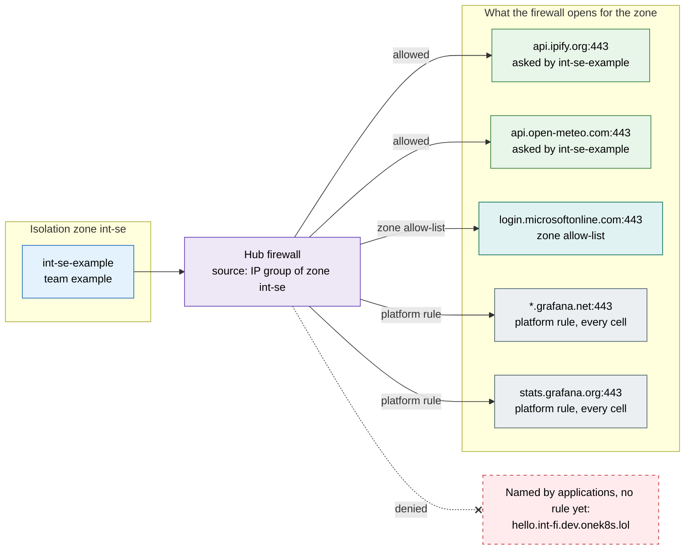
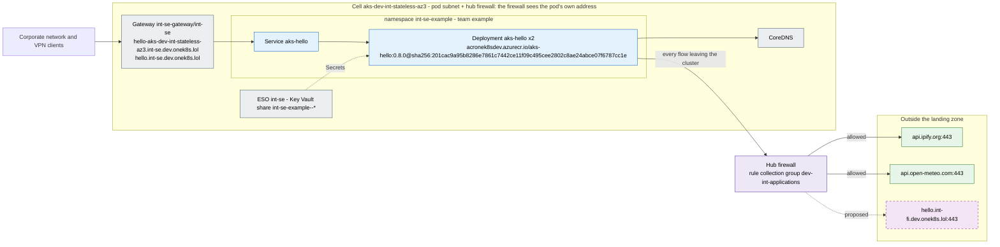

# Internal - Sweden

Generated by the documentation agent of [onek8s/aks-ai-agents](https://github.com/onek8s/aks-ai-agents) (`aks-agent docs lab`) from Git alone: what Git deploys into the isolation zone `int-se` of the spoke `dev-int`. Do not edit by hand - aks-terraform's Lab examples workflow regenerates it.

Back to the [lab examples](index.md).

| | |
|---|---|
| Isolation zone | Internal - Sweden (`int-se`) |
| Cells | `aks-dev-int-stateless-az3` (germanywestcentral, availability zone 3) |
| Domain | `int-se.dev.onek8s.lol` |
| Gateway | `int-se-gateway/int-se` (traefik), listener HTTPS 443 `*.int-se.dev.onek8s.lol` |
| Published names | `hello-aks-dev-int-stateless-az3.int-se.dev.onek8s.lol` `hello.int-se.dev.onek8s.lol` |
| Zone allow-list | `login.microsoftonline.com` ([fleet](https://github.com/onek8s/aks-fluxcd-platform/blob/main/policy/egress-allow-lists.yaml)) |
| Applications | [aks-hello in int-se-example](#aks-hello-in-int-se-example) |

## Placement

The zone's nodes are classic node pools of aks-terraform (`zone_node_pools`), each scaled by the cluster
autoscaler from zero, labelled and tainted `platform/zone`; an application states its architecture and
capacity with pod labels only.

| Cell | Pool | Architecture | Capacity | VM size | Nodes | OS disk | Pods per node |
|---|---|---|---|---|---|---|---|
| `aks-dev-int-stateless-az3` | `intse` | amd64 | on-demand | Standard_D2alds_v6 | 0-1 | Ephemeral | 250 |
| `aks-dev-int-stateless-az3` | `intsespot` | amd64 | spot | Standard_D2alds_v6 | 0-1 | Ephemeral | 250 |
| `aks-dev-int-stateless-az3` | `intsearm` | arm64 | on-demand | Standard_D2pds_v6 | 0-1 | Ephemeral | 250 |
| `aks-dev-int-stateless-az3` | `intsearmspot` | arm64 | spot | Standard_D2pds_v6 | 0-1 | Ephemeral | 250 |

## Traffic of the zone

What the hub firewall opens for the zone: every destination below is open to every application of the zone.

## aks-hello in int-se-example

From [onek8s/aks-hello](https://github.com/onek8s/aks-hello)'s README: A .NET hello world website - the example application of [OneK8s](https://onek8s.github.io/), one Kubernetes platform for every cloud. It is deployed by Flux to the `example` team namespace of the clusters built by [aks-terraform](https://github.com/onek8s/aks-terraform) and published through the platform's Gateway (Traefik Proxy, Kubernetes Gateway API). The page shows which cluster answered: https://hello.onek8s.lol is served by every stateless cluster at once, and DNS hands out one or the other.

| | |
|---|---|
| Configuration | [onek8s/aks-fluxcd-example / firewall-egress](https://github.com/onek8s/aks-fluxcd-example/tree/main/firewall-egress) |
| Team, contact | example, https://github.com/onek8s/aks-fluxcd-example/issues |
| Deployment | `aks-hello`, replicas 2 |
| Image | `acronek8sdev.azurecr.io/aks-hello`, version `0.8.0`, digest `sha256:201cac9a95b8286e7861c7442ce11f09c495cee2802c8ae24abce07f6787cc1e` |
| Source | [onek8s/aks-hello](https://github.com/onek8s/aks-hello), version `0.8.0` |
| Placement labels | `platform/arch: amd64`, `platform/capacity: spot` - the zone's pools `intsespot`, `intse` |
| Firewall rule file | [int-se-example.yaml](https://github.com/onek8s/azure-landing-zone/blob/main/stacks/platform-extensions/firewall-applications/dev-int/int-se-example.yaml) |
| Traffic flows | [int-se-example](https://github.com/onek8s/azure-landing-zone/blob/main/docs/traffic-flows/dev-int/int-se-example.md) |

### Services and routes

| Service | Port | Target port | Protocol |
|---|---|---|---|
| `aks-hello` | 80 | `h2c` | `kubernetes.io/h2c` |

| Route | Hostnames | Paths | Backends | Gateway | platform/home-cell |
|---|---|---|---|---|---|
| `aks-hello` | `hello-aks-dev-int-stateless-az3.int-se.dev.onek8s.lol` | `/` | `aks-hello:80` | `int-se-gateway/int-se` | `aks-dev-int-stateless-az3` |
| `aks-hello-home` | `hello.int-se.dev.onek8s.lol` | `/` | `aks-hello:80` | `int-se-gateway/int-se` | `aks-dev-int-stateless-az3` |

### Environment

| Variable | Value |
|---|---|
| `CLUSTER_NAME` | `aks-dev-int-stateless-az3` |
| `DOTNET_EnableDiagnostics` | `0` |
| `NODE_NAME` | `(from spec.nodeName)` |
| `PEERS` | `int-fi (Service)=http://aks-hello.int-fi-example.svc.cluster.local/status` `int-fi (published)=https://hello.int-fi.dev.onek8s.lol/status` |
| `WEATHER_PLACE` | `Stockholm` |
| `WEATHER_URL` | `https://api.open-meteo.com/v1/forecast?latitude=59.33&longitude=18.07&daily=temperature_2m_max,temperature_2m_min,precipitation_sum&timezone=auto&forecast_days=3` |

### Endpoints of aks-hello

| Path | What |
|---|---|
| `/` | The page: cluster, pod, version, the node's public IP, the weather forecast, the peers |
| `/status` | The same as JSON, plus node (`NODE_NAME`), architecture, the HTTP protocol the caller spoke (`protocol`, 0.5.1), start time, uptime and readiness |
| `/weather` | The forecast as JSON, or why there is none |
| `/public-ip` | The node's public IP found when the pod started, or why none was |
| `/peers` | The peers (`PEERS`, 0.8.0): each one's URL, the last poll's answer or error, and the counts since the pod started |
| `/health/live` | Liveness: 200 while the process answers HTTP; checks nothing else |
| `/health/ready` | Readiness: 200 from the end of startup until SIGTERM, then 503 |
| `/healthz` | All checks (the probe path before 0.3.0) |

### Egress

| Destination | Port | Status | Named in the configuration | Reason of the rule |
|---|---|---|---|---|
| `api.ipify.org` | 443/https | **allowed** - the application's rule, named in its configuration | mentioned in firewall-egress/kustomization.yaml | aks-hello needs to query api.ipify.org for its public IP, as a new egress destination not yet in the configuration firewall-egress/kustomization.yaml line 6 |
| `api.open-meteo.com` | 443/https | **allowed** - the application's rule, named in its configuration | Deployment aks-hello, WEATHER_URL mentioned in firewall-egress/kustomization.yaml | aks-hello fetches a weather forecast from the internet (api.open-meteo.com) as configured in firewall-egress/kustomization.yaml line 34 |
| `hello.int-fi.dev.onek8s.lol` | 443/https | **proposed** - in an open pull request, not allowed yet | Deployment aks-hello, PEERS | - |

## Legend

The status of a destination, from the traffic flow documentation:

- **allowed** - the application's rule, named in its configuration
- **unexplained** - the application's rule, but its configuration does not name it
- **missing** - the configuration names it, the firewall denies it
- **proposed** - in an open pull request, not allowed yet
- **zone** - open to every application of the zone
- **platform** - open from every cell of the exposure
