# 0.1 How we work: requirements-driven collaboration

OneK8s is built by humans and AI together, and each side owns one half of the repository:

- **Humans own the requirements and the acceptance criteria**, the folder `requirements/` - this part:
  [0.2 Requirements](0.2-requirements.md) and [0.3 Acceptance criteria](0.3-acceptance-criteria.md). AI may propose a
  change here, but every change needs a human's approval (`olljanat`).
- **AI owns the design and the infrastructure as code built from it**, the folder `design/` - parts 1 to 8 - and the
  implementation repositories. Humans may contribute too, but every change needs the AI's review (`olljanat-ai`),
  which checks that it does not conflict with the requirements or the acceptance criteria.

A change flows in one direction:

1. A requirement or an acceptance criterion changes, in a pull request to `requirements/` that a human approves.
2. The AI updates the design to meet it, in a pull request to `design/`, with the decision and its options in the
   [decision log](../design/7.2-decisions.md).
3. The AI implements the design in the infrastructure as code; the environments are built from the design, never the
   other way round.
4. The acceptance tests prove the criteria in the environment.
5. A finding in an environment that changes the design is a design pull request first, and it is checked against
   the requirements like any other.

The repository enforces this. `CODEOWNERS` names the owner of each folder, and a required check, **Approvals**, lists
which approval each changed path of a pull request needs. The author's own authorship counts as their side's approval,
so a pull request waits only for the other side, and only when it touches the other side's folder. An approval is
kept across later pushes that do not touch that owner's files.

Each half is its own PDF: the requirements ([`/onek8s-requirements.pdf`](https://onek8s.github.io/onek8s-requirements.pdf),
this part) and the design ([`/onek8s-design.pdf`](https://onek8s.github.io/onek8s-design.pdf), every page
of `design/`).
